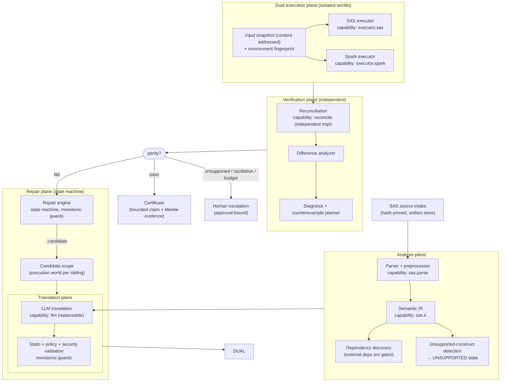
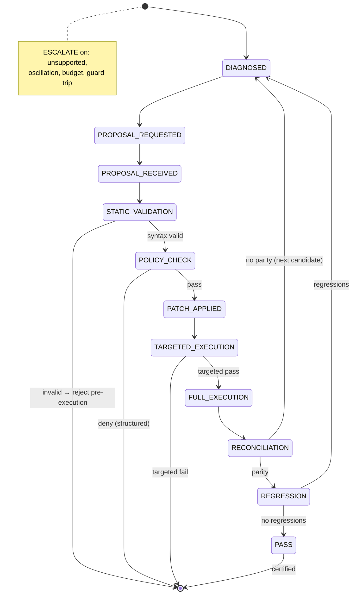
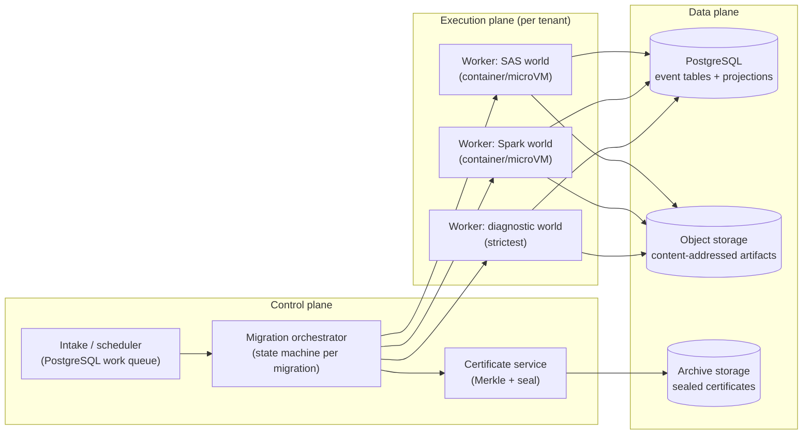
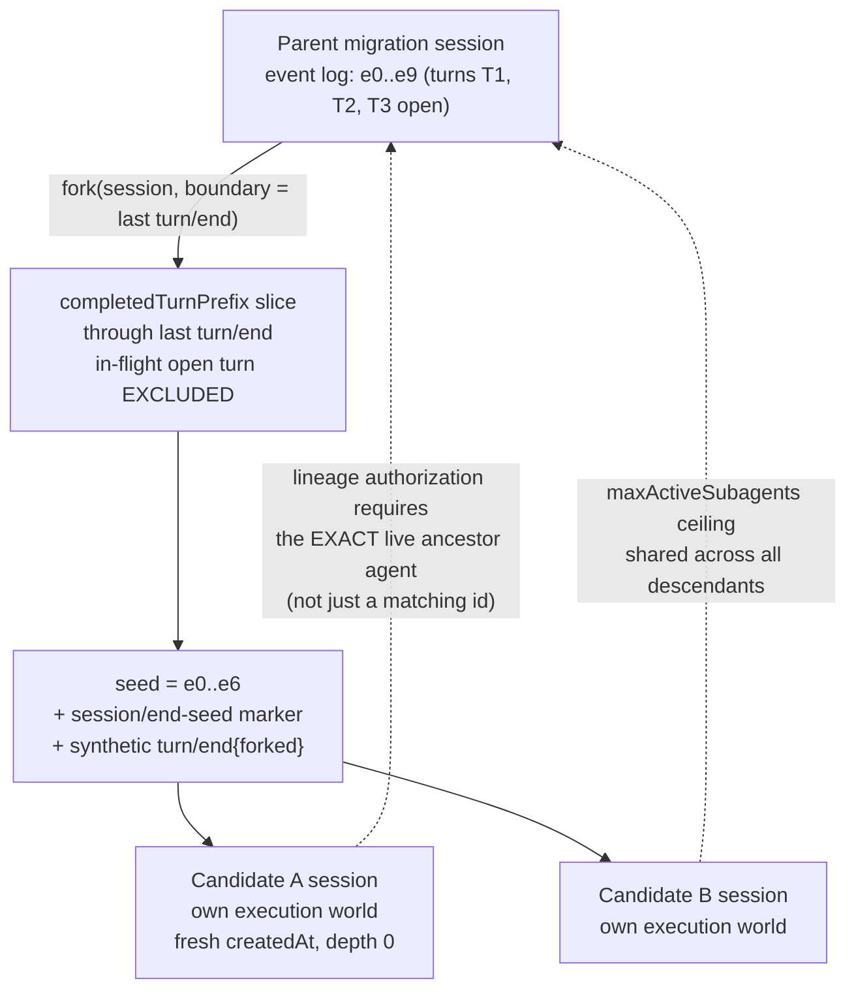

# DeepSeek Harness Reverse Engineering & SAS→PySpark Architecture

**A source-level investigation of DeepSeek Harness, translated into an architecture for a production-grade SAS→PySpark migration verification platform.**

---

## Evidence Basis and Method

| Item | Value |
|---|---|
| Repository | `github.com/deepseek-ai/deepseek-harness` (local checkout `C:\Users\madhu\deepseek-harness`) |
| Branch | `master` |
| Commit analyzed | `00102833dfaee1da9f48a3a8eae9d34005a75218` |
| Commit date | 2026-09-22 ("Merge pull request #4978 from deepseek-harness/worktree/release-dsh-0.1.7-alpha.2") |
| Scale | pnpm monorepo; **307 packages** across **57 groups** (54 non-empty); 9 vendored Cordis packages; `apps/`, `native/`, `python/`, `benchmarks/`, `website/`, `snapshots/` |
| Documentation | **347** markdown files in `docs/` (**100,038 lines**) |
| Decision records | **3,526** notes in `.agents/notes/` (1,448 `implemented/`, 1,919 `archived/`, 117 `proposed/`, 42 `rejected/`) |
| Method | Direct source inspection of `packages/**/src/**/*.ts`, generated docs (`docs/`), agent decision notes (`.agents/notes/`), and the machine-produced capability graph. Claims cite file path + symbol + line. Where documentation and code disagree, both are stated. |

**Verification convention used throughout:**

```
Repository:  packages/core/tools/src/index.ts
Symbol:      ToolRuntime.execute()
Observed:    ...
Implication: ...
```

Unverified speculation is explicitly labeled. I do not assert behavior I did not read.

**Currency note.** This document is preserved as the original `00102833` report. The requested current-source verification is rebased to target merge commit `46a7f68b0922371ce7144b668b90e377d8e799f4` (`0.1.7-rc.1`); the target correction ledger is [`docs/dsh-target-audit.md`](docs/dsh-target-audit.md), with the architecture-facing synthesis in [`docs/deepseek-harness-verification.md`](docs/deepseek-harness-verification.md). Do not use the old commit's counts or claims as current DSH evidence.

---

## 1. Executive Summary

DeepSeek Harness (DSH) is an **all-plugin Cordis agent harness**: a microkernel in which the model adapter, the tool registry, the session log, the agent loop itself, the sandbox, the approval policy, and the persistence backend are all swappable plugins composed at boot from ordered YAML layers. There is no privileged core to patch — `packages/bundle/base` is *a* layer, not *the* kernel.

The single most important finding for our purposes is **not** any individual subsystem. It is the combination of four properties that together make the LLM *replaceable rather than authoritative*:

1. **The durable event log is the only source of truth.** `packages/core/session/src/index.ts` — `Session` is an append-only `SessionEvent` log; the LLM message history is *derived* by `deriveMessages()`. The design note `.agents/notes/implemented/architecture/2026-06-11-event-sourced-sessions.md` states the rejected alternative plainly: *"A mutable message array with events fired as notifications — simpler, but state and log can diverge; with event-sourcing the log IS the state, so divergence is structurally impossible."* Nothing the model claims is real until it is an appended event.

2. **"Model-visible ⟺ logged" is an enforced invariant**, not a convention. `AGENTS.md`: *"anything that reaches a model request must be reconstructable from the session log; a new model-visible input requires a session event."* The system asserts this at runtime via invariant companions (§5.4).

3. **Tool results are canonicalized, frozen, and schema-validated before anyone — including the tool author — can mutate them.** `ToolRuntime` deep-freezes arguments *before* policy runs, validates every returned value against a declared JSON Schema, re-validates any value fabricated by middleware, and emits exactly one authoritative frozen result through `tools/result` (§7).

4. **Failure is a typed, closed vocabulary, not an exception blob.** `TurnEndReason`, `ApprovalOutcome`, `PreToolDecision`/`PostToolDecision`, `SessionForkErrorCode`, and `ManualCompactionErrorCode` are closed unions that a replayer, a billing system, or an auditor can switch on exhaustively (§19).

These four properties are exactly what a **migration verification system** needs, because they invert the usual dependency: instead of trusting the LLM and checking its output, the harness *records everything the LLM was allowed to see and do*, and every downstream artifact (prompt, context, tool call, result, approval, cost) becomes replayable evidence.

The second most important finding is a **warning**. DSH's tool sandbox is a *capability-layer fence over model-controlled paths in trusted code*, not a kernel-grade security boundary. Its own JSDoc says so verbatim — `packages/fs/fs-sandbox/src/index.ts:10-18`: *"The fence is a policy check in TRUSTED code over a MODEL-CONTROLLED path, NOT a kernel boundary… This is containment, not a security boundary; kernel-grade isolation of untrusted CODE stays `ctx.shell`'s job."* A tool that performs I/O through anything other than the injected capability seams is unconstrained. For a regulated migration platform that executes SAS and Spark workloads, this is the single most important thing **not** to copy naively: the seam discipline must be enforced by isolation, not by convention.

Third: DSH is a **developer-facing, single-tenant, single-session-per-process** product. Its concurrency model (per-agent scope keys, WeakMaps keyed on live execution objects, single-writer file leases, in-process guard registries) is *excellent* for one operator at one machine and *untested* for a multi-tenant batch farm. We borrow its event-sourcing, capability-seam, and guard designs; we **redesign** its concurrency, persistence, and UI layers for batch.

Fourth, and most useful for our domain: **DSH has already solved the "streaming deltas are not evidence" problem** that our own spec (§194 Q62) accuses it of having. At this commit there is no `assistant/chunk` in the durable event vocabulary at all — the stream is embedded as `AssistantStreamRecord[]` inside `assistant/attempt` / `assistant/message` (`packages/core/session/src/types.ts:355`). The lesson transfers directly: *token deltas must never be the durable unit of evidence.*

**The core architectural recommendation of this report:** build the migration platform as an **event-sourced capability-harness in which the LLM is one of several replaceable "translation engines"** — each producing patches that are validated by *deterministic* reconciliation against dual execution, and every step (source parse, IR, translation, execution, reconciliation, repair, approval) is an appended event in an immutable log. Parity is decided by the reconciliation engine, never by the model's self-report.

---

## 2. Repository Snapshot

### 2.1 Top-level layout

```
deepseek-harness/
├── vendor/        Vendored Cordis (cordis, cosmokit, schemastery, loader, include, group, hmr, timer, logger-console)
├── packages/      @deepseek-ai/dsh-<name> workspaces at packages/<group>/<pkg>/  (307 packages)
├── native/        @deepseek-ai/node-addon-system: Landlock launcher, native build
├── python/        Python SDK/runtime (ships dsh CLI as a wheel)
├── apps/          Product assemblies: web, desktop(Electron), desktop-host, cli(=dsh)
├── benchmarks/    Performance gates
├── .agents/       Agent workflows + 3,526 decision notes (implemented/ archived/ proposed/ rejected/)
├── docs/          347 markdown docs incl. subsystems/, cookbook/, postmortem/, persistence-changes/
├── scripts/       Gates and generators (verify-*, gen-doc-graphs, gen-cordis-catalog, gen-persistence-catalog)
├── snapshots/     Keyless recorded-session replay fixtures
├── website/       VitePress docs projection
└── (config)       pnpm-workspace.yaml, tsconfig.*, vitest.*, tsdown.config.ts
```

`pnpm-workspace.yaml` globs `vendor/*`, `packages/*/*`, `native/system*`, `apps/*`, `benchmarks`, `website`, `python/sdk-runtime`. It pins `@deepseek-ai/cosmokit` and `@deepseek-ai/schemastery` to vendored `link:` copies — confirming **Cordis lineage** (Cordis is the Koishi-community framework; cosmokit and schemastery are its utility and schema libraries). Notable supply-chain posture: `allowBuilds` is **deny-by-default** (only `esbuild`, `lefthook`, `node-pty`, `koffi`, `dsh-subprocess-local` may run build scripts) and there are 12 `patchedDependencies`.

### 2.2 Package groups (verified at HEAD)

57 group directories, 54 non-empty. The three empty groups — `code-runtime`, `e2b`, `examples` — are placeholders, a visible signal that the code-execution world is being reorganized.

| Group | Purpose | Representative packages |
|---|---|---|
| `core/` (8) | Kernel: agent/session/tools/prompt/scope | `session`, `agent`, `agent-loop`, `tools`, `system-prompt`, `scope`, `agent-default-model`, `agent-tool-presentation` |
| `llm/` (7) | Model providers + token metering | `llm`, `llm-deepseek`, `llm-pi-ai`, `llm-retry`, `token-meter`, `deepseek-llm-api-extensions` |
| `shell/`, `subprocess/`, `terminal/` | Execution worlds | `bash-local`, `bash-sandbox`, `pwsh-local`, `pwsh-sandbox`; `subprocess-local`, `win32-process`; `terminal-bash` |
| `ssh/` | Remote execution world | `ssh`, `fs-ssh`, `subprocess-ssh`, `sandbox-ssh` |
| `sandbox/` (4) | Process confinement | `sandbox`, `sandbox-local`, `sandbox-policy`, `sandbox-windows-acl` |
| `fs/` (7) | Filesystem capability | `fs`, `fs-local`, `fs-sandbox`, `fs-observation-policy`, `tool-fs`, `tool-fs-search`, `tool-str-replace-editor` |
| `session/` (20) | Durable sessions | `session-persistence`, `-jsonl`, `session-projection`, `-cache`, `session-format`, `session-format-catalog`, `session-format-v0-to-v1…v3-to-v4`, `session-checkpoint-policy`, `session-stats`, `session-telemetry[-otel]`, `session-title*`, `session-turn-outline`, `session-log-deepseek` |
| `compaction/` (5) | Context compaction | `compaction`, `compaction-basic`, `command-compact`, `compaction-image-offload`, `compaction-tool-result-pruner` |
| `context/` (6) | Model context sources | `agent-instructions`, `file-reference[-local]`, `session-reference`, `time-context`, `tmux-context` |
| `skill/` (6) | Skill system | `skill`, `skill-filesystem`, `skill-badge`, `skill-office`, `tool-skill`, `tool-workspace-dependencies` |
| `subagent/` (10) | Delegation | `subagent`, `subagent-fork-in-process`, `-spawn-in-process`, `-in-process-driver`, `-acp`, `-claude-code`, `-codex`, `-dsh-sdk`, `tool-subagent[-control]` |
| `ptc-runtime/`, `typert/` | Programmatic tool use + type graphs | `ptc-runtime`, `ptc-runtime-node`; `typert/{registry,loader,protocol,generator}` |
| `interaction/` (5) | Human-in-the-loop | `user-approval`, `user-questions`, `tool-ask-user`, `permission-presets`, `commands` |
| `credentials/` (5) | Secrets | `credentials`, `credentials-local`, `authorization`, `deepseek-account[-platform]` |
| `guard/` (2) | Loop/tool guards | `repeat-tool-reminder`, `timeout-policy` — **no `guard/guard` package exists** |
| `storage/`, `spill/` | Non-session storage | `storage`, `storage-json`, `storage-sqlite`, `storage-domain`; `spill`, `spill-local`, `spill-policy` |
| `jobs/`, `workflow/`, `goal/`, `plan/`, `todo/`, `schedule/` | Autonomy | `jobs[-local]`, `tool-jobs`; `workflow`, `workflow-ptc`, `tool-workflow`, `tool-ralph`; `goal`, `goal-round-driver`, `tool-goal`; `plan-mode`; `tool-todo`; `schedule` |
| `experimental/` (20) | Pre-stable prototypes | `agent-team[-profile]`, `tool-agent-team`, `client-ui-agent-team`, `auto-review`, `ptc-runtime-python`, `inspector`, `webworker-{packer,runtime}`, `browser-use-*`, `computer-use-cua-driver-*` |
| `extensions/` (4) | Runtime self-modification | `cordis-host-runner`, `tool-cordis`, `ui-cordis`, `cordis-client-runner` |
| `hooks/` (3) | External-agent bridges | `hooks-claude-code`, `hooks-codex`, `hook-protocol` |
| `bundle/`, `boot/`, `preset/` | Composition | `base`, `web-app`, `headless`, `sdk-app`, `sdk-minimal`, `acp-app`; `app-boot`, `cmdline`, `hmr`, `plugin-manager`, `config-editor`; `agent-presets`, `persona` |
| `api/`, `host/`, `client/` (59), `sdk/` | Surfaces | `api/{gateway,session-controller,job-controller,…}`; `host/{webserver,frontend-static,…}`; ~59 `client/ui-*`; `sdk/{protocol,client,server}` |
| `deliverables/`, `workspace/`, `settings/`, `identity/`, `document/`, `feedback/`, `attachment/`, `web/`, `mcp/`, `lsp/`, `acp/`, `runtime-diagnostics/`, `util/`, `test-support/` | Supporting | (`deliverables/{tool-present,workspace-changes}` is new since older analyses; `runtime-diagnostics/invariants` is the `ctx.invariants` assertion registry) |

### 2.3 Dependency / capability graph

DSH classifies every `ctx.<key>` into four roles. The graph is **generated** by `scripts/gen-doc-graphs.ts`, but the role *table* is the hand-curated `SERVICE_ROLES` array (`gen-doc-graphs.ts:101-823`). Services are *discovered* from Cordis `declare module … interface Context` merges by `packages/typert/generator/src/analyzer.ts:940-999`, which **skips optional keys** (`X?`, `X | undefined`) because *"no plugin provides"* them — this is why `cmdlineArgs`, `appExit`, `appReady`, `dshHomePath` are absent from the graph. `assertServiceRolesComplete` (`gen-doc-graphs.ts:872-883`) throws on any discovered-but-unclassified or classified-but-stale key.

**89 rows: 54 `core`, 33 `seam`, 1 `bundle`, 1 `service`.**

- **core (54)** — spine services owned by exactly one package: `sessions`, `systemPrompt`, `tools`, `agents`, `agentDefaultModel`, `agentPresets`, `sessionProjections`, `sessionProjectionCache`, `storageDomain`, `workspaceChanges`, `invariants`, `typert`, `sandboxPolicy`, `permissionPresets`, `planMode`, `commands`, `goals`, `settings`, `webServer`, `clientModules`, `dynamicCordisRunner`, `cordisInspect`, …
- **seam (33)** — swappable capability with a Service Definition + one-or-more Providers + Consumers: `llm`, `fs`, `shell`, `subprocess`, `sandbox`, `approval`, `credentials`, `sessionPersistence`, `sessionQuery`, `compaction`, `spillStore`, `skills`, `subagents`, `ptcRuntime`, `workflowEngine`, `jobs`, `web`, `lsp`, `mcpResources`, `storage`, `sessionTelemetry`, `sessionTitle`, `userQuestions`, `directoryPicker`, `attachments`, `speechToText`, `browserUse`, `computerUse`, `authorization`, `deepseekAccount`, `fileReferences`, `terminals`, `deepseekLlmApiExtensions`.
- **bundle (1)** — `agentLoop`: the one concrete loop plugin.
- **service (1)** — `productTelemetry`.

A representative capability chain (from the graph):

```
Model-facing shell tool (tool-bash)
   ↓ depends on
ctx.shell  (Bash executor seam)
   ↓ providers
bash-local | bash-sandbox | pwsh-local
   ↓ bash-sandbox depends on
ctx.subprocess (subprocess seam) + ctx.sandboxPolicy
   ↓ providers
subprocess-local | subprocess-ssh
   ↓ consumers hand argv to
ctx.sandbox (sandbox seam)
   ↓ providers
sandbox-local (Landlock/bwrap/Seatbelt) | sandbox-ssh | sandbox-windows-acl
   ↓ runtime effect
confined child process
```

The key structural property: **swapping one provider moves a whole execution world.** `docs/architecture.md`: *"Filesystem and subprocess providers share one execution world, so pointing them at a remote sandbox moves Bash, PTY, and LSP with them, with no provider forks."* This is precisely the property our migration platform needs: a "Spark execution world" and a "SAS execution world" should be capability seams, not hard-coded integrations.

**⚠️ Verified divergence (docs vs code).** The graph's *consumer* edges are incomplete and can drift. `ctx.hmr` lists consumers `[app-boot]` (`gen-doc-graphs.ts:570`), but `packages/boot/plugin-manager/src/index.ts:675` calls `hmr.runExclusive()` — plugin-manager is an unlisted consumer. Likewise `ctx.profileContext` lists `[plugin-manager]` (`:573`), yet `packages/boot/hmr/src/index.ts:206` reads `profileContext`. The generator's footer admits the classification is curated (*"hybrid: services are discovered … roles are classified in `scripts/gen-doc-graphs.ts`"*, `:660`) but does not admit that *consumer* edges are hand-maintained. **Lesson for us: machine-generate the *edges*, not just the role labels, or the graph becomes a mural with stale arrows.**

### 2.4 Layer classification for our purposes

| Class | DSH examples | Migration analogue |
|---|---|---|
| Kernel-like | `session`, `scope`, `tools`, `agent`, `system-prompt`, cordis context/registry | Event log, scope, capability registry, prompt assembler |
| Framework-like | cordis `Context`/`Service`/`Events`, `ScopedLayers`, waterfall dispatch | Our DI + event bus + scope primitive |
| Capability providers | `llm-*`, `fs-*`, `shell-*`, `subprocess-*`, `sandbox-*`, `session-persistence-jsonl`, `credentials-local` | SAS executor, Spark executor, LLM adapter, artifact store, reconciliation engine |
| Policy layers | `guard/*`, `permission-presets`, `user-approval`, `sandbox-policy`, `fs-observation-policy`, `session-checkpoint-policy` | Parity policy, approval policy, guard registry, budget policy |
| Application behavior | `tool-*` (model-facing tools), `workflow`, `goal`, `plan`, `todo`, `schedule`, `agent presets` | Translation/diagnosis/repair tools, migration orchestration |

---

## 3. Actual Runtime Architecture

### 3.1 Boot and composition

A running `dsh` is a **plugin tree composed at boot from ordered layers** (`docs/architecture.md`):

- A **profile** (named composition stored in Harness home) lists **bundles** it stacks, holds out-of-tree plugins, and keeps the user's `cordis.patch.yml`. Shipped templates: `web`, `headless`, `sdk`, `sdk-minimal`, `acp`.
- A **bundle** is a distribution format for Cordis config rows and the code they mount, declared via the `dsh.bundle` field in its `package.json`. `dsh.bundle.patch` is `string | string[]` resolved in order (`bundlePatchFiles`, `packages/boot/app-boot/src/profile.ts:56-62`). `dsh-base` is one file; **`dsh-web-app` declares five** (`cordis.patch.yml` + `presets/{standard,ptc,minimal,cordis}.patch.yml`) — `packages/bundle/web-app/package.json:41-51`.
- **Layer order (verified):** `readProfilePatches` concatenates, in order, `profile.layers.flatMap(l => l.patches)` → the profile's own `cordis.patch.yml` → `$DSH_HOME/cordis.patch.yml` → CLI `--patch` overlays, then an optional telemetry-disable patch (`profile-context.ts:63-74`). All layers are flattened into **one** `applyEntryPatches([], …)` call over an **empty** root (`profile.ts:710-717`) — the *same single call* `boot()`'s Include makes, so config dumps and flag derivation see exactly what mounts. **This is a deliberately load-bearing property: the composition is the contract.**
- **Two-anchor bundle resolution:** `resolveBundleDir` tries the installation anchor first, then the profile dir (`profile.ts:615-626`). Installation-first is the contract that `dsh-base` always comes from the running dsh, never a profile-local copy.
- **Row semantics:** a patch targets a row by id and **replaces its whole `config`**, or inserts new rows; row order carries no load semantics (*"activation is service-availability driven"*, `dsh-base/cordis.patch.yml:12`). `!!js` expressions evaluate per-entry against `ctx`.

**YAML controls HMR.** `dsh-base` mounts the `hmr` row `disabled: !!js "!ctx.get('profileContext')"` with `root: []` — **config-only by default; module roots are opt-in**. `headless`, `sdk-app`, `acp-app` set `disabled: true`; `sdk-minimal` **omits the row entirely**. HMR requires `loader.internal` (`--expose-internals`); profile HMR additionally requires `ctx.appReady` and watches the profile patch, home patch, and manifest, reconciling via `reconcileProfilePatches`. Module changes are classified accepted/declined by dependent-graph analysis (`analyzeChanges`, `hmr/src/index.ts:351-404`); a change in an *external* (CLI-entry dependency tree) forces `loader.exit()` — a full process exit. All mutations serialize through `runExclusive` (`:139-147`), shared with plugin-manager.

**Application launch is restricted.** Only `dsh` profiles may launch supported Node applications; `scripts/verify-application-entrypoints.ts` rejects any Node application path that bypasses `dsh`. A deliberate anti-sprawl control worth copying: **one launcher, composition-only extension.**

**Startup policy** (`auditStartupEntries`, `app-boot/src/index.ts:907-921`): global `requiredStartupEntryIds` = `agent-loop, webserver, modules, connection, headless-runner, acp, sdk-jsonrpc-server`. Absent/disabled ids are *ignored*; an *enabled* listed id that fails to activate throws `StartupError`. Other inactive entries → one warning, siblings keep running. `installFailLoud` (`:661-710`) turns any unhandled rejection into labelled stderr + `exit(1)`.

### 3.2 The turn — actual call chain

The documented turn flow and the code agree. A **step** is one model request plus the tools it calls; a **turn** is zero or more steps, opened before its first input is claimed and closed once nothing is owed.

```
send(msg,target,wakeup)                     agent.ts:153
  └─ inbox.splice(target,∞,0,[msg])         inbox.ts:167 → mutate() inbox.ts:198
       └─ session.append('agent/inbox/spliced')   inbox.ts:235   [PERSISTED]
       └─ emit agent/inbox/inserted         inbox.ts:240
  └─ wakeDriver(wakeAfterAbort)             agent.ts:213
       ├─ phase ≠ idle → latch wakeRequested (not if disposed)
       └─ idle → setPhase running; agents.withInitiator(this, () => kick())  agent.ts:226-233
            └─ kick()  → while (await turn()) {}
                 └─ turn()                       agent.ts:295
                      ├─ session.append('turn/start')             [OPENS TURN]   agent.ts:304
                      ├─ loop { throwIfAborted; preStep(target,{turn,step})    agent.ts:315
                      │    ├─ inbox.claim(target,turn)             inbox.ts:109
                      │    ├─ systemPrompt.assemble(...)           agent.ts:271
                      │    ├─ runtimeContext.project(...)          agent.ts:274
                      │    └─ dispatch.waterfall('agent/pre-step') agent.ts:275
                      │    reject → turnEnds={blocked}; return false            agent.ts:316-319
                      │    empty first step → {completed}          agent.ts:323-326
                      ├─ session.append('step/start')              [OPENS STEP]  agent.ts:328
                      ├─ step(decision)                            agent.ts:333
                      │    ├─ prepareRequest → waterfall('agent/request') + llm.prepareCall
                      │    ├─ systemPrompt.project → N× session.append('system/message')
                      │    ├─ first attempt only: session.append('user/message', …)
                      │    ├─ buildRequest → request/header + request/context, deriveMessages, freeze
                      │    ├─ ctx.llm.stream → agent/assistant-stream start
                      │    │      └─ assistant/message | assistant/attempt → stream end
                      │    └─ executeToolCalls → tool/call [logged BEFORE execution]
                      │            └─ tools/pre-execute → (approval ask) → monotonic guards → tools/execute
                      │                  → tool body → normalize → projectContent → tools/post-execute
                      │                  → finalizeContent → tools/result (frozen)
                      │            └─ tool/result*
                      ├─ finally: session.append('step/end')        agent.ts:338   [CLOSES STEP, always]
                      ├─ turnEnds && nextStep empty → dispatch.serial('agent/turn-stopping') agent.ts:342
                      └─ finally: session.append('turn/end',{turn,reason})  agent.ts:367  [CLOSES TURN, always]
```

**Ownership and mutability at each step (verified):**

| Step | Owner | Mutable state | Immutable/frozen | Events emitted | Persisted |
|---|---|---|---|---|---|
| claim input | `ReactLoopInbox` (`agent-loop/src/inbox.ts`) | inbox projection state rebuilt per event | wire arrays `readonly` (`inbox.ts:22-24`) | `agent/inbox/inserted`, `/discarded`, `/claimed` | `agent/inbox/spliced` |
| `agent/pre-step` | loop + listeners | claimed messages may be rewritten/rejected | — | `agent/pre-step` (waterfall) | — |
| `agent/request` → `prepareCall` | loop + LLM seam | route resolution | `seedConfig` deep-frozen (`agent.ts:548`) | `agent/request` (waterfall) | `request/header`, `request/context` |
| prompt assembly | `ctx.systemPrompt` | — | rendered assembly | `system-prompt/assemble` (waterfall) | `system/message` |
| history derivation | `Session.deriveMessages()` | derivation cache | log events, derived messages (shared, deep-frozen) | — | derived from log |
| streaming | `ctx.llm` adapter | stream accumulator, assembler | — | `llm/stream` (waterfall), `agent/assistant-stream` (emit) | `assistant/message` (+ embedded stream) or `assistant/attempt` |
| tool dispatch | `ToolRuntime` | `exec.signal` only | args (frozen pre-policy), identity fields, final result | `tools/pre-execute`, `tools/execute`, `tools/post-execute`, `tools/result` | `tool/call` (pre-policy), `tool/result` |
| turn close | loop | — | — | `agent/turn-stopping` (serial), `turn/end` | `turn/end` (durable) |

**Freezing is layered and load-bearing:** event objects are deep-frozen at append (`session/src/index.ts:742`); derived `Message` objects are shared-and-deep-frozen (`session/src/index.ts:837-839`); the loop *additionally* freezes per message identity through the `frozenMessages` WeakSet so each identity is frozen exactly once (`agent.ts:631-636`), then `Object.freeze`s the array and the whole request via `markAgentLoopRequest` (`agent.ts:637-644`).

### 3.3 Where middleware intercepts, where policy denies, where extensions transform

- **Interception points (waterfalls):** `agent/pre-step`, `agent/request`, `agent/request-error`, `llm/stream`, `system-prompt/assemble`, `tools/pre-execute`, `tools/execute`, `tools/post-execute`, `tools/ptc-dispatch-log`, `approval/request`, `compaction/summary-error`.
- **Denial points (ordered):** (1) PTC-mode collapse → `UNKNOWN_TOOL` **before** the pipeline; (2) `tools/pre-execute` deny/cancel/ask; (3) approval refusal (ask); (4) monotonic guards; (5) `tools/post-execute` block; (6) output-schema validation failure; (7) lossless-JSON materialization failure.
- **Transformation points:** `tools/execute` (may replace the signal; may fabricate a result), `projectContent` (definition-owned, pre-post-execute), `tools/post-execute` accept-with-content/value/block, `finalizeContent` (definition-owned, last-mile, must be total), `tools/ptc-dispatch-log` (durable-log copy only).
- **Loop-level extension surfaces:** `ctx.sessionProjections.register` and `sessions.registerMessageProjection` (`session/src/index.ts:924`) — a plugin can change *how events derive messages* — plus `ctx.systemPrompt.variable/section/context`.
- **Extensions cannot:** emit `interrupted` or `forked` (producers are package-internal, `repair.ts:54-55`), change turn/step numbering, veto turn closure, or make the loop await a flush at turn boundaries (`session/src/types.ts:292` — durability checkpoints belong to `dsh-session-checkpoint-policy`).

### 3.4 Failure, cancellation, timeout, crash

- **Tool failure** → `toolErrorResult`, still routed through `tools/post-execute`, emitted as `tool/result` with `error: { name, code, reason? }`.
- **Cancellation** is cooperative and *never abandons a started body*. The registry distinguishes `ABORTED` (body invoked) from `ABORTED_BEFORE_DISPATCH` (`core/tools/src/index.ts:483-486`). An aborted tool group drains started calls, then gives every unstarted model-order call a synthetic `TOOL_ABORTED_BEFORE_DISPATCH` error result so replay stays valid (`agent-loop/src/tool-calls.ts:97,241-260`). `fuseToolSignals` re-fuses the caller signal after any wrapper swap so an around-middleware cannot detach caller cancellation. The `ToolDefinition.execute` JSDoc admits: *"it cannot hard-kill same-process code."*
- **Timeout is NOT a loop concept.** `grep` for `timeout|setTimeout|deadline` across `agent-loop/src` returns **no matches**; `AgentOptions` has no timeout field (`agent/src/runtime-types.ts:26-35`). Timeouts exist only as (a) the `guard/timeout-policy` `tools/execute` wrapper (`timeout-policy/src/index.ts:56-80`), (b) a caller-supplied `AbortSignal.timeout()`, or (c) SDK wire-level `requestTimeoutMs`. **A platform needing a turn deadline must implement it as a listener owning a timer that calls `agent.cancel({kind:'hook', reason})`.**
- **`turn/end` is unconditional** — it sits in a `finally` (`agent.ts:364-371`). Same for `step/end` (`agent.ts:337-339`). A turn may close with **zero** steps.
- **Crash** — a process death mid-turn leaves a durable log ending inside an open turn. **Persistence does not truncate or repair it** (`docs/subsystems/persistence.md`); the *reader* repairs on resume by computing `interruptedTurnClosers` (`core/session/src/repair.ts:175`) and appending synthetic closers: error results for unmatched tool calls (`TOOL_OUTCOME_UNKNOWN` / `TOOL_NOT_STARTED`), any open `step/end`, and `turn/end { reason: 'interrupted' }`. The wording given to the model is deliberately conservative: *"Its outcome is unknown… retry only if the operation is read-only or idempotent; if it may have side effects, first verify external state… Do not retry blindly."* (`repair.ts:36-43`)

**Implication for us:** this crash model is *exactly* right for dual execution. A SAS or Spark run that was started but whose result was never durably recorded is **outcome-unknown**, not "failed" and not "succeeded" — and the correct response is to verify external state, never to blindly re-run a side-effecting job.

---

## 4. Plugin / Capability Architecture

### 4.1 Is "everything is a plugin" actually true?

**Substantially yes, with a small, well-defined privileged set.** `docs/architecture.md`: *"There is no privileged core to patch: you extend dsh by mounting a plugin beside the others, and registrations are effects that unwind when their plugin unloads."*

Verified replaceable via seams (Service Definition + Provider + Consumer roles, each a separate package):

| Capability | Seam | Providers observed at HEAD |
|---|---|---|
| Model adapter | `ctx.llm` | `llm-deepseek`, `llm-pi-ai`, `llm-replay` (deterministic replay provider!) |
| Tool registry | `ctx.tools` | one package, but tools/restrictions/guards/mode are per-scope registrations |
| Filesystem | `ctx.fs` | `fs-local`, `fs-sandbox`, `fs-ssh` |
| Shell | `ctx.shell` | `bash-local`, `bash-sandbox`, `pwsh-local`, `pwsh-sandbox` |
| Subprocess | `ctx.subprocess` | `subprocess-local`, `subprocess-ssh` |
| Sandbox | `ctx.sandbox` | `sandbox-local`, `sandbox-ssh`, `sandbox-windows-acl` |
| Event store | `ctx.sessionPersistence` | `session-persistence-jsonl` |
| Session query | `ctx.sessionQuery` | `session-query-sqlite` |
| Compaction | `ctx.compaction` | `compaction-basic` |
| Subagents | `ctx.subagents` | fork-in-process, spawn-in-process, in-process-driver, acp, claude-code, codex, dsh-sdk |
| Skills | `ctx.skills` | `skill-filesystem`, `skill-badge`, `skill-office` |
| PTC runtime | `ctx.ptcRuntime` | `ptc-runtime-node`, `experimental/ptc-runtime-python` |
| Credentials | `ctx.credentials` | `credentials-local` |
| Approval answerers | `approval/request` listeners | UI answerers, ACP bridge |
| Web/search | `ctx.web` | 4 providers |
| LSP / Spill / Storage / Telemetry / Workflow / Jobs / Session titles | `ctx.lsp`, `ctx.spillStore`, `ctx.storage`, `ctx.sessionTelemetry`, `ctx.workflowEngine`, `ctx.jobs`, `ctx.sessionTitle` | `lsp-stdio`; `spill-local`; `storage-json`, `storage-sqlite`; `session-telemetry-otel`; `workflow-ptc`; `jobs-local`; 2 LLM providers + deterministic fallback |

**The agent loop itself is a plugin** (`ctx.agentLoop`, package `agent-loop`) and *"nothing outside it may depend on it"* (decision note `2026-06-11-microkernel-event-taxonomy.md`).

### 4.2 What remains privileged

1. **The Cordis `Context`/registry** — vendored, not a plugin. Root context is process-global.
2. **`Session`/`SessionStore`** — core; persistence is pluggable but the in-memory log and its `append()` contract are not.
3. **`ctx.tools` pipeline ordering** — tools are plugins, but the *pipeline* (pre→guard→execute→post→finalize→result) is kernel.
4. **`ctx.systemPrompt`** — assembly registry is core; sections are plugins.
5. **`ctx.scope`** — the scope primitive is a library (`scope`), not replaceable.
6. **`ctx.invariants`** — assertion registry is core.
7. **The Loader builtins** — `loader`, `cordis:include`, `cordis:group`, `timer` are installed before the tree mounts (`app-boot/src/index.ts:530-548`); not in the capability graph, cannot be patched away.
8. **16 `protectedModules`** and **7 `requiredStartupEntryIds`** — startup-critical and management-critical rows are not profile-modifiable (`plugin-manager/src/index.ts:59-69, 224-232`).
9. **`dsh-base` bundle** — the shared first layer; installation-first resolution pins it to the running dsh. (Exception: `sdk-minimal` deliberately owns its complete explicit tree — 28 deps, no `dsh-base`.)
10. **`ctx.agentLoop`** is labelled `bundle` but has exactly **one** implementation; it is a composition point, not a swappable seam.

### 4.3 Hidden coupling (verified)

- **Opportunistic service reads.** `dsh-tools` reads `ctx.get('approval')`, `ctx.get('ptcRuntime')`, and `ctx.get('sandboxPolicy')` **at use time rather than via static `inject`** — deliberately. The JSDoc on `requirePtcRuntime` explains why: *"an inject entry would hold `ctx.tools` — and every tool plugin behind it — hostage to a PTC runtime existing even under `mode: 'native'`."* **Eager `inject` creates load-order dependency; opportunistic `ctx.get` creates optional capability.** Both are used deliberately and documented.
- **Type-only augmentation imports.** `core/tools/src/index.ts:19-21` does `import type {} from '@deepseek-ai/dsh-user-approval'` *purely* so `ctx.get('approval')` resolves the augmented type. The seam stays optional at runtime. Clean pattern for optional capabilities.
- **Registration-order dependence.** Waterfall listeners run in registration order; `prepend: true` exists to jump the queue. DSH's answer: make *policy that must not be reordered* a **monotonic guard** instead of a listener (§8).
- **Scoped-restriction exemption.** `tools.restrict()` filters only *inherited* tools, never the scope's own registrations. The code comment (`core/tools/src/index.ts:1169-1173`) documents a **real past bug**: *"Reading the exempt set as 'the global layer' instead of 'not mine' held only while every model-facing tool sat in the host composition. Once presets moved them onto the agent plane they became an ANCESTOR contribution, so a child's filter silently stopped constraining anything it was given."* — a security-relevant regression caught by reasoning, not by types.
- **Config interpolation boundary.** Postmortem `0002`: `!!js` expressions are interpolated only under a plugin's `config` and its `disabled` field, **not** other entry metadata. An ACP composition put `disabled: !!js …` on filesystem entries; the raw expression object was truthy, so **the filesystem stack was permanently disabled in every mode**, and the snapshot suite *"proved deterministic replay of the regression rather than successful behavior."* Guardrails now include `verify-cordis-config` (rejects expression nodes in entry metadata) and `dsh-session-snapshot` rejecting structured `UNKNOWN_TOOL` results in fixtures.

### 4.4 Multi-tenant production fitness (analysis)

DSH's plugin/service registry is **single-context, single-process**. Verified concurrency-sensitive structures:

- `ToolRuntime` holds per-execution `WeakMap<ToolRunContext, …>` (deferred contexts, cancellation states, finalizers, projectors, canonical results) and `ScopedLayers` per scope. Safe for *interleaved* calls in one process, not for cross-process tenants.
- `SessionStore` is a `Map<SessionId, SessionEntry>` with a module-private `attachments` WeakMap; single-writer ownership is enforced per-id, and `session/end-seed` explicitly *"is NOT a liveness signal about other writers"* (`core/session/src/types.ts:419-426`).
- Session persistence uses a **cross-process write lease** (`session-persistence-jsonl/src/lease.ts`) and single-writer `open(id,'write')` rejection — so *persistence* is multi-process-safe; the *live registry* is not.

**Conclusion:** DSH's model is "one live session per id per process; many readers." For a multi-tenant batch platform we must add: tenant-scoped contexts, per-tenant capability registries, and a distributed lease. **Borrow the seam design; do not borrow the in-process registry.**

### 4.5 Plugin lifecycle — what the docs don't tell you

**Dependency resolution is NOT a DAG.** Cordis uses a reactive fiber model: each fiber's `_refresh()` (`vendor/cordis/src/fiber.ts:611-623`) builds an epoch string from the `uid`s of its injected services' providers and reloads/unloads when it changes. Fibers sit in `PENDING` until every injected service is present.

- **Cycle handling: none.** There is no topological sort and no inject-cycle detection anywhere in `vendor/` (only `cosmokit/src/volatile.ts:21` rejects *config* cycles). A circular `inject` therefore **deadlocks silently** as two permanently-`PENDING` fibers — the only symptom is `auditStartupEntries` reporting `pending (waiting for services: …)`. *Verified-absent-by-design, not by check.*
- **Duplicate exclusive providers:** `vendor/cordis/src/reflect.ts:289-291` throws `service "X" has been registered at <fiber-name>` — one provider per isolation scope per name, no last-wins.
- **Lifecycle states** — `FiberState` (`fiber.ts:147-154`): `PENDING, LOADING, ACTIVE, FAILED, DISPOSED, UNLOADING`; transitions emit `internal/status`.
- **Disposal ordering:** `_unload()` (`fiber.ts:675-696`) runs `Promise.all(this._disposables.clear().map(…))` — **disposers run concurrently, not in reverse-registration order**, each error swallowed into `ctx.logger.error`. Only the *epoch* transition is ordered. **This matters for guards: a disposed guard weakens subsequent calls (§8).**

---

## 5. Context / Scope / Dependency Injection

### 5.1 The Cordis model

Cordis (vendored, `vendor/cordis`; upstream SHAs in `vendor/README.md`) provides:

- **`Context`** — a repository of services. A service claims a stable `ctx.<key>`; plugins find services by key, not by import.
- **`Service`** — plugin base class; lifecycle mounted into the current context.
- **`inject`** — declared service dependencies; load order is expressed through service requirements, not manual boot sequencing.
- **Typed events** via TypeScript declaration merging on `interface Events` — *this is how the three event domains are declared* (§5.2).
- **Effects** — every registration goes through `ctx.effect()` / `ctx.on()`; the registry's `register()` returns the disposer. Registrations unwind when the plugin unloads.
- **Fibers** — plugin-scoped lifecycles with async teardown (`fiber.dispose()`, `fiber.inertia`).

`docs/cordis-primer.md` distills it to five ideas: plugin = Service implementation; context = repository of services; `inject` declares dependency; typed events for communication; registrations are reversible effects.

### 5.2 The three event domains (verified)

This is a key design insight worth preserving. DSH events split into three disjoint domains, each declared by declaration-merging on a different `interface Events`:

1. **Session events** — durable, appended to the log. Declared in `packages/core/session/src/index.ts:41-85`: `session/created`, `session/disposed`, `session/event` (all `@mode emit`), and `session/flush` (`@mode parallel` — the awaited durability checkpoint).
2. **Agent events** — carry a live `Agent` instance. Declared in `packages/core/agent/src/runtime-types.ts:246-381`: `agent/pre-step`, `agent/request`, `agent/request-error` (waterfalls), `agent/turn-stopping` (serial, **non-vetoing by design**: *"Data decides, so listener order cannot change the outcome"*, `:369`).
3. **Capability events** — attach policy to a seam (`tools/*`, `fs/*`, `approval/*`) without importing the agent loop.

The separation is what makes capability policy trustworthy: **a security policy can attach to `fs/*` or `tools/*` without depending on the loop.** Our migration platform should keep this three-way split: durable migration events, orchestrator events, and capability-policy events.

### 5.3 Scope — the sharpest idea in the codebase

`packages/core/scope/src/index.ts` (204 lines) + `store.ts` (267). No `ctx` key — a library primitive. It implements **dual-direction inheritance** over one parent relation (`scopeParents: WeakMap<ScopeKey, ScopeKey>`, `index.ts:32-39`):

- **Registration views inherit DOWN the chain.** `ScopedLayers.chainLayers()` returns ancestor→self order, *farthest first, nearest last* so the nearest scope wins (`store.ts:192-199`); `merge()` layers global named entries then chain shadows (`store.ts:208-217`). A child scope sees its ancestors' layers: tools, restrictions, guards, prompt sections.
- **Event admission extends UP the chain.** `scopeTarget(base, key)`'s filter walks from the *dispatch* key up the parent chain; an ancestor-tagged listener receives descendant events; untagged listeners are admitted globally; a tag **below** the dispatch key is excluded (`index.ts:170-185`). *"Events flow up the chain, never down."*

This one relation powers both directions:

```
createScope(ctx, key)          → Context tagged with opaque ScopeKey (fresh object)
bindScopeParent(key, parent)   → one-time; returns the sole ScopeParentBinding that may rebind
                                  cycle-checked: linkScopeParent throws 'scope parent link would form a cycle'
scopeOf(ctx)                   → nearest scope tag
scopeTarget(base, key)         → event carrier with ancestor admission
```

The scope key is an **opaque, identity-compared object** — a capability, not a name. `Scoped<T>` is a phantom brand so the carrier never exposes the subject's properties. `rawDispose` is the **exact** Cordis fiber disposer (for ordered composite effects); `dispose()` memoizes `quiesceFiber` = `fiber.dispose()` then drains `fiber.inertia`, so racing callers share one completion. The `scope-invariant` companion (`core/scope/src/invariant.ts`) fails any scope-filtered event dispatched without a carrier, or whose carrier key differs from the argument-derived subject.

**Why this matters for us:** this is the cleanest possible primitive for **repair-candidate isolation**. A repair candidate is a *scope*: it inherits the shared evidence prefix and capability set from its parent, can be additionally restricted (never widened) per candidate, and its registrations and observers unwind deterministically on disposal. An ancestor-scope observer (the orchestrator) sees every descendant's events automatically — *for free*.

### 5.4 The invariants registry — runtime assertions, not comments

`packages/runtime-diagnostics/invariants/src/index.ts` (200 lines). `ctx.invariants` = `InvariantRegistry extends Service`.

- **Config** (`:95-99`, compiled once at startup — a documented limitation): `enabled` (default `true`), `package_allowlist`, `package_blocklist`, case-sensitive **regex sources**; invalid/blank/duplicate entries throw at service startup rather than being skipped.
- **`register(packageName, installer)`** (`:136-197`): **duplicate package names throw even when filters disable the checks** — *"two plugins can never silently claim the same name."* An *enabled* installer runs in a dedicated **child fiber**; its completion is joined before registration succeeds; installer failure disposes the child and releases the reservation atomically.
- **`InvariantError`**: stable code `INVARIANT` + full npm `packageName` (`:50-66`).
- **What it asserts, and when:** only *observable event-stream or mutable-data* relationships its owner package holds — never service/method presence. **39 companion `src/invariant.ts` files** exist across the tree. Examples: `dsh-scope` validates `internal/dispatch` carrier/subject agreement; `dsh-session`/`dsh-agent`/`dsh-agent-loop` validate log enclosure, status transitions, and loop-built request reconstruction (session-backed, rebuilding the baseline from durable events after reload).
- **Mounting:** `dsh-base` **deliberately omits** the registry; `dsh-sdk-minimal` mounts it with the four core companions. Loading the service alone installs **zero** checks. Companion wiring is mechanically enforced by `pnpm run verify-package-invariants`.

**Copy this pattern:** invariants that assert the *load-bearing correctness properties* (model-visible ⟺ logged; tool stage pairing; request reconstruction) as runtime checks in a dedicated profile — and a CI gate that verifies the companions are actually wired.

### 5.5 What to reproduce vs. what is over-engineered

**Reproduce:**
- Service registry keyed by `ctx.<name>` with declaration-merged typing (compile-time capability graphs).
- `inject` for load-order-free bootstrapping.
- Scope with the dual-direction parent relation (registration down, events up).
- Registrations-as-effects with exact disposers.
- Opportunistic `ctx.get` for optional capabilities (documented as such).
- The invariants registry + companion pattern.

**Redesign / drop:**
- **HMR / dynamic plugin load-unload** (`extensions/cordis-host-runner`, `ctx.hmr`, `ctx.dynamicCordisRunner` with a `vm` sandbox for host halves) is essential to a *developer tool* and a liability in a *regulated platform*. Live plugin mutation changes the effective policy set mid-run; guards registered via effects can be disposed, **weakening policy for subsequent calls**. For migration, we want *immutable, pinned policy per migration run*, with the policy hash recorded in the certificate.
- **Fiber inertia / async teardown chains** are subtle; a batch platform prefers explicit, staged shutdown with a hard timeout (DSH itself uses `Promise.all` with swallowed errors — not a model to copy).
- The `vm`-sandboxed "dynamic Cordis" runner is an attack surface we do not need.

---

## 6. Event System

### 6.1 Dispatch modes (verified from `docs/cordis-primer.md` + `vendor/cordis/src/events.ts`)

| Mode | Awaited? | Dispatch order | Return value? | DSH use |
|---|---|---|---|---|
| `emit` | No | listeners observe in registration order | No | `session/event`, `session/created`, `session/disposed`, `tools/result`, `tools/change`, `agent/assistant-stream`, inbox transitions |
| `waterfall` | No | listeners in registration order; **`next()` delegates** | Yes | `agent/pre-step`, `agent/request`, `agent/request-error`, `llm/stream`, `system-prompt/assemble`, `tools/pre-execute`, `tools/execute`, `tools/post-execute`, `tools/ptc-dispatch-log`, `approval/request`, `compaction/summary-error` |
| `parallel` | Yes | all listeners in parallel | No | `session/flush` (the durability checkpoint) |
| `serial` | Yes | listeners in registration order | Yes | `agent/turn-stopping` (no `next()` — it observes and may stop the turn) |
| `bail` | No | listeners in order until one bails | Yes | (framework mechanism; used sparingly) |

The dispatch mode is **part of each event's public contract**, documented with a `@mode` JSDoc tag, and `scripts/gen-cordis-catalog.ts` checks declarations against dispatch sites. **Copy this: the dispatch mode is a compile-time-checked interface property, not a comment.** Verified example — `packages/core/session/src/index.ts:51` `@mode emit` on `session/created`; `:82` `@mode parallel` on `session/flush`.

### 6.2 Waterfall semantics and their traps

`vendor/cordis/src/events.ts:234` — `waterfall()` shifts listeners off a queue; `next()` either invokes the next listener or the built-in inner default. Observed rules:

- **Not calling `next()` short-circuits the whole chain, including the built-in behavior.** For single-decision events this *is* the design (a policy listener that owns the decision returns without delegating).
- **A throwing listener propagates out of the enclosing `next()`.** Each pipeline stage contains this (`prepareExecution`, `dispatchScheduledExecution`, `finalizeScheduledExecution` in `core/tools/src/index.ts` wrap in try/catch → `toolErrorResult`).
- **Callback exceptions are contained in the dispatcher** for emit/parallel events (`invokeContainedSessionObservers` in `core/session/src/index.ts`; `notifyResult` in `core/tools/src/index.ts`). `docs/defensive-patterns.md`: *"A user-supplied listener that throws must not reject the promise it runs inside or starve the listeners after it."*
- **Hidden ordering dependencies are real.** Because listeners compose by registration order, two policy listeners that both `deny`/`block` produce different observable behavior depending on order. DSH's mitigation: put non-reorderable policy in **monotonic guards** (which run after *all* pre-execute listeners), and enforce invariants that the *never* policy is decided in-service before dispatch so `prepend` cannot defeat it.

### 6.3 Event table for our migration harness (recommended)

| Event mode | Execution | Error behavior | Mutation allowed | Best use in migration harness |
|---|---|---|---|---|
| `emit` | sync, registration order, fire-and-forget | contained per listener (logged, never fails the producer) | none (frozen payloads) | artifact-written, execution-finished, reconciliation-settled, guard-denied, approval-decided, telemetry |
| `waterfall` | around-middleware, `next()` to delegate | propagates; stage-level containment | request/signal/decision only, per documented contract | translate-request, patch-validate-pre, execute-around (timeout/retry/meter), patch-validate-post, reconcile-policy |
| `serial` | awaited, in order | propagates | decision | migration-stopping, budget-checkpoint |
| `parallel` | awaited fan-out | aggregated (`AggregateError` naming each failure) | none | durability flush, multi-artifact materialization, fan-out notifications |
| `bail` | in order until first bail value | propagates | bail value | cheap short-circuit predicates (e.g. "already certified?") |

**Deterministic ordering model for our system (recommendation):** policy that must be order-independent becomes a **monotonic guard** (deny-only, no allow result, evaluated after all waterfall policy); waterfall policy is reserved for *transformation and advisory* concerns; durability barriers use `parallel` with aggregated errors; and every policy decision is recorded as an event with the policy version that produced it, so ordering is *reconstructable* even when it isn't fixed.

---

## 7. ToolRuntime — the Full Execution Pipeline

This is the highest-value subsystem to copy, and it is worth specifying precisely because it is where DSH's "model proposes, harness executes" principle is actually *enforced*. All citations: `packages/core/tools/src/index.ts` unless noted.

### 7.1 The pipeline, exactly

```
execute(exec: ToolExecutionInput)                                   :1368
  └─ prepareExecution(exec, completeScheduledExecution)             :1369
       ├─ createExecution(exec)                                     :1390
       │    ├─ token = createExecutionToken()                        :1392   IDENTITY
       │    ├─ callId, rootCallId = rootCallId ?? callId             :1393-1394   LINEAGE
       │    ├─ get(name, agent) + collapses(name, agent, hasParent)  :1406-1407   PTC COLLAPSE
       │    ├─ capturedFinalizer / capturedProjector                 :1435-1436
       │    ├─ snapshotJsonValue(exec.arguments)                     :1440   LOSSLESS CHECK
       │    ├─ arguments = deepFreeze(detached)                      :1444   *** FROZEN BEFORE POLICY ***
       │    ├─ WeakMap registration: deferred/finalizer/projector/   :1445-1451
       │    │                          cancellationState
       │    └─ collapsed? → final-result ToolNotFoundError w/ route  :1452-1473   (PRE-POLICY)
       ├─ callerCancelled(exec)? → final-result ABORTED_BEFORE_DISPATCH :1499-1501
       ├─ ctx.waterfall(scopeTarget(this,exec.agent),
       │                'tools/pre-execute', exec, allow)            :1503-1507   *** POLICY GATE ***
       ├─ gate.kind==='ask' ? serviceAsk(exec, gate)                 :1508-1510   *** APPROVAL ***
       ├─ decision.kind==='cancel' → post-result ABORTED_BEFORE_DISPATCH :1515-1517
       ├─ denialReason = allow ? guardReason(exec) : decision.reason :1518   *** MONOTONIC GUARDS ***
       ├─ denialReason? → post-result error w/ model text + info     :1520-1529
       ├─ callerCancelled? → post-result ABORTED_BEFORE_DISPATCH     :1531-1533
       ├─ catch → final-result toolErrorResult(error)                :1535-1537
       └─ next({kind:'dispatch', exec})                              :1534
  └─ completeScheduledExecution(prepared)                            :1372
       ├─ dispatch → dispatchScheduledExecution(exec)                :1375
       │    ├─ ctx.waterfall('tools/execute', mutableExec,
       │    │                 dispatchToolBody(mutableExec))          :1604-1607   *** AROUND-DISPATCH ***
       │    │    └─ dispatchToolBody:                                :1563
       │    │         fuseToolSignals(callerSignal, wrapperSignal)   :1568   RE-FUSE
       │    │         state.bodyInvoked = true                       :1579
       │    │         tool.execute(exec.arguments, exec)             :1580   *** THE BODY ***
       │    │         createSuccessResult(...)                       :1581
       │    │         aborted? → toolAbortedResult(result)           :1582-1584
       │    ├─ normalizeDispatchResult(exec, result)                 :1608
       │    ├─ deferred contexts merged into additionalContexts      :1609-1620
       │    └─ callerCancelled && !isError → cancellationResult      :1623-1625
       │       (ABORTED if bodyInvoked, else ABORTED_BEFORE_DISPATCH) :1553-1555
       ├─ post-result → finalizeScheduledExecution(exec, result)     :1377 / 1640
       │    ├─ projectContent(exec, result)  [definition-owned]      :1642-1647   PRE-POST-EXECUTE
       │    ├─ materializeFinalResult({...result, content})          :1647
       │    └─ postExecute(exec, projected) → 'tools/post-execute'   :1648
       └─ final-result → finishScheduledExecution(exec, result)      :1383 / 1668
            ├─ materializeFinalResult(result)                        :1671
            ├─ applyFinalContent(exec, result) [finalizeContent]     :1677-1690   LAST-MILE
            ├─ materializeFinalResult(...)                           :1677
            └─ notifyResult(exec, finalResult)                       :1681
                 ├─ Object.freeze(exec)                              :1697   *** FROZEN BEFORE OBSERVERS ***
                 └─ ctx.events.dispatch('emit', …, 'tools/result')   :1702-1704
```

The scheduler also exposes a symbol-keyed `ToolRuntimeScheduler` (`:465-474`: `prepare`/`dispatch`/`finalize`/`finish`) so a composite tool can overlap dispatch while keeping pre/post policy ordered — **explicitly not a plugin extension point** (`:460-463`).

### 7.2 Execution identity

`ToolExecution` extends `ToolExecutionInput` (`:393`); `ToolRunContext` extends `ToolExecution` and adds `deferContext()` and `concludeTurn()` (`:418-435`).

- `token` — a fresh per-call `ToolExecutionToken`, used as the WeakMap key for canonicalization (`:1821, 1825, 1864`).
- `callId` / `rootCallId` — nested calls inherit lineage: `rootCallId = exec.rootCallId ?? callId` (`:1394`).
- `parent` — set for nested (PTC sub-)calls; the PTC collapse check is parent-aware (`:1407`).
- `agent` — the owning agent; used as the **scope key** for all policy events (`scopeTarget(this, exec.agent)`, `:1503, 1603, 1703`), so policy is agent-scoped by construction.
- `signal` — the only mutable field on the live object (`MutableToolRunContext`, `:438`), and it is re-fused after any around-wrapper replacement (`:1568-1575`).

### 7.3 Immutability guarantees

- **Arguments are frozen before policy.** `snapshotJsonValue` rejects non-lossless JSON with `TypeError` (`:1440-1443`), then `deepFreeze` (`:1444`). No listener — including the tool author — can mutate arguments after `createExecution`.
- **`projectContent` / `presentationMeta` / body / policy values are all snapshot-and-lossless-checked** (`snapshotProjection`, `snapshotToolValue`, `:546-569`), with violations folded into `ToolOutputError` (`code: 'INVALID_TOOL_OUTPUT'`, `:529-538`).
- **The live execution object is frozen before any observer sees it** (`Object.freeze(exec)` in `notifyResult`, `:1697`).
- **The final result is materialized twice and frozen** (`materializeFinalResult` → `snapshotJsonValue` + `deepFreeze`, `:651-658`, applied at `:1671` and `:1677`), with `finalizeContent` (definition-owned last-mile content transform) sandwiched between.
- **`Object.freeze` is applied twice deliberately** — the first materialization freezes the body output; `finalizeContent` then receives an already-frozen object and can only *return new content*, never mutate fields.

### 7.4 Why the PTC collapse runs *before* policy

`createExecution` rejects a `ptc`-presented native call **before** `tools/pre-execute`, approval, or guards. The code comment states the rationale (`:1399-1405`): *"The collapse denies the call before the policy pipeline, but… pre-execute listeners, approval ask, and guards must never observe — or worse, approve — a call that can only fail."* The denial also carries the *route* (`:1465-1472`): `only \`run_code\` is callable directly — call \`<name>\` from inside a \`run_code\` program instead`, because *"Without it the model reads a bare `unknown tool` for a tool the prompt just declared and concludes the deployment is broken rather than correcting itself."*

**This is a security property, not a UX nicety.** A policy listener must never be given the chance to *approve* a call that the presentation mode has already structurally forbidden. Any equivalent "structurally impossible call" in our platform (e.g. a patch tool invoked outside the repair state machine) must be denied at the same position.

### 7.5 Monotonic guards — the ordering-proof policy

```ts
export type ToolGuard = (execution: Readonly<ToolExecution>) => string | undefined   // :730
```

JSDoc (`:722-728`): *"A monotonic execution guard evaluated after every `tools/pre-execute` listener and before the tool body. Returning a reason denies the call; returning `undefined` leaves it unchanged. Because guards have no allow result, listener ordering cannot turn a denial back into permission."*

Verified mechanics (`:1518`): `const denialReason = decision.kind === 'allow' ? this.guardReason(exec) : decision.reason` — guards are consulted **only when every pre-execute listener allowed**, and **only after** the approval ask. Guards are registered per-scope (`ToolLayer.guards`, `:736`) via `guard()` (`:1135`), and because a guard can only *deny*, composition is order-independent: `first denial wins`, and no listener can undo one.

**This is the single most important security pattern in DSH for our domain.** Repair-oscillation guards, duplicate-patch guards, budget guards, and escalation guards should be *monotonic guards*, never waterfall listeners — because a guard cannot be re-ordered into permission by plugin registration order or by `prepend`.

**Verified caveat:** guards are registered as *effects* and therefore **unwind when their plugin unloads**. Combined with fiber disposal running disposers concurrently with swallowed errors (§4.5), a guard can disappear at runtime. In a regulated platform, guards must be registered for the lifetime of the migration run and their presence must be an asserted invariant.

### 7.6 Approval — every fail-closed path

`serviceAsk()` (`:1726-1757+`) consumes the approval seam **opportunistically** (`ctx.get('approval')`, `:1730`) precisely so a deployment without an `ApprovalService` is not a load-order failure. Enumerated fail-closed paths:

| Condition | Outcome | Evidence |
|---|---|---|
| No `ApprovalService` composed | `deny` — *"requires approval (not yet supported)"* | `:1731-1735` |
| Call has no agent (no session to audit to, no UI to route to) | `deny` — *"no agent to route it through"* | `:1737-1741` |
| `allowed-once` | `allow` (and **nothing is cached** — see §19) | `:1751` |
| `rejected` | `deny` — *"the user rejected tool …"* | `:1752-1755` |
| `cancelled` | `deny` — *"approval for tool … was cancelled"* | `:1756-1757` |

The design note is explicit that the three non-grants produce **distinct reasons so the model can tell a human "no" from an absent approval channel** (`:1722-1725`).

### 7.7 Result normalization and the single authoritative result

- `normalizeDispatchResult` (`:1608`) converts the body's raw return into the canonical `ToolExecutionResult`, running the tool's declared output **JSON Schema** validation; failures become `ToolOutputError`.
- `canonicalResults = new WeakMap<object, ToolExecutionToken>()` (`:1821`) and `markCanonical` (`:1825`) attach the execution token to a result object; the canonicalization check (`:1864`) returns the *same frozen object* for repeated reads of the same result.
- `additionalContexts` are merged in **call order** (`:1612-1620`), and `deferContext` lets a composite tool ferry nested-dispatch contexts out — retaining each context's individual source and metadata (`:419-424`).
- `concludesTurn` exists **only** on `ToolExecutionSuccess` (`:581`), and a composite forwards it from a nested result *"exactly like `additionalContexts`, so only an authoritative nested success can conclude the enclosing run"* (`:428-433`).
- `ToolExecutionSuccess.value` is **execution-local canonical** and *"deliberately omitted from durable events"* (`:574-575`) — the durable projection is `content`, not `value`.

**One authoritative result:** exactly one `tools/result` emission per call (`:1702`), carrying the frozen `exec` and the frozen result. `toolErrorResult` / `toolAbortedResult` / `toolAbortedBeforeDispatchResult` (`:1907, 1956, 1970`) are the three canonical constructors.

### 7.8 Error taxonomy (verified closed unions)

| Union | Values | Where |
|---|---|---|
| `PreToolDecision` | `allow` \| `deny{reason,info?}` \| `cancel` \| `ask{reason?}` | `:606-610` |
| `PostToolDecision` | `accept{content?}` \| `accept{value}` \| `block{feedback}` (both may add `additionalContexts`) | `:616-619` |
| `ToolExecutionResult` | success{isError:false,value,content,meta?,additionalContexts?,concludesTurn?} \| failure{isError:true,error,content,…} | `:572-596` |
| `ToolFailure` | `{message, info?}` | `:497-502` |
| `ToolErrorInfo` | `{name, code, reason?}` | `:489-494` |
| Error codes | `UNKNOWN_TOOL` (`ToolNotFoundError`, `:510-526`), `INVALID_TOOL_OUTPUT` (`ToolOutputError`, `:529-538`), `ABORTED`, `ABORTED_BEFORE_DISPATCH` | `:483-486` |

**Model-visible vs human-visible separation** is a real guarantee, not a convention: `ToolErrorInfo.reason` is documented as *"Optional raw user-facing detail; durable projections preserve it but model-facing content does not include it"* (`:492-493`). The model sees `content`; the operator/auditor sees `error.info` in the durable projection. **Copy this exactly** — for us, the model must see "patch rejected: boundary condition not handled" while the auditor sees the full guard evaluation trace.

### 7.9 Cancellation, timeouts, retries

- **Cancellation never abandons a started body.** `dispatchToolBody` awaits the body to quiescence before mapping to `ABORTED` (`:1559-1591`). The two codes are distinguished by `bodyInvoked` (`:1579`), and the JSDoc is explicit: *"Cancellation never abandons the body: a started promise reaches quiescence before its outcome becomes `ABORTED`."*
- **`fuseToolSignals`** (`:1568`) re-fuses the caller signal into any signal an around-wrapper substituted, so an `tools/execute` middleware cannot detach caller cancellation. This is a subtle and important guarantee: **middleware can replace the signal, but not the caller's ability to cancel.**
- **Timeouts are not a pipeline concept.** They are implemented as the `guard/timeout-policy` `tools/execute` around-wrapper (`packages/guard/timeout-policy/src/index.ts:56-80`), which *"arms that deadline and maps its own expiry to `TOOL_TIMEOUT` without racing or abandoning the tool promise"* (`:2-5`) and is itself cooperative — the tool must honor `exec.signal`.
- **Retries are not a pipeline concept either.** LLM-level retry classification lives in `llm-retry` and the `agent/request-error` waterfall (`§19`).

### 7.10 Guarantees vs. conventions

| Property | Status | Evidence |
|---|---|---|
| Exactly one `tools/result` per call | **Enforced** | single emission point `:1702`; canonical constructors only |
| Arguments frozen before policy | **Enforced** | `:1444` |
| Guard cannot be re-ordered into permission | **Enforced by type** | guard returns `string \| undefined`, never allow (`:730`); evaluated only on allow (`:1518`) |
| Policy events are agent-scoped | **Enforced** | `scopeTarget(this, exec.agent)` at every dispatch |
| Structurally-impossible calls bypass policy (correctly) | **Enforced** | PTC collapse pre-pipeline (`:1406-1407`) |
| Model-visible ≠ human-visible error content | **Enforced** | `:492-493` |
| Middleware cannot detach caller cancellation | **Enforced** | `fuseToolSignals` `:1568` |
| Tool honors `exec.signal` | **Convention only** | JSDoc: *"it cannot hard-kill same-process code"*; a tool may ignore the signal and only times out if a timeout wrapper is composed |
| Tool uses only injected capabilities (fs/shell/subprocess) | **Convention only** | a tool importing `node:fs` directly is unconstrained by the sandbox — see §18 |
| Result is schema-valid | **Enforced** | `ToolOutputError` on violation (`:529-538`) |
| `finalizeContent` is total | **Enforced defensively** | failures are caught and re-materialized as error results (`:1678-1680`) |
| Guards persist for the session | **NOT guaranteed** | guards are effects; they unwind on plugin unload (§4.5) |

### 7.11 Can middleware be bypassed? Can one plugin alter another?

- **No tool can bypass `tools/pre-execute`, approval, or guards.** The only entry to the body is `dispatchToolBody`, reached solely through `prepareExecution`'s `dispatch` outcome.
- **A tool can bypass the sandbox** by not using the injected `ctx.fs`/`ctx.shell`/`ctx.subprocess` — the sandbox is a capability fence, not a kernel boundary (§18). This is the one real bypass, and DSH documents it rather than fixing it.
- **One plugin *can* alter another's behavior**, legitimately, at four points: `tools/pre-execute` (deny/ask/cancel), `tools/execute` (replace signal, fabricate result), `tools/post-execute` (accept-with-content/block), and `finalizeContent` (last-mile content). Two middleware that disagree: **deny beats allow** (union has no allow-overriding), **block beats accept** at post-execute, and **finalizeContent is definition-owned** so a plugin cannot override another tool's finalizer — it can only intercept via post-execute.
- **Middleware that crashes** is contained per stage: each stage wraps its body and maps the throw to `toolErrorResult` (`:1535-1537, 1627-1629, 1655-1657, 1672-1680`). A crashing `tools/pre-execute` listener fails the call, not the turn.

---

## 8. Guards, Policy, and Approval

### 8.1 Monotonic guards — precise semantics

`ToolGuard = (execution: Readonly<ToolExecution>) => string | undefined` (`packages/core/tools/src/index.ts:730`). Every aspect of the mechanism is verified:

| Property | Behavior | Evidence |
|---|---|---|
| Where registered | `ToolRuntime.guard()` → a Cordis `ctx.effect` appending to the scope's `ToolLayer.guards` | `tools/src/index.ts:1135-1141` |
| Scope / inheritance | One layer per scope + one eager global layer; `ScopedLayers.chainLayers` returns overlays **farthest ancestor first, exact scope last**; agentless calls see only the global layer | `scope/src/store.ts:159-171, 192-199`; `tools/src/index.ts:1144-1153` |
| When evaluated | Only after the **entire** `tools/pre-execute` waterfall returns `allow` **and** any `ask` was resolved to `allowed-once` | `tools/src/index.ts:1504-1518` |
| Composition | **First denial wins**; global layer first, then chain farthest-first; nearest scope speaks last | `tools/src/index.ts:1144-1153`; `ToolLayer.guardReason` `:766-772` |
| Monotonicity within a call | Guaranteed by type — a guard can only abstain or deny; a `prepend: true` listener "can force the extensible pre decision to allow, but cannot bypass the owner-level monotonic guard" | `tools/tests/scoped.spec.ts:302-308` |
| Monotonicity across time | **Not guaranteed** — guards are in-memory and effect-bound; disposal lifts them; the empty layer is reclaimed | `store.ts:257-262` |
| Removable | Yes — `AnonymousEntries.append` returns an idempotent undo for that exact append; the undo is the effect's disposer | `scope/src/store.ts:122-133` |
| Can become weaker | Yes — disposal removes a guard; nothing durable records that it existed or denied | `tools/src/index.ts:1139` (`notify: false`) |
| Reaching the model | The denial text `Error: <reason>` becomes an `isError` tool result — deliberately routed as `post-result` so `tools/post-execute` still observes it | `tools/src/index.ts:1520-1530`; `agent-loop/src/tool-calls.ts:277-289` |
| Reaching the human | `tool/result` is a `SurfaceEventType`, so it reaches the ordered surface with `surfaceOp: 'append'`; no dedicated "denied" card exists | `session/src/types.ts:439-447` |
| Reaching the events | `tools/result` carries `error: result.error.info` — i.e. `{name, code}` — **not** the message. A guard returning a bare reason leaves **no structured failure identity** in the log | `agent-loop/src/tool-calls.ts:285` |

**⚠️ The single most counterintuitive finding in this section:** `packages/guard/` contains **zero** `ToolGuard` implementations. Both shipped packages are Cordis waterfall listeners:

- `repeat-tool-reminder` — *"Advisory per-agent repeat-call detector… enriches post-execute decisions with logged model context **without vetoing or rewriting calls**"* (`guard/repeat-tool-reminder/src/index.ts:3`); registers `tools/post-execute` (`:220-231`) and an `agent/pre-step` chain reset (`:236-239`).
- `timeout-policy` — a `tools/execute` **around-wrapper**, not a guard (`guard/timeout-policy/src/index.ts:56-80`).

The only non-test `ctx.tools.guard()` registration in the entire repository is the structured-output "run is complete" seal in `packages/subagent/subagent-in-process-driver/src/structured.ts:109`.

**What this reveals:** the reorderable waterfalls are the *policy plane*; the monotonic guard is reserved for owner policy that must not be reordered — *"Use `ctx.tools.guard()` when an invariant needs a monotonic final denial"* (`docs/cookbook/extension-cookbook.md:33`). The `guard/` group is the home for optional behavioral-hygiene *leaves*, not for the guard mechanism. Two corroborating signals that the group is still unsettled: an open **FIXME** to rename `timeout-policy` to `dsh-timeout-guard` "before the first tagged release" (`timeout-policy/src/index.ts:6-9`), and an **archived decision note that is entirely stale** (`.agents/notes/archived/feature/2026-07-08-repeat-tool-guard.md` names a package, hook, and source kind that no longer match the code). **Trust the code, not the note.**

### 8.2 Approval — the implementation, not the docs

Identity: `ApprovalRequestId = Branded<'ApprovalRequestId'>` — *"Service-issued (one fresh id per `ApprovalService.request` call)"* (`user-approval/src/types.ts:17`).

Lifecycle (`user-approval/src/index.ts:215-234`): `hasOpenTurn` precondition → append `approval/asked {id, toolName, callId?, reason?}` → `decide()` → append `approval/decided {id, outcome}` → return outcome. Both events are **log-only and never enter the model transcript** (`types.ts:38-59`).

**The `hasOpenTurn` precondition and why it exists** (`:84-92`): *"the audit pair must be turn-enclosed: the turn is the durable log's commit/replay boundary, so a bare event appended between turns is indistinguishable from a crash tail and silently dropped on reload."* The invariant companion enforces the same independently — failing on either event outside an open turn, a repeated open id, an unmatched `decided`, or a non-vocabulary outcome (`user-approval/src/invariant.ts:33-43`).

**`decide()` — every fail-closed path** (`:267-307`):

| Condition | Outcome |
|---|---|
| Signal already aborted | `cancelled` |
| Effective policy `never` | `rejected` — **evaluated inside the service, before any dispatch** |
| No answerer claims the request | `unavailable` (waterfall default) |
| Answerer throws (sync or async) | `unavailable` |
| Answerer returns non-vocabulary | normalized to `unavailable` |
| Abort wins the race with a pending answer | `cancelled`; the late answer discarded by settled-promise no-op |

Closed vocabulary: `'allowed-once' | 'rejected' | 'cancelled' | 'unavailable'` (`types.ts:32`) — *"Callers fail closed on `unavailable`."*

**Why `never` is unbypassable, and the design lesson.** The `never` policy is enforced *inside the service's request path*, not as a listener, with the reason in the code: a listener registered with `prepend: true` after the service mounts *"would sit ahead of any gate LISTENER, so a listener-shaped gate cannot keep the documented promise that 'never' rejects deterministically regardless of registration order"* (`:270-274`). Proven both ways: a `prepend` answerer that would bypass a listener gate is never consulted (`approval.spec.ts:422-442`). **This is the correct pattern for any policy that must hold in production: make it a property of the service, not a listener.**

**Model-visible vs audit-visible separation:** model-visible policy state travels as a `systemPrompt.context` section (`approval:policy`) placed *after* retained history so switching policy does not rewrite the stable cache prefix (`:162-174`), plus `setPolicy` injecting a `user/message` notice on a live switch (`:184-195`). The audit events are log-only.

**⚠️ Verified doc/code divergence:** `docs/subsystems/approval.md:33` tells consumers to read policy via `ctx.approval.effectivePolicy(session)`. That method is `private` (`:243`); only `overrideOf(session)` is public, and it returns the raw fold without the configured default. `docs/subsystems/approval.md:86` also omits that the `ask`→`allow` mapping runs **before** monotonic guards (`tools/src/index.ts:1508-1518`), which `docs/tool-execution-pipeline.md:63` states correctly.

### 8.3 The stale-approval problem — answered definitively

**There is no approval store, no memoization, and no reuse — by construction.** Every `request()` mints a fresh id (`:224`); `allowed-once` is literal and scoped to the asked-about action. Nothing durable records a *grant* — only the *decision* of one ask.

The closest real behaviors:

- `allowed-once` is per-**action**, not per-(tool, args). An identical call re-asks; a session resumed from persistence re-asks. There is no "remember this approval" knob in the API surface.
- `permission/preset` records **intent, never a grant** — it writes two *knobs* (`sandbox/mode`, `approval/policy`) through their canonical setters, and `derive()` re-derives the preset name from the current knob folds on every read (`permission-presets/src/index.ts:343-355, 397-412`). `custom` is a derived not-a-preset state that can never be written.
- Sandbox escalation grants are **per-call and unpersisted**: *"A strictly wider mode requires approval and applies only to this call"*; repeating the effective mode returns it without approval (`sandbox/src/escalation.ts:144-152`).
- The ACP bridge *"offers one-shot choices only and never infers a durable grant from an unknown client response"* (`acp/src/index.ts:152-154`).
- The structural analogue in credentials is **per-operation re-resolution**: *"consumers re-resolve at each operation and must not cache across operations — that per-operation read is what makes a changed credential reach the next operation without a restart"* (`credentials/src/index.ts:176-183`).

**Answer to the spec's question:** an approval is *never* a durable property of an artifact. If our platform wants "approved once for this migration," we must implement an `approval/request` answerer owning that state, and the audit pair will still record one ask per action. For regulation that is arguably *desirable* — the audit trail is complete by construction. **Our design decision:** approvals bind to `(artifactHash, policyVersion, environmentFingerprint)` and are re-evaluated on any change, which is the *opposite* of memoization — it is invalidation-by-construction.

---

## 9. Session / Event Sourcing — Treat It Like a Database

### 9.1 The record

The log is an append-only array of `SessionEvent` (`core/session/src/index.ts:445`): `{ type, seq, time, data, surfaceOp?, sourceEventSeqs?, ignorable? }`. `seq` is assigned as `SessionSeq(this.log.length)` — contiguity is **structural, not a check**: the next seq *is* the log length. `time` is `Date.now()`.

`append()` contract (`index.ts:720-771`):
1. `data` and surface metadata are each snapshotted in one iterative pass; non-JSON values (BigInt, symbol, `undefined`, `-0`, non-finite, sparse arrays, `Map`/`Set`/`Date`) are rejected **before** the log mutates.
2. `validateSessionEventData` rejects noncanonical headers (`header.system` forbidden), developer-role/tool-change-block coupling, and a `tool/result` error without `message.isError === true` (`surface.ts:172-226`).
3. `surfaceManager.validateNext(event)` plans the surface transition **before** the push, so a bad event cannot partially mutate the surface (`:750`).
4. Reentrant append while the publication boundary is open is rejected (`:739-741`).
5. Once pushed, the append is **committed**: observer failures are logged and contained per listener and cannot change the return value (`:683-692`).
6. Message-carrying `data` is deeply frozen. `adoptSessionEvent` freezes without copying; `snapshotSessionEvent` clones first (`:169-200`).

`SessionHeader` (`types.ts:94-131`) lives **outside** the log: `version` (always `SESSION_FORMAT_VERSION = 4`), `id`, `createdAt`, `cwd`, `parentSession`, `isSeeded`, `origin?`, `delegationDepth?`, `agentPreset?`. On disk it is the first JSONL record with `type: 'session'`.

### 9.2 Message history is derived, cached, and frozen — in that order

Three layers of authority, and this is the answer to "is message history primary state?":

**(a) Primary: the event log array.** Everything else is derived.

**(b) Derived — the surface.** `SurfaceManager` (`surface.ts:617-718`) maintains `nodes`: the ordered seqs of *message-producing* events after applying `surfaceOp` markers. Only five event types are surface-eligible (`surface.ts:50-56`). `surfaceOp` is `'append'` or `{ op: 'replace', startSeq, endSeq }` (inclusive-inclusive); a `replace` splices the shadowed range out of `nodes` and inserts the new seq — **it mutates a position list, not event data** (`surface.ts:575-591`). Originals stay byte-identical in the log.

**(c) Cached.** `Session.deriveMessages()` (`index.ts:842-863`) walks `surface.nodes` and projects each node. Invalidation is by generation counter — `replaceGeneration` counts positional replacements; `contentGeneration` also counts plugin-owned message projections (`surface.ts:251-258, 579-583`). A generation mismatch resets the whole cache; otherwise it extends over `nodes.slice(derivedNodes)` — **O(new nodes)**. The returned array is fresh per call; the `Message` objects inside are shared and deep-frozen.

This directly refutes a premise in our own spec (§194 Q61) that `foldSurface()` "processes all events on every model request." The stateless `foldSurface(events, projections)` (`surface.ts:600-615`) exists for offline replay; the live path is incremental.

### 9.3 Structural validation of the surface (the part most people miss)

Every surface transition is validated, and the rules are the integrity backbone:

- `assertSourceEventReferences` — dense, non-empty, unique, strictly earlier seqs; `assistant/message` may not carry them at all. **A replacement must cite every node it removes** (`surface.ts:367-369`: *"surface replace: sourceEventSeqs must include every shadowed surface node; missing …"*).
- `assertToolResultRewrite` — a `tool/result` replacement may change **only** `content`, compared via custom deep equality with content nulled (`surface.ts:461-491`).
- `assertSystemHeadRewrite` — node 0, when it holds a `system/message`, may be rewritten only by a `system/message` over exactly that node.
- `assertDeveloperHeader` — tool additions must resolve to exactly one `deferLoading: true` tool in the cited historical `request/header`.

`SurfaceManager` deliberately **retains no replacement history** (`surface.ts:619`) — a human transcript must use `isAppendSurfaceEvent` over the raw log, because the model-visible surface shadows replaced conversation.

### 9.4 Plugin-owned message projections

`registerMessageProjection` (`index.ts:924-932`): a `SessionMessageProjection` is a pure interpreter for a plugin-owned event that changes *existing* message content **without changing node membership or message identity** (`surface.ts:34-47`). Registration is a fiber-owned effect; a duplicate type throws; **disposal makes sessions that used it refuse further derivation** (`surface.ts:705-717`). Exactly one event type requires one today: `MESSAGE_PROJECTION_EVENT_TYPES = { 'image/offload' }` (`known-event-types.ts:85-87`).

This is a genuinely important mechanism for us: it is how a plugin can change what the model sees *without* lying about what happened — the original event is unchanged, and the projection is recomputed on every replay.

### 9.5 Crash recovery — the honest state machine

`openTurnClosers(events, cause)` (`core/session/src/repair.ts:63-164`) is one shared scanner used by **both** crash recovery and fork. It tracks an open turn/step cursor and a `pendingCalls` map keyed by `ToolCallId`, cleared at every `turn/start`, `turn/end`, and `step/end` so earlier calls cannot leak into tail repair.

For an open tail it appends, in order: one synthetic error `tool/result` per unmatched call **in the open step only**; then `step/end` if a step is open (a `turn/end` over an open step is an invariant violation); then `turn/end { reason: { kind: cause.kind } }`. Sequences continue the log; **timestamps reuse the last real event's time** so the closers are deterministic and never invent a future time.

**The exact conservative wording given to the model** (`repair.ts:35-44`) — this is the single best piece of error UX design in the codebase:

> "The tool call was interrupted after it was recorded, but no result was durably recorded. **Its outcome is unknown.** Decide whether to retry from the tool semantics: retry only if the operation is read-only or idempotent; if it may have side effects, first verify external state or ask the user. Do not retry blindly."

Error identity distinguishes the two honest states: `ToolOutcomeUnknownError` / `TOOL_OUTCOME_UNKNOWN` (recorded, no result) vs `ToolNotStartedError` / `TOOL_NOT_STARTED` (never recorded). The `forked` variant changes the prose but keeps the discipline: *"The parent session may have completed it after the fork point."*

**For our platform this is not a nice-to-have.** A Spark job that started but whose result event was never appended is `OUTCOME_UNKNOWN` — and the correct action is to verify external state (check the cluster for a completed job), never to blindly re-run a side-effecting transformation.

---

## 10. Persistence Architecture

### 10.1 What is stored, and the integrity story

**⚠️ Headline finding: there is no hashing, MAC, or hash-chaining anywhere in the session log.** Integrity rests on three weaker pillars: (a) `seq = log.length` contiguity, enforced at append, seed, and every fold; (b) one-pass lossless-JSON snapshot validation so a stateful getter cannot feed validation one value and storage another; (c) stat-derived revision tokens. The only SHA-256 in the persistence path is `historicalCorpusRevision` — a hash over *paths + stat identities* used solely to invalidate listings when a historical generation exists (`session-persistence-jsonl/src/index.ts:1038-1053`). **A log's byte content is never digested.** Tampering that preserves JSON validity, seq contiguity, and file size/mtime/ctime is undetectable at the storage layer. *This is the single most important gap for a regulated platform, and §37 shows exactly where to close it.*

### 10.2 The bus deliberately leads the store

`Session.append` pushes to the in-memory log, then invokes `session/event` callbacks (`core/session/src/index.ts:752-764`); the JSONL backend copies each event into a buffered window and arms a **200 ms** batch timer (`storage.ts:36, 274-281`). Ordering is preserved (both paths serialize on one per-handle promise chain, `storage.ts:357-361`), but **a crash in that window loses events the bus already observed**. `session/flush` is the barrier that closes it.

**Can the bus and store diverge?** In *time* and *on crash*, yes; in *content or order*, never. `enqueueLive` stores a `structuredClone`; the logged event is already deep-frozen. A failed background drain pauses the timer and **retains the batch in order** so `session/flush` retries loudly.

**`session/flush` is the only sanctioned durability entry** (`index.ts:1163-1193`): it dispatches the awaited parallel `session/flush`, awaits all listeners with `allSettled`, throws the first rejection after every listener settles, and returns whether at least one participated. `dsh-session-checkpoint-policy` is the semantic owner — it checkpoints before adapter dispatch (`llm/stream`), before top-level tool bodies (`tools/execute`), and at `agent/pre-step`, **fail-closed**: a flush failure prevents the downstream side effect. **This is precisely the hook a migration platform needs before an irreversible transformation.**

### 10.3 Write lease and single-writer

**Cross-process** (`session-persistence-jsonl/src/lease.ts`): a kernel lock on `session.lock` beside the log, held for the life of a write handle. POSIX: non-blocking `flock(2)`; contention maps to `SessionAlreadyOwnedError`; acquisition re-stats and verifies the locked inode is still the file at the path, retrying up to 3 times (a lock on an unlinked-and-recreated file proves nothing). Windows: a named kernel semaphore — no file, no handle, so readers/searches/directory removal proceed freely. **The POSIX lock file is never removed** (it preserves the stable inode later lockers verify against). The kernel releases on any process death, so a crashed holder never blocks a successor. There is **deliberately no expiry**: *"expropriating a stalled writer whose resumed appends would tear the log was rejected."* Advisory `flock` is unreliable on NFSv3 — such a root degrades toward in-process-only exclusion.

**In-process** (`storage.ts:391-500`): `JsonlBackendTracker.writers` is a `Map<SessionId, JsonlSessionHandle | null>`; `claimWrite` throws on a duplicate; a `null` slot marks a claim mid-construction. The browser worker deployment **stubs the flock entry to immediate success** because its in-process claim already excludes every writer.

### 10.4 Torn-line and crash handling (genuinely good engineering)

- **Plaintext:** `SessionLogScanner` searches newlines over raw buffers and retains an incomplete final fragment; a torn raw tail holds no complete record, so `recoveredTail` is empty and the file is truncated to `committedBytes` (`format.ts:417-475`).
- **Zstandard:** `scanZstdFrames` locates frame boundaries; a **torn final frame's already-flushed complete records are recovered** via `decompressZstdPrefix` and returned as `recoveredTail` with `tornTruncateTo = tornStart` (`index.ts:938-1022`). The write path then truncates the torn bytes and durably rewrites the recovered events, logging *"recovered from a torn tail; incomplete tail bytes were discarded."*
- **Partial-write rollback:** `appendLines` writes then `handle.sync()` (fsync); on any failure it **truncates back to the pre-append size before rethrowing**, because the unchanged cursor will retry the batch and partial bytes would duplicate sequence numbers (`index.ts:1324-1352`).
- **Recovery modes:** `strict` throws immediately; `recoverable` records the issue, suppresses subsequent events, and rethrows at the next `turn/end` — so the recoverable prefix ends at a turn boundary and the log truncates back to the last good event (`format.ts:478-521`).
- **Read monotonicity:** a handle refuses a stored log that shrank below a previously observed prefix (`storage.ts:165-180`).

**Is persistence append-only in practice?** Within a generation: append, plus two deliberate non-append operations — rollback truncation on partial write failure, and torn-tail truncation before the next append. Across generations: strictly immutable; migration writes only the final current target and never moves, replaces, or deletes a committed generation. POSIX publication is `link()` + directory fsync (EEXIST means another process won); Windows is no-overwrite write-through `MoveFileExW`.

---

## 11. Projections

Two unrelated projection systems. **(A) Message projections** (§9.4) — plugin-owned, in-`Session`, affect derived messages. **(B) `ctx.sessionProjections`** — the domain-state seam.

**(B) contract:** a `ProjectionDefinition` is `{ key, stateSchema, init(header, inheritedEventCount), apply(state, event), wire?, stateVersion }`. All functions must be **synchronous** (an async unit would tear the carriers' consistency cut) and `state` must be plain JSON. `apply` MUST return the same reference when uninterested — `Object.is` equality produces zero downstream work.

- **Drive:** the registry subscribes to `session/event` once; every committed event passes every unit's `apply` (eager). Cells build lazily — a unit registered after events flowed folds `init` over the in-memory log on first touch.
- **Watermarks:** each `UnitCell` carries `observedSeq`. `snapshot.asOfSeq` is `cursorBefore(session.seq)`; `cachedSnapshot` takes the lowest observed watermark and is explicitly *"a hint, not a baseline."*
- **Change feed:** `onChanged` fires only when the raw `view` result changes by `Object.is` — a two-slot view buffer suppresses publication across internal-only state changes.
- **Concurrency:** registration is ref-counted (N presets mounting the same unit share it; the last one out removes the key). Same key with a different `stateVersion` is refused.
- **Cold reads** use `restore(checkpoint, events, baseSeq, …)` with a `restoreFloor` that is **one event below** the lowest usable watermark — the one-below anchor is load-bearing: it proves how far the stored log still extends, so a log that shrank below a row's watermark (crash-repair truncation) is detected instead of serving the stale row. **This pattern is directly reusable for a verification checkpoint that must never claim more than the stored log proves.**

**Persisted cache** (`session-projection-cache`): writes throttled plus three mandatory points — `session/created`, `turn/end`, `session/disposed` — all fail-soft. `write()` snapshots the registry cut, **flushes the log first**, then puts the record — so **the cache can lag the log but never lead it** (no phantom values folded from events no stored log contains). Records are identity-bound (`formatVersion`, `createdAt`, `cwd`, `isSeeded`, `inheritedEventCount`) — a session id names a slot, not a lifecycle.

**Existing projection keys:** `sessionStats`, `turnOutline`, `title`, `usage`/`breakdown`, `goal`, `todo`, `plan`, `schedule`, `subagentCatalog`, `modelSelectionState`, `permissionPresets`, `sandboxPolicy`, `agentPreset`, `agent`/`tmux`/`time` context, `llmRetry`, team. Two shipped folds are worth noting for their cleverness: `sessionStats` counts `step/end` (not `assistant/message`) because the loop appends exactly one per entered step in a `finally`, so completed/failed/cancelled/max-tokens steps all land one; `turnOutline` anchors entries on `turn/start` because its seq is the load-through target for a jump.

---

## 12. Compaction

### 12.1 The one-sentence summary that matters

**Compaction never deletes anything.** It is an append-only log plus a positional shadow-mask ("surface") that *hides* originals from the model. Every byte an auditor needs is still in the log, addressable by seq, with a record of exactly which seqs were shadowed and why. The one thing it destroys is *the model's own access path* to the originals.

### 12.2 Triggers, accounting, and the doc divergence

The *backend* (`BasicCompactionEngine`) owns trigger policy — *"Implementations own trigger policy, retention, and summarization"* (`compaction/src/index.ts:110-118`); the seam declares three abstract verbs and owns zero policy. Automatic triggers (only when `auto: true`): `agent/pre-step` → `compactIfNeeded(agent, 'pressure', signal)` before request derivation (failure swallowed, never blocks the turn), and `agent/request-error` → `'context-overflow'` gated on `CONTEXT_WINDOW_EXCEEDED_CODE`.

Pressure arithmetic: `thresholdTokens = floor(min(contextWindow × thresholdRatio, contextWindow − reservedCompletionTokens − headroomTokens))`; `retainTokens = floor((contextWindow − reservedCompletionTokens) × retainRatio)`. Defaults: `thresholdRatio 0.8`, `retainRatio 0.16`, `headroomTokens 65536`, `maxTokens 65536`, `compactionRetries 1`, `auto true`.

**⚠️ Doc/code divergence:** both Agent Notes say `maxTokens: 8192` (`2026-06-18-compaction-capability-seam.md:70`, `2026-07-10-...md:35`). **Code says 65536** (`compaction-basic/src/config.ts:75-76`: `headroomTokens ?? 65_536; maxTokens ?? headroomTokens`).

**The estimator is a fixed heuristic, not a tokenizer:** `CHARS_PER_TOKEN = 4`, `+ ROLE_OVERHEAD (4)` per message, `+ BLOCK_OVERHEAD (4)` per block (`token-meter/src/estimate.ts:13`) — the README concedes it *"underprices CJK text and JSON Schema documents."* **Do not reason about "the model was at 79.8% of context" with regulatory precision; treat thresholds as policy triggers, not measurements.**

There is **no target count** — a threshold plus a retain budget. `selectCompactableRange` walks the priced surface **tail→head** until `>= retainTokens`, then backs the cut to a tool-pairing-balanced boundary. The range is `[first non-system node, cutoff)` — **the `system/message` at surface node 0 is never shadowed.** Overflow bypasses threshold and retention entirely: prune first, then select with `retainTokens: 0`. Retry is authorized **only if** `surface.replaceGeneration` increased — a generation count, not a result object, is the proof of progress.

### 12.3 Model-free is the first line of defense

| | Model-based | Model-free |
|---|---|---|
| Package | `dsh-compaction-basic` | `dsh-compaction-tool-result-pruner` |
| Op | summarize region → one `user/message` replace | rewrite one `tool/result`'s `content` |
| Cost | 1 extra LLM call | zero model calls |
| Events | `compaction/start`+`compaction/summary`+`user/message`+`compaction/end` | `compaction/prune`+`tool/result` |
| Selects by | tokens (route-priced) | Unicode **code points** |

Order is fixed and deliberate: **prune first, remeasure, then decide whether a summary is needed at all** — if pruning drops `totalTokens < thresholdTokens`, `compactIfNeeded` returns `null` with **no LLM call**.

### 12.4 The bracket lock, and crash-in-compaction

Event sequence is contractual: `compaction/start` (log-only, lock) → `[summarize]` → `compaction/summary` (log-only) → `user/message` (**the only surface mutation**) → `compaction/end` (lock released, carries `error?`).

`compaction/start` is appended **synchronously and first**, before any async work. The lock is *log-recorded*, not a process mutex. **Releasing the lock last converts a mid-summarization crash from silent corruption into a detectable orphan** — `compaction/start` with no matching `compaction/end`. A later `session/end-seed` proves the orphan stale. Exactly one close attempt; if *that* append throws, the orphan start **deliberately remains blocking**.

The staleness rule is subtle: an unmatched start **before** a newer `session/end-seed` is stale evidence from a prior lifecycle and ignored; **after** it → `ManualCompactionError('busy')`. The lock is *a time point, not an exclusive container* — idle-injected `user/message`s may land between a manual start and end; the manual path revalidates only its selected span. Automatic compaction instead demands **whole-surface** stability.

### 12.5 The shrink gate, and the absence of a fidelity gate

`region.ts:418-422` throws when `framedSummaryTokenCount >= prepared.shadowedRouteTokenCount` — the summary must provably shrink or the transaction fails. **This is the only quality gate, and it is a token-price comparison, not a fidelity check. Nothing verifies the summary is accurate.**

### 12.6 Auditing compaction (this is the part to copy)

The governing guarantee (`2026-07-05-reconstructable-requests.md:17`):

> **"Model-visible ⟺ durably referenced."** Anything that reaches a model request must be reconstructable from the session log and the immutable content-addressed objects it references.

Consequence (`surface.ts:82-85`):

> "The model-visible surface deliberately shadows replaced ranges, so it is the wrong source for a human transcript … Append-origin events are that transcript's durable source material; replacement copies stay model-only."

Real consumers already implement the audit path: `session-query/src/tracing.ts:199-205` builds `replacedBy`/`replacedEventSeqs` from `folded.replacements`; `documents.ts:71-73` classifies every event `'current' | 'shadowed' | 'log-only'`; `api/session-controller/src/history.ts:412` filters `!isAppendSurfaceEvent(event)` for the human journal. **An auditor has off-the-shelf access to the full pre-compaction transcript.** Compaction even ships an **independent invariant companion** that re-derives the whole bracket from the log (`compaction/src/invariant.ts:288-352`).

Provenance per transaction is rich: `compactionId`, the summarizing `provider`/`model`/`maxTokens`/`usage`, raw output, and exact shadowed seqs. **You can prove exactly which model condensed what, when.**

### 12.7 Where information IS destroyed — three channels, all model-side

1. **The shadowed span's semantic content is replaced by a summary.** Originals are in the log, but the *model* can never read them. The proposed-but-**unimplemented** note `2026-07-06-recallable-compaction.md` states it plainly: *"Compaction is irreversible from the model's current context… Whatever the summarizer drops is unavailable to the model, even though the append-only log holds every byte."* I verified it is unimplemented: no `dsh-tool-recall` package exists and no `history_read`/`history_search` symbol appears in `packages/compaction`.
2. **The pruner's removed middle text** is gone from the model-visible message forever, though present in the log.
3. **Image-offload marks are permanent and one-directional** — *"Offloaded images never return automatically."*

**Replayer consequences:** model-visible replay ≠ log replay. "What the model saw at step N" requires the surface fold *up to N*, including all projections; "what happened" uses `isAppendSurfaceEvent` only. Projections must be registered or the fold throws. **Do not use `shadowedRange` as a numeric interval** — a summary node has a *higher* seq than the nodes it shadows yet occupies an *older* surface position, so `shadowedRange.start` can be `> end`; `shadowedSeqs` (surface order) is authoritative.

### 12.8 Rule for our migration harness

> **Evidence must never be destroyed by conversational compaction.**

| Compactable (model-side) | Must remain immutable (log-side) |
|---|---|
| Model reasoning summaries, old repair conversation, repeated context, oversized tool-result *content* | Source, IR, artifact, execution result, reconciliation result, patch, approval, policy, environment fingerprint, certificate evidence |

The split is already the design: compaction rewrites the **surface** (what the model sees) while the **log** (what happened) is append-only. Our implementation adds one rule DSH lacks: **a `<compacted-summary>` checkpoint is never acceptable evidence for a certification decision** — if an artifact's rationale appears only inside a checkpoint, re-derive it from `shadowedSeqs` before certifying.

---

## 13. Prompt Assembly

### 13.1 The "system prompt" is not a request field — it is a session-surface message

This is the first surprise. `renderPrompt()` output is committed as a `system/message` **surface node** (`packages/core/agent-loop/src/agent.ts:387`, `:392-400`); the loop **never puts a `system` field on the request**. Node 0 is reserved by the first prompt even when empty (`runtime-context.ts:88-103`).

The consequence is architectural: the prompt is *auditable state*, not ephemeral configuration. Every model-visible prompt byte is an appended event reconstructable from the log — the "model-visible ⟺ logged" invariant made concrete in the prompt itself.

### 13.2 Two disjoint prompt channels, deliberately

- **`PromptSection` → system-role prompt.** Cache-prefix-critical. Ordered, prioritized, may be `complete: true`.
- **`PromptContext` → a durable user-role snapshot** appended *after* retained history (`system-prompt/src/index.ts:78-86`, `:303-307`).

**Why the split matters:** policy facts (sandbox mode, approval policy) travel in the *second* channel precisely so **policy switches do not rewrite the cached prompt prefix** (`sandbox-policy/src/index.ts:8-11`; `user-approval/src/index.ts:160-161`). A mid-session policy change would otherwise invalidate the entire KV cache prefix and re-bill every prior token. **This is a cost-engineering decision with auditability as a happy accident — copy both.**

### 13.3 Ordering and the one true "replace"

Sections are ordered by `priority` (higher first) with a stable name tie-break; `complete: true` is the only real replacement mechanism, and it is enforced **after** the cooperative waterfall — the registry restores the exact section if a waterfall listener tries to add to or replace a complete prompt (`system-prompt/src/index.ts:597-600`, `:630-634`).

### 13.4 Only three runtime-context contributors

`CONTEXT_ORDERS` (`system-prompt/src/index.ts:164-168`) admits exactly three: `sandbox:policy` (110), `approval:policy` (115), `subagent:delegation` (120). Registrations: `sandbox-policy/src/index.ts:142-152`, `user-approval/src/index.ts:163-174`, `subagent/subagent/src/child-agent.ts:206-210`. The runtime-context snapshot is projected onto the **user-role** channel (`agent.ts:274`).

This is a deliberately small surface. **The model learns policy through the runtime-context snapshot — never the audit events, which are log-only and never enter the model transcript.**

### 13.5 Tool schema presentation is a four-field allowlist

`ToolSchema` is `{ name, description, parameters, deferLoading }` (`packages/llm/llm/src/types.ts:461-472`); the projection (`tools/src/index.ts:1281-1293`) copies only those four. **Everything else is withheld from the model — including `timeoutMs`, which exists as a schema-level knob but is never transmitted.** `schemaOf()` projects the allowlist; `assemble()` clones parameters and applies `orderTools`.

Presentation mode (`Config.mode`: `native` | `ptc` | `both`) decides what the model sees: `native` sends every visible schema; `ptc` sends only `run_code` plus a generated SDK prompt and collapses the executor to the same surface; `both` sends both (`tools/src/index.ts:673-684`).

### 13.6 Determinism

Assembly is deterministic in practice. **No git state of any kind enters assembly** — there is no `git status`/branch symbol anywhere in the repo (verified by grep). Injected non-determinism is limited to time (`time-context`), cwd, and the live policy fold. The fs-observation policy deliberately requires an explicit re-read rather than trusting a cached prompt (`fs-observation-policy`).

### 13.7 Our prompt architecture (progressive disclosure)

```
SAS source (hash-pinned reference, not full text)
   ↓
semantic IR summary (construct census, unsupported list)
   ↓
reconciliation report (current verdict, mismatch clusters)
   ↓
diagnosis + repair history (attempted patches + outcomes)
   ↓
skills catalog (name + truncated description only)
   ↓
policy hints (parity policy version, budget remaining, guards active)
   ↓
artifact references (content-addressed, never inline)
```

Rule: **evidence is referenced by hash, never inlined into the prompt.** The prompt is routing metadata; the log holds the content.

---

## 14. Skill System

### 14.1 Registration and discovery

Providers implement `SkillProvider` and register on `ctx.skills`. `skill-filesystem` discovers directory bundles and flat Markdown with YAML frontmatter from **ranked roots**: `project-dsh` 100, `project-agents` 200, `custom` 300, `user-dsh` 400, `user-agents` 500 (`skill-filesystem/src/index.ts:36-40`), with `runtime` at 250 and bundled at 600 (`skill/src/index.ts:24-28`). **Lower ranks win duplicate skill names before provider registration order** (`skill/src/index.ts:77-84`). Names are kebab-case. Roots are watched (chokidar, 200 ms stability threshold, max 128 projects) so **the catalog can change mid-session**.

### 14.2 Progressive disclosure — the mechanism worth copying

Each `agent/pre-step` (only when this plugin's exact `skill` tool is visible to that agent: `ctx.tools.get(skillTool.name, agent) === skillTool`, `tool-skill/src/index.ts:220`) publishes a `<system-reminder>` catalog of **name + truncated description** (default 500 chars) that explicitly says:

> "This catalog contains summaries only; do not infer or follow a skill's instructions until it has been loaded"

Full bodies load **only** on the `skill` tool call, or on a user `/name` gesture. Republishing is keyed to a sha256 digest over the entry list — *"the surrounding `<system-reminder>` framing is written for the model and must not decide whether a republish is needed"* (`:328-334`). A `/name` gesture only counts when the message source is `user` (`:177-204`).

**Policy re-check on load:** the tool checks `isModelInvocable` on the *summary* before loading **and** again on the *loaded definition*, so a provider whose catalog entry and body disagree cannot smuggle in a disabled skill (`:127-147`). The `invocation` frontmatter policy resolves `modelInvocable` / `userInvocable` independently; a `disable-model-invocation` skill is reachable only through the `/name` gesture, never through the catalog or tool.

### 14.3 Caching and context cost

A per-scope collect cache (default 128 entries, max 2 collection attempts) keyed by cwd + scope chain + revision. Incomplete observations are never cached so consumers retain last-good state; any provider registration change invalidates the whole cache.

Context cost is managed: the catalog rides every step; a loaded body enters as a tool result (pruned above 8192 chars by the standard preset's pruner — hence the creator-skills restructure keeping `SKILL.md` under the head, `.agents/notes/implemented/architecture/2026-09-21-creator-skills-progressive-disclosure.md`). First load ≈3.9 KB, recipes 1–3 KB more.

### 14.4 Skills have zero policy reach — structurally

**Skills are prompt-only.** `SkillDefinition.content` is a string; no skill package registers tools or mutates policy (`tool-skill/src/index.ts:122`). Skills influence behavior only through injected instructions. The nearest things to "skill-provided tools" are separate *tool* plugins (`tool-workspace-dependencies`, `tool-skill`), deployment-owned, not skill-authored.

### 14.5 SAS-specific skills, activated by reconciliation findings

The spec lists `sas.by_group`, `sas.first_last`, `sas.retain`, `sas.lag`, `sas.merge`, `sas.proc_sql`, `sas.macro`, `sas.format`, `sas.informat`, `sas.missing`, `sas.datetime`, `sas.numeric_precision`, `sas.sort`, `sas.hash_object`. The non-obvious design move: **activate skills by reconciliation finding, not by model whim.**

```
reconciliation mismatch on a BY-group aggregate
   ↓
difference classifier identifies "aggregation scope" family
   ↓
sas.by_group skill FORCED into the catalog (not merely offered)
   ↓
skill body loaded, provenance recorded in the repair candidate
   ↓
if the repair succeeds, the (finding-family → skill) link is reinforced
```

This makes the skill system a **deterministic routing layer driven by measured failure**, not a suggestion the model may ignore. The activation event is appended to the log, so "which skill was applied to which mismatch" is auditable.

---

## 15. Code Mode / Programmatic Tool Use (PTC)

### 15.1 What it is

PTC ("programmatic tool calling") replaces native tool calls with **model-authored code** that invokes a generated SDK. Under `mode: 'ptc'` the model sees exactly one tool — `run_code` — plus a generated SDK prompt; a model-direct call may only name `run_code`, while `run_code` sub-dispatches keep every visible tool (`tools/src/index.ts:675-682`). The transport lives in `packages/core/tools/src/ptc.ts`; the runtime in `packages/ptc-runtime/{ptc-runtime, ptc-runtime-node}` (Node `AsyncFunction` sandbox) and `experimental/ptc-runtime-python`.

### 15.2 How the SDK is generated — and the guarantee that it cannot drift

`PtcSdkLanguage` renderers (`SDK_RENDERERS`) compile the agent's visible tool schemas into a language-specific SDK. The mechanism that keeps it honest:

- `resolveFlavor(peekRuntime)` reads the runtime language **at schema-emission time so the model-visible `run_code` schema always matches the SDK section's language** (`ptc.ts:134-147`).
- A mounted runtime whose language has no flavor entry **fails loud** — `no run_code schema flavor registered for runtime language …` (`:160-163`).
- `wireSchemas` calls `requirePtcRuntime` **before** projecting, so the assembly path never degrades (`:152-154`).
- The binding set is built from `registry.schemas(exec.agent)` — *"the CALLING AGENT's visible set (scoped tools join, restricted globals vanish) — the same view the SDK section declared, so a program can bind exactly what its prompt promised; sub-dispatch re-resolves per call through the same view (`exec.agent` threads down)"* (`:685-692`).

**This is the SDK-canonicity guarantee, and it is structural, not conventional:** the SDK, the schema, and the live binding set are all derived from *one* call to `registry.schemas(exec.agent)`. A program literally cannot bind a tool the model was not promised, and cannot bind a tool the agent is not scoped to see. A registered tool named `__proto__` is forced to an ordinary own key — *"a plain-object assignment would hit the prototype setter, silently dropping the binding"* (`:680-683`).

### 15.3 Isolation, timeout, cancellation

- The Node runtime is a module-per-run `AsyncFunction` with a redirected stream-write buffer; binding rejections are constructor-typed (`bootstrap.ts:121-133, 235`).
- A per-run controller aborts on settlement: *"Abort sub-dispatches and drain every in-flight dispatch before closing the turn (queued-unstarted ones are abandoned unlogged). Binding failures remain observable through their individual promises"* (`ptc.ts:709-714`).
- `run_code` failure → `CodeRunFailedError` (`code: 'CODE_RUN_FAILED'`) whose model-facing text carries **the failure kind plus the captured logs, so the model can self-correct** (`:167-179`, `:717-719`).
- Backpressure: each settle-append task retains a full result while a slow backend stores it, so *"the pool cap bounds their count. Beyond the cap, the ordered lane waits, so later sub-calls cannot start and pending I/O/memory cannot grow without bound"* (`:655-660`).

### 15.4 The sub-dispatch scheduler — native parity, exactly

**This is the most important part.** The per-run scheduler uses the registry's staged interface (`ToolRuntimeScheduler`, §7.1) and *"follows the native loop's SEQUENCING: every ordered stage (the dispatch-start append, prepare = pre-execute/guards, finalize/finish = post-execute, context deferral, the settle append) runs inside ONE driver lane, so ordered policy stages never overlap each other and only the around-dispatch/body stage runs concurrently"* (`ptc.ts:417-431`).

- Starts are strictly submission-ordered; results commit in submission order through a head-of-line cursor.
- Parallel-classified calls overlap up to `maxParallelSubCalls` (default 10); an exclusive call waits for the pool to drain, runs alone, and holds its barrier through its **commit**, *"exactly like a native exclusive group"*.
- Classification is **re-read immediately before each start** — *"a registry mutation while queued can flip a call exclusive"* — matching the native scheduler's lazy reclassification.
- Images and `additionalContexts` are ferried out via `exec.deferContext` (`:639-647`); `concludesTurn` forwards from a nested success only — *"a policy-converted failure cannot stop the turn through a recovering program"* (`:648-653`).

### 15.5 THE CRITICAL QUESTION: is tool visibility equivalent to tool authorization?

**Yes — and this is a stronger result than the premise of the question assumes.** Three independent mechanisms make a PTC sub-call *at least as* authorized as a native call:

1. **Every sub-dispatch runs the full policy pipeline.** `scheduler.prepare(input)` is the *same* `prepareExecution` that runs `tools/pre-execute`, the approval `ask`, and the **monotonic guards** (`ptc.ts:622`; `tools/src/index.ts:1492-1538`). Model-written code cannot bypass pre-execute, approval, or guards. There is no "trusted inner path."

2. **The binding set is scoped to the calling agent at bind time AND re-resolved per sub-dispatch** (`ptc.ts:685-692`) — the same `exec.agent` scoping that makes native policy agent-scoped (§7.2). A restricted global is absent from the SDK *and* from the bindings.

3. **A program-level sandbox escalation explicitly does NOT widen nested tool policy.** The escalation guidance text, which the runtime itself returns to the model (`ptc.ts:129-132`):

   > "A sandbox escalation approves this complete program for one execution only. **Nested tools retain their own policies and approvals.** Request wider access only after evidence of a denial. Earlier effects may already have completed: inspect them before explicitly retrying. Programs are never replayed automatically."

The one place PTC is *narrower* than native: `tool/ptc-dispatch` and `tool/ptc-dispatch-start` are logged with a **sibling parse** of the dispatched value — *"byte-identical JSON, two parses"* — so dispatch and logging stay independent (`:186-201`, `:586-618`); the outer `run_code` result is the *only* thing entering model history.

**Conclusion:** under DSH's design, *programmatic reachability ⟺ native authorization*, because both funnel through one pipeline. **The dangerous authority is not policy bypass — it is blast radius and ordering.** A single `run_code` program can fan out 10 concurrent tool calls with one model decision, can hold an exclusive barrier, and can request a *whole-program* sandbox escalation that widens the *file* world for every nested call even though each nested call's *tool* policy is unchanged. For a diagnostic program, that is exactly the power you want; for a regulated platform, it means the **escalation grant must be scoped to the smallest possible execution world and recorded per-dispatch.**

### 15.6 Evaluation for our use case

| | Native tool calls | Code Mode (PTC) |
|---|---|---|
| Latency to first evidence | one round-trip per tool | many tools per round-trip |
| Fits "diagnostic experiment" | poorly | **well** — one program, typed SDK, one result |
| Policy pipeline | full | **full, identical** |
| Concurrency control | loop scheduler | same rules, program-driven |
| Blast radius | one tool | up to `maxParallelSubCalls` per decision + whole-world escalation |
| Model self-correction | per-tool error text | failure kind + **captured logs** |
| Evidence shape | one `tool/result` per call | `tool/ptc-dispatch[-start]` per sub-call + one outer result |

**Recommendation: use Code Mode for the diagnostic/counterexample engine, never for repair.** Diagnostic programs are read-only, idempotent, and benefit enormously from multi-tool composition ("query the reconciliation report, then filter the mismatch set, then compute the boundary-value rows"). Repair must stay native tool calls so that each patch is a single, individually-guarded, individually-approved event — because a repair is a *side effect on an artifact*, and side effects must never be batched behind one escalation grant.

---

## 16. Subagents

### 16.1 Three transports, one seam

`ctx.subagents` is a named-provider registry (`subagent/src/index.ts:31-77`) with three transports:

- **spawn (in-process, fresh)** — fresh child `Agent` on the same cordis context: own session, own system prompt, `inheritsParentContext = false`; no seed (`subagent-spawn-in-process/src/index.ts:41-59`). Cheapest.
- **fork (in-process, seeded)** — `completedTurnPrefix` slices the parent's log through the last `turn/end`; **the in-flight unbalanced turn is excluded**, and since `seq === array index` the slice stays a valid seed from seq 0 (`subagent-fork-in-process/src/index.ts:48-55`). The seed is captured **once at creation** for continuable children so *"a later cold resume replays that prefix instead of re-forking the parent's newer history."*
- **out-of-process / external** — `subagent-acp`, `subagent-claude-code`, `subagent-codex`, `subagent-dsh-sdk`.

### 16.2 What is inherited — and what is deliberately not

**Inherited (snapshot at delegation):** model route (provider, model, reasoningEffort, maxTokens, latest request header wins); composition (parent preset joined via `composeFrom` — *"a child composed without the join … sees an empty tool registry and none of its parent's prompt sections"*); permission posture (`permission/preset` only when the parent runs `auto` or `danger-full-access`; the parent's *explicit* sandbox override only, *"never deployment defaults or one-shot grants"*); depth budget (parent+1, monotone, header-authoritative).

**Deliberately NOT inherited:** the parent's conversation (spawn gets nothing; fork gets only the completed-turn prefix); the parent's deployment defaults (*"defaults remain operator-owned and may change; an unswitched parent stamps nothing"*); live policy changes (*"a running child does not follow later parent switches"*); ambient credentials for out-of-process children (the subprocess seam scrubs the parent env; an explicit `env` entry merges *after* the scrub); parent tool-result context.

**The single most important inheritance finding:** `captureDelegatedPolicyOverrides` sets `approvalPolicy: 'never'` **whenever the approval capability is composed**, independent of the parent's own policy (`child-agent.ts:246-253`). **A subagent can never ask for escalation.** The model is told this explicitly: *"your permission scope was fixed when you were started and cannot be widened."* These land as `source: 'delegation'` events **after** any fork seed, so fresh policy beats stale seed state.

### 16.3 Result delivery, and the default you must not accept

**⚠️ A background subagent's transcript, tool output, and reasoning are NOT delivered to the parent.** The runtime appends return guidance telling the child it must `send_message` its result: *"The parent shares your workspace but does not automatically receive your transcript, tool output, or reasoning"* (`continuation-messages.ts:81-97`). Settlement is a **one-line runtime-authored notice**, and its `MessageSource` is deliberately a distinct kind (`subagent-settled`) from an agent-authored message (`agent-message`) so a transcript *"would credit the child with words it never wrote."*

One-shot delivery maps `TurnEndReason` to the seam vocabulary, with a `blocked` pre-step rejection becoming `refusal`, so *"the caller must not read the run as done."* Background one-shots own a `ctx.jobs` Task; `aborted` without a diagnostic is `killed`, everything else non-completed is `failed` with **no partial output**.

**For a verification platform, result loss is the default and must be designed away: mandate structured `outputSchema` on every translation/diagnosis child so evidence is machine-checkable rather than prose-quoted.**

### 16.4 Limits, cancellation, isolation

- `maxActiveSubagents` is a **hard admission ceiling, default 8**, shared across a parent and *all* its continuable descendants; exceeding it throws `ACTIVATION_LIMIT_REACHED` rather than queuing.
- Out-of-process children advertise **zero start capabilities** — `agentOptions`, `outputSchema`, `maxDepth`, `toolFilter`, `persona` are all `false`, and the service rejects such a request *before* `start`, never accepts-then-ignores (`out-of-process.ts:51-63`).
- `interrupt` requires either a `user` authority matching the child's recorded `parentSession`, or an exact *live* ancestor agent in the activation's `ancestry` `WeakSet`; **an agent cannot interrupt itself**; cancel uses `keepInBox: true` so queued messages survive.
- Session isolation is a stated invariant: *"two sessions never see each other's state"*; live-resolution walking `parentSession` was rejected precisely because it *"breaks the 'two sessions never see each other's state' isolation invariant."* Lineage authorization requires the **exact live agent object, not just a matching id**.
- Job ids are predictable, so *"authorization — not secrecy — is the boundary."*

### 16.5 Inheritance risks for our platform, in severity order

1. **Silent privilege carry-over.** An Auto/Full-access parent stamps its preset into the child. A "diagnosis" subagent inherits a `danger-full-access` identity and the parent's explicit sandbox override. **Pin `sandboxMode` explicitly at delegation and never let a privileged parent spawn file-mutating children.**
2. **Approval pinning cuts both ways.** The child cannot escalate — good for regulation, but human gating must happen at the parent, and the parent must be a root/human-driven agent.
3. **Result loss is the default** (see 16.3).
4. **Snapshot staleness.** A child keeps the policy it was handed; a mid-run tightening does not propagate, and cancel-and-redelegate is the only way to pick it up. **Audit logs must record the delegation snapshot, not the parent's then-current policy.**
5. **Out-of-process backends ignore parent policy entirely** — they *"retain their own deployment policy"* and advertise `NO_START_CAPABILITIES`. **Do not delegate regulated work to `acp`/`codex`/`claude-code` children expecting inherited restrictions.**
6. **Workflow caps are not security controls.** The workflow VM is explicitly not a security boundary — file enforcement, heap limits, and process cleanup belong to the PTC runtime; the agent/total/item counters are *"not host-enforced security quotas"*.

### 16.6 Mapping to our agents

| Agent | Transport | Why |
|---|---|---|
| translation | fork or spawn with `outputSchema` | structured capture; seeded context where lineage matters |
| diagnosis | workflow `pipeline()`/`parallel()` fan-out | per-item null-swallowing over many files |
| repair | continuable child steered by `send_message` | `interrupt_agent` for runaway edits |
| review | continuable, read-only scope | tools.restrict() to read-only |
| escalation | **the parent agent** | the only party that can widen scope (approval pin) or hold goal authority |

Goal tools already demand direct-human authority (*"Execution rejects non-human and subagent authority"*, `tool-goal/src/index.ts:51-55`; `requireDirectHuman` demands a `user`-sourced message on a root agent, `authority.ts:100-103`) — which matches a regulated sign-off gate exactly.

---

## 17. Credentials and Secret Handling

### 17.1 Two disjoint key spaces

`CredentialRef` is a POSIX-identifier brand (an environment-variable name); `CredentialKey` is `<scope>/<id>` where scope is the owning plugin's registered name — *"The scope is the owner rather than the domain because a record's payload is written in its owner's format"* (`credentials/src/types.ts:20-28`). The `/` keeps the grammars from colliding (`credentials/src/index.ts:19-22`).

### 17.2 What is stored, and provider layering

`$DSH_HOME/.credentials.yaml`, version 1, with `refs:` and `records:` sections. Records are `ApiKeyRecord { kind: 'api-key', key?, env? }` or `GrantRecord { kind: 'grant', payload: unknown }`; an `api-key` carrying neither field *"states that its owner confirmed ambient authentication, which is configured, not blank."*

Precedence: **inherited process environment (read-only, wins)** > managed YAML (writable) > invocation-cwd `.env` (`project-env`) > `$DSH_HOME/.env` (`user-env`). *"The inherited environment wins because `DEEPSEEK_API_KEY=… dsh`, a CI secret, or a container `-e` is this run's explicit intent."* A seam-wide rule: **an empty stored value is absent everywhere.**

A chokidar watcher hot-publishes external edits, replacing snapshots wholesale so a deleted entry never lingers. Record writes take a cross-process file lock and **re-read from disk first** — which is what makes a token refresh safe.

### 17.3 No environment injection — a deliberate choice with a subtlety

**Credential values are never injected into a subprocess environment.** Nothing in `packages/shell/**` or `packages/terminal/**` references the credentials seam. `ApiKeyRecord.env` (e.g. `AWS_PROFILE`) is consumed only in-process. Without the seam composed, consumers fall back to the ambient launch environment, read-only.

The subtlety: the subprocess seam **scrubs** credential-shaped names (`SENSITIVE_ENV_PATTERN = /KEY|PASSWORD|SECRET|TOKEN/i`) from the child env, and a deliberately supplied explicit `env` entry merges *after* the scrub — so *"a confined process that needs a secret must receive it through the tool's explicit `env`."* **Scrub-then-explicit-inject is the right pattern; implicit inheritance is the wrong one.**

### 17.4 What the model sees — nothing, directly

*"Indirectly, through the consuming adapter, which resolves each credential reference and owns every model-facing use a value authorizes"* — resolved values never enter a request prefix. **The model can *describe* a credential (it can name `apiKeyEnv`) but never read one.**

### 17.5 Redaction is structural, not a filter

`describe`, `describeRecord`, and `listRecords` return views **with no slot a value could ride in** — *"which is what lets the whole read half cross the Remote wire."* YAML parse errors report only code + line/column because *"the parser quotes the offending source line and in this document that line is a secret."* Documents are created at `0600` and rejected at load and before every write if group/other bits are set. Writes are refused when the inherited environment would shadow them into apparent no-effect. Note `apiKeyEnv` uses `role('credential-ref')`, which is *not* `role('secret')` — the **reference name is safe to display**.

### 17.6 Failure handling

An invalid document **fails plugin activation** rather than being treated as empty — *"a credentials document that exists but cannot be trusted must never be treated as 'no credentials stored'."* A named-but-missing ref fails loud with `MISSING_CREDENTIAL` rather than letting the provider pick up an unrelated ambient key — *"billing another tenant for a request the deployment meant to authenticate differently."*

`AuthorizationService` allows one flow per `CredentialKey`; success requires observing a `credentials/record-updated` for that key *during* the attempt **and** a post-commit `describeRecord` still configured — *"on a re-auth the record already exists, so presence alone would let a flow that wrote nothing report the stale credential as freshly authorized."* `DeepSeekAccount` marks `PlatformSession` *"Host-only … never expose through account RPC"*; `resolveToken` is **origin-bound** and refuses development grants on production origins; a stored grant whose issuer mismatches the configured origin is **deleted at boot**.

### 17.7 The three redaction problems are separate — and only one is built

| | Credential redaction | Data / PII redaction | Source-code secret detection |
|---|---|---|---|
| **Exists?** | Yes, structural | No built-in capability | **None** |
| **Where** | `role('secret')` walking (`settings/src/redact.ts`); credential `describe*` views; error-text discipline | Deployment-owned only | — |
| **Key fact** | The canonical session log is **never rewritten** by telemetry redaction | The seam *"ships NO rules of its own … records reach the backend as captured, so exported data is exactly as clean as the rules a deployment mounts"*; *"including any credentials embedded in file contents or command output"* | No scanner in `packages/fs`, `packages/spill`, or `packages/deliverables` |

Two things easily misread as redaction but are not: `spill-policy` replaces oversized results with a preview + locator — it is **size**-based, not content-based; `session-query` "lineage redaction" is **authorization**-based masking of out-of-workspace ancestors, not content classification.

**⚠️ Live leak path:** the experimental inspector explicitly *"does not redact credentials, cookies, query values, or payloads"* in fetch capture (`packages/experimental/inspector/README.md:114`).

**For our platform this is the most consequential gap.** Nothing scans migrated SAS source or generated PySpark for secrets before it is logged, exported to telemetry, or shown to the model. Since SAS programs routinely embed database passwords and API keys in connect strings, **a pre-emit scanner is a hard requirement, not an enhancement.**

---

## 18. Sandbox and Runtime Security

### 18.1 What the sandbox actually isolates — one thing

**⚠️ Headline finding: the sandbox isolates filesystem *write* effects only.** No backend restricts network, and only bwrap restricts process visibility — and even that is a backend invariant, not a mode promise (`sandbox/src/index.ts:27`: *"Network and process visibility are outside this vocabulary"*). **There is no resource confinement at all** — no rlimit, cgroup, CPU, or memory limit is applied by `dsh-sandbox`/`sandbox-local`; time is bounded by the *shell executor*.

| Platform | Runner | Kernel mechanism | Isolates |
|---|---|---|---|
| Linux (1st) | `bwrap` | mount namespace `--ro-bind / /`, `--unshare-pid` + private `/proc`, `--die-with-parent`; `workspace-write` adds `--tmpfs /tmp` + `--bind <root> <root>` | fs writes; host PID visibility |
| Linux (2nd) | `landlock-run` (shipped C11 binary) | Landlock LSM allow-list, self-restrict-then-`execvp`; `prctl(PR_SET_NO_NEW_PRIVS)` before `restrict_self` | fs accesses the negotiated kernel ABI governs |
| macOS | `sandbox-exec` (SBPL) | Seatbelt `(allow default) (deny file-write*)` + subpath allow-lists | fs writes only |
| Windows | ACL restricted-token runner | `CreateRestrictedToken(WRITE_RESTRICTED|DISABLE_MAX_PRIVILEGE|LUA_TOKEN)` + Low integrity + capability-SID ACEs | write/delete only |

### 18.2 Full vs partial enforcement — an honest, reported fact

`SandboxEnforcement = 'full' | 'partial'` rides every wrap on `ConfinedArgv.enforcement` and is **surfaced to the model** in `ShellSandboxInfo.enforcement`. Documented partial cases: **Windows ACL is always `partial`** (NTFS hard links alias one file object across paths; reads unconfined); **Landlock older ABI** prints the partial notice rather than refusing. A missing binary, wrong arch, or unenforcing kernel are all *deliberately indistinguishable* → `unusable`.

**⚠️ A genuine regulated-platform hazard:** the Windows Low integrity label is a **standing, non-revoked widening of the workspace**: *"the workspace's inheritable label survives the session … so any other process running at Low integrity as the same user … can write and delete inside the workspace, where a Medium label would have denied it."*

**For us:** treat `enforcement: 'partial'` as a **validation failure**, not a warning. Pin Linux + a known Landlock ABI or bwrap as the attested target and reject every other verdict. Our spec's `execution_environment_attestation` (network/fs/process/resources: full|partial|none|unknown) is the correct generalization — and DSH's practice of *reporting* honest enforcement rather than claiming full is the posture to copy.

### 18.3 SandboxPolicy vs SandboxProvider — the exact split

- **`SandboxPolicyService` (`ctx.sandboxPolicy`)** is the *single policy home*: deployment default (`mode` default `'read-only'` — the fail-safe default), fallback `workspaceRoot` (default `process.cwd()`), the `sandbox/mode` session-projection fold, and the `sandbox:policy` prompt section. `resolve()` precedence: **approved explicit mode > session's last `sandbox/mode` event > deployment default**, and **`session.header.cwd` > configured root**.
- **`SandboxProvider` (`ctx.sandbox`)** is the *mechanism*. `confine(argv, policy, signal)` returns `ConfinedArgv` or throws `SandboxUnavailableError`. The JSDoc is explicit: *"the provider treats the policy as fully specified"* — **the provider does no defaulting and no resolution.**

**Where policy is evaluated relative to dispatch:** at the *consumer boundary*. `SandboxBashExecutor.resolve()` stamps `request.sandboxPolicy ?? ctx.sandboxPolicy.resolve()` onto the spec, and `execute()` **short-circuits on `danger-full-access` before ever calling the provider** — a full-access run never touches `ctx.sandbox`.

### 18.4 The security boundary that isn't — verified verbatim

`packages/fs/fs-sandbox/src/index.ts:10-18`:

> "The fence is a policy check in TRUSTED code over a MODEL-CONTROLLED path, NOT a kernel boundary"
> "the operations are the seam's own (open, rename), and only the target path is untrusted"
> "kernel-grade isolation of untrusted CODE stays `ctx.shell`'s job"
> "The residual TOCTOU … is narrowed by re-canonicalizing immediately before delegating and is accepted"

**What a tool must do to be unconstrained (all verified):**
1. Mount the bare backend (`dsh-fs-local` / `dsh-bash-local`) — `FileSystem.sandboxMode` returns `undefined` and `writeText`'s `sandboxPolicy` param is ignored.
2. Run `mode: 'danger-full-access'`.
3. **Bypass the seam** — call `LocalFileSystem.writeText` or any Node `fs` API directly. The fence is a subclass override on **two methods only**; nothing else in the process is fenced. web/todo tools are unfenced by design: *"an argv wrapper cannot confine a function closing over `ctx`."*
4. On Windows, exploit a documented partial boundary.

**This is the central security lesson of the entire investigation.** A capability-seam policy is only as strong as the *completeness of seam routing*. Any component writing through Node `fs` directly (an embedded SAS interpreter, an MCP server) is entirely outside it. **For our platform: put the SAS interpreter and the Spark driver in the subprocess world where a kernel runner applies — never in-process.**

### 18.5 One execution world — the strongest property for multi-tenancy

`ctx.fs` and `ctx.subprocess` jointly define one execution world: *"Executable paths belong to one execution world shared with the mounted filesystem provider."* Swapping a provider moves a whole world — verified concretely in the SSH family: `SshSandboxProvider.confine` RPCs the SSH host's own `sandbox` request and rehydrates the identical `ConfinedArgv` schema. **The sandbox is a *third* capability that must be world-consistent, not a wrapper around subprocess.**

The note is blunter about the alternative: an agent whose bash runs in a container while its fs tools write the host *"lives in two split worlds."* This is why `sandbox-policy` preserves absolute execution-world spelling rather than host-normalizing — the same root string must be meaningful to whatever provider pair is mounted.

**For us:** one execution world per tenant — mount a coherent `fs`+`subprocess`+`sandbox` provider triple per world (container, microVM, SSH host) and bash/pwsh/terminal/LSP/fs-tools move with it unchanged. But the sandbox must be world-local (`sandbox-ssh` resolves confinement *on the remote host*), and Windows ACL per-machine standing workspace ACEs make a shared-host multi-tenant deployment unsafe.

### 18.6 Env handling — the scrub is the security property

Every child starts from `scrubbedParentEnv()`: ambient parent env minus credential-shaped names (`/KEY|PASSWORD|SECRET|TOKEN/i`) minus all `DSH_*`, plus a proxy overlay. Merge order: scrubbed ambient → `ENV_OVERRIDES` → request `env` → managed `dshEnv` **last**, so a caller entry can never displace a managed one. The Landlock package: *"Deliberately no environment-variable overrides anywhere in this module: which binary confines a process must never be decidable by the ambient environment."*

### 18.7 Fail-closed is real and load-bearing

No usable backend → `SANDBOX_UNAVAILABLE` and the command **never spawns**. The native launcher is explicit (`native/system/packages/entry/src/main.c:233-236`): *"Either way: not enforceable — fail CLOSED, never exec unconfined."* The Windows ACL runner: *"a child is NEVER spawned unrestricted."*

**Escalation is a one-shot, approved, strictly-wider retry carried per call — never persisted.** Postmortem 0004 (`docs/postmortem/0004-landlock-partial-notice-misclassified-child-failures.md`) is the only sandbox-attribution postmortem: the harness matched one `landlock-run: ` substring plus any nonzero exit, so ripgrep's no-match exit 1 surfaced as `SANDBOX_UNAVAILABLE`. It did **not** weaken confinement — *"Its security effect was availability and diagnostic integrity."* Residual accepted risk: *"Stderr remains an in-band attribution channel. A confined child can deliberately reproduce a runner's gated fatal line and exit status."*

### 18.8 SandboxPolicy + SandboxProvider for our four execution classes

| Class | Isolation | Why |
|---|---|---|
| SAS execution | container/microVM world, network to license server only | SAS Grid requires network for licenses — attestation will say `network_isolation: partial`; record it |
| Spark execution | container/microVM world, egress allow-list to object storage + metastore | a confined Spark job can exfiltrate today — egress must be *built*, not configured |
| model-written diagnostic code | strictest: no network, read-only inputs, write-only outputs, rlimits | PTC `setrlimit(RLIMIT_CPU/RLIMIT_AS)` is a runtime feature, not the harness sandbox — add real quotas |
| patch validation | fs-write confined to the candidate workspace; no network | patches are untrusted code until reconciliation passes |

---

## 19. Observability

### 19.1 The OTel backend emits log records, not spans

**⚠️ Verified surprise:** `session-telemetry-otel` composes a `LoggerProvider` + `BatchLogRecordProcessor` + OTLP/HTTP **log** exporter (`session-telemetry-otel/src/index.ts:31-38`). **There is no tracer, no span surface.** "OTel spans/events" in the usual sense does not exist here. Anyone planning distributed-tracing correlation from DSH will find nothing to correlate.

### 19.2 Capture — one record per canonical event, severity pre-mapped

`session-telemetry` emits one logical record per canonical Session event across two channels: `ledger` (log mirror) and `ops` (`agent-error`, `shutdown` — deliberately carrying no `event.seq` so they can't be mistaken for ledger rows). **Severity is pre-mapped at capture so a receiver can alert with zero configuration:** `error` for tool `isError`, `turn/end` error reasons, and `agent-error`; everything else `info`. Capture mode is `live` (firehose) or `on-demand` (explicit canonical-log replay).

`session-telemetry/record` is the **redaction waterfall and ships no rules of its own** — *"exported data is exactly as clean as the rules a deployment mounts,"* including *"any credentials embedded in file contents or command output."* Modes: `FEEDBACK_ONLY` (default) / `DISABLED`. Only the session's own `feedback/*` events authorize replay.

**For us:** telemetry is opt-in and policy-empty by default. A regulated deployment must mount its own redaction rules or export nothing — and the canonical session log is **never rewritten** by telemetry redaction, so the log stays the authoritative record.

### 19.3 Token and cost accounting — three layers, only one authoritative

1. **Provider-reported usage** — `tokenUsageProjection` folds `uncachedInputTokens, outputTokens, cacheReadTokens, cacheWriteTokens`, with `addReplacing` subtracting a re-folded event's previous buckets to avoid double-counting on replay. `pressureFrom` = input + cacheRead + cacheWrite, **excluding output**.
2. **Surface (heuristic) cost** — `contextBreakdownProjection` prices the retained surface into `systemTokens / toolsTokens / messageTokens` using a fixed estimator; tools repriced from each `request/header`.
3. **Route-projected cost** — `priceSurface()` replaces image/file structural heuristics with what the route actually sends (provider visual tokens + model-visible handle text). It **throws if the pricing answers a mismatched occurrence count**.

The **shadow-price protocol** is the elegant part: `surface-projection` is an O(1) occupancy fold where `compaction/summary`/`compaction/prune` arms a `ShadowPriceClaim` and the immediately-following surface `replace` consumes it. A replace with no armed claim folds **zero delta** — *"historical replay degrades to drift instead of failing"*; a claim for a different range **fails loud**.

**⚠️ No circuit breakers exist** in token or cost accounting. Backpressure is the bounded retry policy plus `IMAGE_OFFLOAD_REQUIRED`.

**Rule for us:** only `TokenUsage` is provider-authoritative; surface/context figures are estimator-derived. **Never bill from the meter, and never reason about context pressure with regulatory precision** (the 4-chars-per-token heuristic).

### 19.4 session-stats — and why it counts `step/end`

A pure fold to `turns, steps, llmMs, toolMs, ttftMs, ttftSteps, decodeMs, decodeTokens`. `step/end` — **not** `assistant/message` — is the counted step event *"because it is the step lifecycle authority"*, avoiding overcount of max-tokens empty messages and undercount of cancelled steps. This is a subtle and correct choice worth copying verbatim.

### 19.5 Our required metrics

**Latency/tokens/cost (extend DSH's):** `llmMs`, `ttftMs`, `toolMs`, `decodeMs`, token buckets, `routes`.

**Business-level metrics we must define:**

| Metric | Definition | Why it's the right numerator |
|---|---|---|
| first-pass parity rate | candidates reaching certified parity with zero repair iterations | measures translator quality, not repair quality |
| repair success rate | candidates reaching parity after ≥1 repair / candidates entering repair | isolates the repair loop |
| **false-parity rate** | certified candidates later found non-equivalent by holdout/challenge | the only metric that measures the *verifier*; a lower false-parity rate is more valuable than a higher automation rate |
| average repair iterations | mean repairs-to-parity | feeds cost model and oscillation-guard tuning |
| median time to parity | wall-clock from source intake to certificate | the operator-facing SLA |
| cost per successful migration | LLM + SAS-exec + Spark-exec / certified candidates | the unit economics |
| human escalation rate | escalations / migrations | capacity planning |
| policy rejection rate | guard/policy denials / tool calls | detects a struggling model or a mis-tuned guard |
| semantic family failure rate | failures by SAS construct family | drives skill corpus and benchmark investment |
| provenance coverage | % of output columns with complete source→repair lineage | a certificate-quality metric, not a performance metric |

### 19.6 What we must emit that DSH does not

- `execution_environment_attestation` per execution (network/fs/process/resource: full|partial|none|unknown) — DSH reports `enforcement` but does not gate on it.
- **Enforcement facts and runner identity recorded per artifact**, not just the mode.
- **Parity-policy version and guard-set hash** on every certificate — DSH has no equivalent because it has no parity concept.
- **Reconciliation wall-clock** and **dual-execution divergence** as first-class spans-equivalents (recorded as log events, since we likewise may prefer records over traces).

---

## 20. UI / UX

### 20.1 What DSH actually optimizes for

**⚠️ The CLI has no chat UI.** `apps/cli` is a profile launcher (`profile | plugin | dump-config | dump-config-schema`); there is no `ink`/`blessed` dependency anywhere in `apps`. **Interactive conversation is web-only** (`apps/web` + `packages/client/ui-*`), plus ACP. `packages/host/webserver` is a deliberate non-harness route registrar: *"It knows no harness concepts and serves no files."*

This is the single clearest framing of the gap: **DSH optimizes for one developer at one machine having one conversation.** An enterprise migration operator needs the opposite — many operators, many migrations, batch triage, and evidence reconstruction.

### 20.2 Model-facing vs UI-card separation — the pattern to copy

Two distinct projections per tool result, and the separation is load-bearing:

- `ToolOutputDefinition = { schema, render, presentationMeta? }`. `render` produces the **model-facing** `ContentBlock[]`; `presentationMeta` is a separate `JsonValue` persisted on the durable `tool/result` `meta` and read back by `presentResult` — *"the structured `lines`/`path`/`lang` fields cannot be reconstructed from the model-facing result text alone."*
- `projectContent` installs execution-prepared content **before** `tools/post-execute`, so *"retention sees real images"* while policies remain authoritative.

**The principle: what the model needs to reason and what the human needs to investigate are different projections of one frozen fact.** Never derive the UI from the model-facing text.

### 20.3 Existing UI cards (the substrate we build on)

- Tool rows classify tool name → `ToolRowVariant` (`search|read|bash|write|edit|code|others`) with `ToolRowState = 'running'|'ok'|'error'|'stopped'`. Keyed `tool.call.toolview` entries *replace* the generic row.
- Assistant nodes fold `StreamChunk`s into `AssistantBlock`s, resetting on retry while preserving `firstTokenTime`.
- **Approval: `ui-approval`'s `ApprovalPanel` is a composer takeover answering exactly `'allowed-once' | 'rejected'` — narrower than the four-value `ApprovalOutcome`** (it cannot express `cancelled`/`unavailable`). For an unattended regulated platform this matters: the UI does not expose the fail-closed states.
- Client state reconstruction: a contiguous event window (`MutableSessionEventSource`) mixes durable events with client-only transient `assistant/live-chunk` rows; `settleAssistant(attemptId, entry)` filters the attempt's transient rows and splices in the committed settlement. `SessionSnapshot` exposes `running`, `openState ('cold'|'loading'|'open'|'error')`, `hasMore`, `pendingSubmissions`, `lastAgentError`. **Echoes are client-memory only — reload and reconnect rebuild the conversation from durable events alone.**

### 20.4 The session-query API — our investigation substrate

`SessionQueryEngine` is the *"unified live-preferred session query service"* — exact reads/filters/traces are backend-independent concrete behavior. Notable: `extractSessionEventText` defines searchable text per event type, and **`reasoning` blocks and `assistant/attempt` contribute no search text** — so an operator searching for a failure string will not find it inside a reasoning block.

The **live-preferred corpus** is the key design: a known live target never consults persistence, so an optional backend failure cannot make current in-memory history unreadable; a live/persisted header conflict is **asserted rather than silently merged**.

---

## 21. Failure Modes — the explicit taxonomy

### 21.1 Error categorization (verified closed unions, plus our additions)

| Category | DSH vocabulary | Retryable? | Our migration equivalent |
|---|---|---|---|
| Tool error | `ToolFailure{message, info?}`; codes `UNKNOWN_TOOL`, `INVALID_TOOL_OUTPUT`, `ABORTED`, `ABORTED_BEFORE_DISPATCH` | per tool | `PATCH_INVALID`, `RECONCILIATION_UNAVAILABLE` |
| Model error | `LlmFailure.code`: retryable `EMPTY_RESPONSE, RATE_LIMIT, SERVER, TIMEOUT, TRANSPORT`; non-retryable `AUTH, QUOTA, CONTEXT_WINDOW_EXCEEDED, INVALID_REQUEST, INVALID_CREDENTIAL, MALFORMED_RESPONSE, UNSUPPORTED_CONTENT, ABORTED, IMAGE_OFFLOAD_REQUIRED`, fallback `HTTP_<status>` | `retryableCodes` closed set, `maxRetries` default 5 | same, plus `TRANSLATION_BUDGET_EXHAUSTED` |
| Validation error | output-schema violations → `INVALID_TOOL_OUTPUT`; lossless-JSON rejection → `TypeError` | no | `STATIC_VALIDATION_FAIL` |
| Policy denial | `PreToolDecision.deny{reason, info?}` | no (model may re-ask differently) | `GUARD_DENIED` (structured!) |
| Approval denial | `ApprovalOutcome`: `rejected`, `cancelled`, `unavailable` | no | `APPROVAL_REQUIRED` / `APPROVAL_REVOKED` |
| Cancellation | `ABORTED` vs `ABORTED_BEFORE_DISPATCH` (distinguished by `bodyInvoked`) | idempotent-only | `EXECUTION_ABORTED` |
| Timeout | `TOOL_TIMEOUT` (via `timeout-policy` wrapper) | policy | `SAS_TIMEOUT`, `SPARK_TIMEOUT` |
| Plugin failure | fiber state `FAILED`; startup `StartupError`; `installFailLoud` → `exit(1)` | no | `POLICY_PLUGIN_FAILED` (must fail the migration, not the batch) |
| Persistence failure | `session/flush` rejection; rollback truncation; torn-tail recovery | loud | `EVIDENCE_DURABILITY_FAIL` — **must block certification** |
| Crash | synthesized `turn/end{interrupted}`; `TOOL_OUTCOME_UNKNOWN` / `TOOL_NOT_STARTED` | **outcome-unknown, verify-external** | identical semantics |

### 21.2 The rule that prevents "LLM, try again"

Every failure maps to **one** of four responses, decided by the failure's category, not by the model:

1. **Retry** — only for the closed retryable set, bounded by `maxRetries`, with backoff.
2. **Re-ask the model with structured feedback** — for `deny`/`block`, where the feedback is policy-authored and the retry count is guard-tracked.
3. **Escalate to a human** — for approval denials, guard oscillation, budget exhaustion, unsupported constructs.
4. **Fail the migration with a typed reason** — for validation, persistence, and policy-plugin failures.

**The model never decides which response a failure gets.** That decision is made by a deterministic function of the error code. This is the concrete mechanism by which the LLM stops being a source of truth.

### 21.3 The divergences this report corrects (consolidated)

Our own `SAS2PySpark-Agent-Harness-Spec-v1.1.md` §194 was written against an older DSH. Verified corrections:

| Spec §194 claim | Reality at `00102833` | Evidence |
|---|---|---|
| "`foldSurface()` processes all events on every model request" | `deriveMessages()` is **incremental and cached**; O(new nodes) | `session/src/index.ts:834-837` |
| "dsh logs raw assistant chunk events for streaming fidelity" | **No `assistant/chunk` in the durable vocabulary at all**; stream is embedded `AssistantStreamRecord[]` inside `assistant/attempt`/`assistant/message` | `known-event-types.ts:22-82`; `types.ts:355` |
| "event schema is at format version 0, no documented migration path" | **Format version 4**, with a generated v0→v1→v2→v3→v4 chain and the `ignorable` forward-compat marker | `session-format*` packages; `types.ts:89`; `known-event-types.ts:10-20` |
| CLAUDE.md + AGENTS.md identical content **doubles** the system prompt | **Fixed** — per-directory trimmed-content duplicate suppression exists | `agent-instructions/src/digest.ts`, `files.ts:367-368`, `config.ts:29` |
| "1,386 architectural decision records" | **3,526** notes (1,448 implemented, 1,919 archived, 117 proposed, 42 rejected) | `.agents/notes/` |
| "~170,000 lines" of internal architecture docs | **100,038 lines** across 347 files | `docs/` |
| (implied) `maxTokens` default 8192 | **65536** in code | `compaction-basic/src/config.ts:75-76` |
| (implied) `ctx.approval.effectivePolicy` is public | **`private`**; only `overrideOf` is public | `user-approval/src/index.ts:243` |
| `llmRetryPolicyOf(stream)` sidecar API | **Doc ghost** — zero occurrences in `packages/`; removed per note `2026-07-29-terminal-llm-stream-failures.md` | grep; `docs/subsystems/llm-streaming.md:311` |

---

## 22. Architectural Debt

Each item: observed issue → evidence → why it exists → impact → copy? → how we improve.

### 22.1 The session log has no integrity protection

- **Observed:** No hashing, MAC, or hash-chaining anywhere in the session log. Integrity rests on `seq = log.length` contiguity, one-pass lossless-JSON snapshot validation, and stat-derived revision tokens. The only SHA-256 is `historicalCorpusRevision` (over paths + stat identities, used only to invalidate listings).
- **Evidence:** `session-persistence-jsonl/src/index.ts:1038-1053`; repo-wide grep for digest primitives.
- **Why:** DSH is a local developer tool; the OS file is trusted.
- **Impact:** Tampering that preserves JSON validity, seq contiguity, and file size/mtime/ctime is **undetectable at the storage layer**.
- **Copy?** **No.** This is the single most important gap for a regulated platform.
- **Improve:** per-event content digest + a chained Merkle root in the header (§33).

### 22.2 Guards are in-memory, effect-bound, and leave no structured trace

- **Observed:** A guard denial produces only `Error: <reason>` text; the event's `error` field is populated only from `result.error.info`, so a guard returning a bare reason records nothing but prose. Registration fires no `tools/change`. Guards unwind on plugin unload.
- **Evidence:** `tools/src/index.ts:1139` (`notify: false`); `agent-loop/src/tool-calls.ts:285`.
- **Why:** guards are owner-internal by design; DSH has no external policy audit requirement.
- **Impact:** An auditor cannot reconstruct *which guard* denied *what*, or prove a guard was present at a given time. A disposed guard weakens all subsequent calls silently.
- **Copy?** The **monotonic type**, yes. The **trace**, no.
- **Improve:** guards return `{reason, guardId, policyVersion}`; denial events carry the structured identity; a pre-run invariant asserts the expected guard set is mounted (§34).

### 22.3 `packages/guard/` ships no guards, and its own README is stale

- **Observed:** zero `ToolGuard` implementations ship; both packages are waterfall listeners. An archived decision note names a package/hook/source-kind that no longer match the code. An open FIXME defers the `timeout-policy` rename "before the first tagged release."
- **Evidence:** `guard/repeat-tool-reminder/src/index.ts:3, 220-239`; `guard/timeout-policy/src/index.ts:6-9`; `.agents/notes/archived/feature/2026-07-08-repeat-tool-guard.md`.
- **Why:** the mechanism and the shipping leaves diverged; the `guard/` group is a namespace whose name promises more than it delivers.
- **Impact:** A reader reasonably assumes `guard/` *is* the policy layer and looks for guards there. It isn't.
- **Copy?** **No** — copy the mechanism (`ToolGuard`), not the group.
- **Improve:** our guard packages each ship at least one real `ToolGuard`, and doc-graph CI asserts the group name matches the mechanism.

### 22.4 Fiber disposal is unordered and error-swallowing

- **Observed:** `_unload()` runs `Promise.all(this._disposables.clear().map(…))` — disposers run **concurrently, not in reverse-registration order**, each error swallowed into `ctx.logger.error`.
- **Evidence:** `vendor/cordis/src/fiber.ts:675-696`.
- **Why:** Cordis optimizes for fast HMR turnover, not ordered teardown.
- **Impact:** no ordering guarantee between "unregister guard" and "flush pending writes"; a disposed guard can still be evaluated by an in-flight call.
- **Copy?** **No.**
- **Improve:** staged, ordered, timed shutdown; the guard set is frozen at migration-run start.

### 22.5 No dependency cycle detection — silent PENDING deadlock

- **Observed:** no topological sort and no inject-cycle detection in `vendor/`; only `cosmokit/src/volatile.ts:21` rejects *config* cycles.
- **Evidence:** verified absent; symptom is `auditStartupEntries` reporting `pending (waiting for services: …)`.
- **Why:** reactive fiber model; cycles are "impossible" by convention.
- **Impact:** a circular `inject` deadlocks silently at startup with a misleading status.
- **Copy?** **No.**
- **Improve:** a boot-time cycle check over the capability graph, failing loud.

### 22.6 The capability graph's consumer edges are hand-maintained and drift

- **Observed:** roles are asserted complete, but *consumer* edges are curated and incomplete: `ctx.hmr` lists `[app-boot]` while `plugin-manager` calls `hmr.runExclusive()`; `ctx.profileContext` lists `[plugin-manager]` while `hmr` reads it.
- **Evidence:** `gen-doc-graphs.ts:570, 573, 660`; `boot/plugin-manager/src/index.ts:675`; `boot/hmr/src/index.ts:206`.
- **Why:** roles are machine-derivable from declaration merging; call sites are not.
- **Impact:** the architectural mural has stale arrows; an architect trusting it misjudges coupling.
- **Copy?** The **generation**, yes; the **curation**, no.
- **Improve:** derive edges by static call-site analysis, or don't publish consumer edges at all.

### 22.7 Docs drift from code in specific, checkable ways

- **Observed:** `maxTokens` documented 8192, code 65536; `effectivePolicy` documented public, actually `private`; `llmRetryPolicyOf` documented, absent (doc ghost); `approval.md` omits the ask→allow-before-guards ordering.
- **Evidence:** tabulated in §21.3.
- **Why:** generated-with-JSDoc keeps *some* docs exact, but hand-written prose and two Agent Notes decay.
- **Impact:** an implementer following the docs writes wrong code.
- **Copy?** The **generated-with-JSDoc + CI gates** pattern, yes.
- **Improve:** every doc claim that asserts a value or a signature is backed by a contract test that fails on drift (§37, Phase 0 exit gate).

### 22.8 Token accounting is a 4-chars-per-token heuristic

- **Observed:** `CHARS_PER_TOKEN = 4` + fixed overheads; the README concedes it *"underprices CJK text and JSON Schema documents."* Compaction's only quality gate compares token *prices*, not fidelity.
- **Evidence:** `token-meter/src/estimate.ts:13`; `compaction-basic/src/region.ts:418-422`.
- **Why:** a real tokenizer per provider is a heavy dependency for a local tool.
- **Impact:** pressure thresholds, retention budgets, and the shrink gate are all heuristic-priced. *"Do not reason about 'the model was at 79.8% of context' with regulatory precision."*
- **Copy?** For **triggering**, yes. For **billing or reporting**, no.
- **Improve:** provider-reported usage is the only authoritative number; estimators drive policy triggers only.

### 22.9 No resource confinement anywhere

- **Observed:** no rlimit/cgroup/CPU/memory cap from `dsh-sandbox`/`sandbox-local`. The only `setrlimit` is inside the experimental Python PTC runtime's own child.
- **Evidence:** repo-wide grep; `sandbox-local/src/index.ts:254-258` (config has only `runnerCommand`, `runnerFailureSignatures`, `probeTimeoutMs`).
- **Why:** the sandbox's job is fs-write containment; process quotas are the OS's job.
- **Impact:** a runaway SAS/Spark process is unbounded.
- **Copy?** **No.**
- **Improve:** real cgroup/Job-object quotas per execution world.

### 22.10 Windows ACL is structurally `partial` and non-revoking

- **Observed:** the Low integrity label survives the session — *"any other process running at Low integrity as the same user … can write and delete inside the workspace, where a Medium label would have denied it."*
- **Evidence:** `sandbox-windows-acl/README.md` "Verified boundaries".
- **Why:** integrity labels are inheritable and cannot be cheaply un-set.
- **Impact:** a shared Windows host is unsafe for multi-tenancy.
- **Copy?** **No** — treat `partial` as a validation failure.
- **Improve:** pin Linux + known kernel ABI; record `execution_environment_attestation`.

### 22.11 The CLI has no chat UI; interactive use is web-only

- **Observed:** `apps/cli` is a launcher; no `ink`/`blessed` dependency anywhere in `apps/`.
- **Evidence:** `apps/cli/src/bin.ts:30-76`.
- **Why:** product focus on the web console.
- **Impact:** any human-review station must be the web client or ACP; there is no terminal fallback for approvers.
- **Copy?** The **separation**, yes — a CLI that does only operations is excellent for CI.
- **Improve:** our operator console is the only approval surface, and it is first-class.

### 22.12 Telemetry ships no redaction rules and no spans

- **Observed:** OTel backend emits log records, not spans; the redaction waterfall *"ships NO rules of its own."*
- **Evidence:** `session-telemetry-otel/src/index.ts:31-38`; `session-telemetry/README.md:116`.
- **Why:** privacy-by-default for a local tool.
- **Impact:** exported data is exactly as clean as the rules a deployment mounts — a regulated deployment that mounts nothing exports everything.
- **Copy?** The **fail-safe default**, yes.
- **Improve:** ship a default deny-all rule set and require explicit allow rules.

### 22.13 Additional, briefer debts

| Issue | Evidence | Improve |
|---|---|---|
| No content hash in streaming | grep zero hits in `packages/llm`, `packages/sdk` | add per-artifact digest at generation |
| No circuit breakers | grep finds only short-circuit comments | bounded retry + explicit budget guard |
| `jobs` is process-local, bounded, lossy | `subagent` brief §6 | persist verification artifacts to the log, never to jobs |
| Advisory `flock` unreliable on NFSv3 | `lease.ts` | use a distributed lease for multi-node |
| No PII redaction / secret detection | §17.7 | pre-emit scanner is a hard requirement |
| `code-runtime`/`e2b`/`examples` groups empty | package map | don't ship placeholder namespaces |
| The inspector does not redact credentials/cookies/payloads | `experimental/inspector/README.md:114` | exclude from regulated profiles |

---

## 23. Non-Obvious Questions

These are the questions whose answers can change the architecture. Each is stated with the decision it forces.

### Ground truth and parity

1. **What does parity mean when SAS output is nondeterministic?** — forces an explicit *nondeterminism profile*: is the construct declared order-insensitive (multiset) or order-sensitive (ordered)? The reconciliation policy is a per-construct decision, not a global one.
2. **What if SAS and Spark both produce "correct" but differently ordered multisets?** — multiset/key semantics by default; ORDERED reconciliation must be *declared*, never inferred from observed emission.
3. **What if the original SAS itself contains a business bug?** — the certificate must be a *bounded claim* about equivalence, never about correctness. A faithful migration preserves the bug.
4. **What if the reference result changes between two supposedly identical executions?** — repeat the reference run, classify the workload, and use statistical parity only where the profile explicitly supports it; otherwise the run is non-certifiable.
5. **What if global aggregates pass but key-level behavior is wrong?** — global aggregates never override failing lower-level required checks. All profile-required levels must pass.
6. **What if there are duplicate business keys?** — keyed reconciliation becomes ambiguous; fall back to multiset-with-key or compound-key logic, else `INCONCLUSIVE`.
7. **What if two distinct rows produce the same fingerprint?** — fingerprint collision is a *locator optimization, not proof*; exact value comparison resolves suspicious matches.
8. **When is approximate equality mathematically legitimate?** — only with a declared tolerance band per *type family* (float, decimal, datetime), a documented reason, and a boundary-value test in the policy's golden suite.
9. **What is the correct equivalence relation for SAS missing values?** — SAS has 27 special missings (`.`, `.A`–`.Z`, `._`); whether `.A == .B` is a *policy* decision, and the default must be "distinct unless the profile says otherwise."
10. **What if SAS and Spark both succeed but used different effective input data?** — input snapshot identity is a **hard precondition** for certification.

### Event sourcing and evidence

11. **What happens if the event is persisted but the artifact write fails?** — the event references an artifact that doesn't exist. Fix: the artifact write must precede its referencing event, or the event must be a two-phase "artifact-staged" then "artifact-confirmed."
12. **What happens if the artifact is written but its event is not?** — the artifact is an orphan; no certificate can reference it, and GC must reclaim it. This is the safer direction.
13. **Can an event reference an artifact that hasn't become durable yet?** — DSH's answer for the log is `session/flush` before the side effect. Our answer: **the flush barrier must precede every irreversible transformation**, exactly as `dsh-session-checkpoint-policy` does before tool bodies.
14. **What happens when a projection is rebuilt under a newer schema version?** — DSH requires the projection definition to be registered or the fold *throws*, and cold reads anchor one event below the lowest watermark. Copy both: a projection rebuild under a newer schema must fail loud, not silently reinterpret.
15. **What does a certificate say after a reconciliation policy upgrade?** — the old certificate stands as evidence of what was verified *then*; a new certificate is required for the new policy. Shadow, don't invalidate (§33).
16. **Can a reconciliation policy itself be tested for false positives?** — yes, and it must be: golden suites of must-PASS and must-FAIL cases per policy version (mutation testing, § below).
17. **How do we know the model didn't "game" the reconciliation metric?** — because the reconciler is *independent of the translation/repair path*: different code, different canonicalization, different process. The model cannot optimize toward a measurement it cannot reach.

### Repair

18. **How do we detect semantic repair oscillation?** — identical patch hash, semantic-equivalent patch (AST-normalized), AST toggle, repeated failure signature, repeated diagnosis, alternating candidates, or the *same mismatch set after multiple edits*. Once an oscillation guard fires, stop and escalate.
19. **How do we detect a patch that fixes the target but silently increases another discrepancy?** — regression is a *hard gate*, not a warning: a candidate that improves the target cluster while degrading any unrelated check is rejected, and the repair engine records the trade-off rather than accepting it.
20. **What if the repair improves aggregate parity while making row-level parity worse?** — row-level required checks outrank aggregates; the candidate fails.
21. **What if three candidates all pass the observed data?** — challenge/holdout verification breaks ties; if all pass, select by deterministic policy (fewer changed lines, lower semantic risk, better provenance) and record the structural differences.
22. **What if a full rewrite passes perfectly but loses source-level provenance?** — equivalence may hold, but the certificate must mark *reduced structural provenance* and trigger review under strict profiles.
23. **What if the model keeps making the same patch with different wording?** — compare semantic patch hashes and AST effects, not text. Monotonic duplicate/oscillation guards stop the loop.
24. **When is another SAS execution cheaper than another LLM call?** — when the marginal information gain of a diagnostic fixture exceeds the marginal cost of the LLM attempt; approximate with greedy expected-information-gain selection before any sophisticated planner.
25. **When should a diagnostic fixture replace a full-data execution?** — when the mismatch cluster localizes to a boundary value: a targeted fixture costs seconds, a full run costs the SAS queue plus the Spark cluster.

### Security

26. **What information should the model receive when a guard rejects its action?** — the *category* and the *policy version*, never the guard's internals. DSH's separation (model text vs `error.info`) is the template.
27. **Can a less-privileged repair branch inherit a more privileged resource accidentally?** — yes, if the parent stamps its preset. Pin `sandboxMode` explicitly at delegation; never let a privileged parent spawn file-mutating children.
28. **What prevents a diagnostic program from becoming a privilege escalation path?** — under DSH, nothing structural *prevents* it beyond seam routing — a program that writes via Node `fs` directly is outside the fence. Our answer: **put the diagnostic runtime in the subprocess world with a kernel runner**, and require a whole-program escalation to be scoped, one-shot, and recorded per-dispatch.
29. **What if the model sees PII the operator cannot see?** — no privileged "AI-only" data flow; redaction/classification is applied before model admission and separately for the operator view.
30. **What if safe redaction destroys the diagnostic clue?** — prefer masked deterministic tokens preserving equality/order/category relationships; escalate if the clue is unrecoverable.
31. **Can approvals be batched without destroying auditability?** — only if each approval in the batch binds to its own artifact hash and policy version; a batched grant is N independent one-shot grants, not one grant covering N artifacts.
32. **What should happen when a reviewer approves v3 but v4 is generated before execution?** — the approval is void: approval identity includes the artifact hash; the run blocks.

### IR and translation

33. **What happens when the IR is wrong but the generated PySpark happens to be correct?** — the artifact is *accidentally* right and unprovable. Provenance coverage is a certificate metric precisely so this case is visible rather than silent.
34. **Can executable IR semantics provide an independent oracle?** — yes: an IR interpreter executed alongside both engines gives a *third* result. If SAS and Spark agree but IR disagrees, the divergence is in the *translation*, not the semantics.
35. **Which SAS constructs need lossless IR versus approximate?** — macro expansion, `FIRST.`/`LAST.`, `RETAIN` state, BY-group boundaries, and numeric precision need lossless representation; presentation formatting is legitimately approximate.

### Distributed execution

36. **What if the SAS executor finishes while Spark is unavailable?** — the SAS output is durable and its artifact is pinned; the Spark half runs later under the *same input snapshot*. The pairing is by snapshot identity, not by wall-clock.
37. **What if Spark finishes but the result artifact cannot be persisted?** — the execution is `OUTCOME_UNKNOWN` (§9.5): verify external state (is the job's output committed in the cluster's storage?), never blindly re-run.
38. **How do we guarantee both engines used identical input snapshots?** — content-addressed inputs pinned before either engine starts; snapshot identity is part of execution identity, and the certificate refuses to pair runs whose snapshots differ.
39. **Can two repair candidates accidentally share mutable output paths?** — not if each candidate is an isolated *execution world* (§18.5): per-candidate workspace, per-candidate provider triple. Sharing the *immutable* evidence prefix is safe and desirable.

### Human workflow and economics

40. **How do we prevent reviewers from approving without understanding the semantic change?** — the approval surface must show the semantic diff, the expected effect, and the *actual verification result*, and must require an explicit acknowledgment of the change class. An approval without a viewed diff is not a valid grant.
41. **How do we optimize the repair search by expected information gain?** — greedily: rank candidate experiments by (expected mismatch discrimination) / (SAS queue latency + fixture complexity) and run the top one; refine only if that fails to discriminate.

*(42+ further questions are interleaved with the design sections below, where the answer is the section.)*

---

## 24. Tradeoff Matrix

For each major decision: options, then the verdict.

### 24.1 Event persistence

| | A. Synchronous durable append | B. Async persistence | C. Transactional outbox | D. Event log + projection DB |
|---|---|---|---|---|
| Correctness on crash | best — append before side effect | worst — bus leads store (DSH's 200 ms window) | good | good |
| Latency | highest per op | lowest | medium | medium |
| Operational complexity | low | low | **high** (dual-write, ordering, idempotency) | medium |
| Auditability | perfect | requires flush discipline | good with care | good |
| **DSH** | `session/flush` barrier before side effects (C-like discipline over B) | JSONL batch window | — | SQLite query index over the log |

**Recommendation: C-style discipline over a B-style store, exactly as DSH does** — append to the log, flush *before* the irreversible side effect, and treat a flush failure as a hard stop. Do **not** adopt a dual-write outbox: DSH's single-store-plus-derived-index is simpler and has no dual-write divergence class. Our addition: the Merkle chain DSH lacks.

### 24.2 Event bus

| | In-process | PG NOTIFY | Redis | NATS | Kafka |
|---|---|---|---|---|---|
| Matches DSH semantics | **yes** (emit/waterfall/parallel/serial) | no (pub/sub only) | partially | partially | no |
| Cross-process fan-out | no | yes | yes | yes | yes |
| Replay as a stream | n/a | no | no | JetStream yes | yes |
| Op cost | none | low | low | medium | high |

**Recommendation: in-process bus for policy ordering; a durable log as the cross-process "bus."** DSH's dispatch modes are in-process coordination primitives, not a message broker — and they *must* be in-process for waterfall's synchronous `next()` semantics. For cross-worker coordination use the event log itself plus a lightweight notifier; do not put policy on a network hop.

### 24.3 Session/migration state

| | Event-sourced only | Event + snapshots | Event + projections |
|---|---|---|---|
| Replay fidelity | perfect | snapshot must be rebuildable | perfect |
| Read cost for UI | high (full fold) | low | **low** |
| Complexity | lowest | medium (snapshot invalidation) | medium (projection registration) |
| **DSH** | log is sole truth | `session-projection-cache` (log-lagging, never leading) | `sessionProjections` fold |

**Recommendation: event log + projections, with snapshots only as a cache that can always be rebuilt.** DSH proves the pattern; its one-below-watermark anchor and "cache can lag but never lead" invariant are the two details that make it safe.

### 24.4 Agent orchestration

| | Deterministic state machine | Generic agent loop | Graph execution | Hybrid |
|---|---|---|---|---|
| Parity accountability | **best** — every state is an event | weak — "the model decided" | good | good |
| Handles unsupported constructs | rigid | flexible | medium | flexible-with-gates |
| Auditability | perfect | poor | good | good |
| **DSH** | the *tool pipeline* is a state machine; the *loop* is generic | generic loop + `TurnEndReason` | workflow package | hybrid |

**Recommendation: deterministic state machine for the migration lifecycle (intake → translate → dual-execute → reconcile → repair → certify/escalate), with the LLM confined to leaf decisions inside states.** The repair engine is a state machine with `DIAGNOSED → PROPOSAL_REQUESTED → PROPOSAL_RECEIVED → STATIC_VALIDATION → POLICY_CHECK → PATCH_APPLIED → TARGETED_EXECUTION → FULL_EXECUTION → RECONCILIATION → REGRESSION → PASS/NEXT/ESCALATE`. The model cannot skip states.

### 24.5 LLM tool use

| | Native tool calls | Code Mode | Hybrid |
|---|---|---|---|
| Policy parity | full | **full, identical** | full |
| Fits diagnostics | poor | **excellent** | excellent |
| Blast radius | one tool/decision | N concurrent + whole-world escalation | must be scoped per use |
| Evidence shape | one result/call | per-sub-call log + one outer result | both |

**Recommendation: hybrid, partitioned by side effects.** Code Mode for read-only diagnostics; native calls for any artifact mutation. Rationale in §15.6.

### 24.6 Repair search

| | Single candidate | Sequential retry | Beam search | Hierarchical subagents |
|---|---|---|---|---|
| Escapes local optima | no | no | **yes** | yes |
| Cost | lowest | low | medium | high (N full contexts) |
| Isolation needed | none | none | per-candidate execution world | per-subagent scope |
| Auditability | trivial | trivial | good (sibling comparison) | hardest (inheritance) |
| DSH primitive | — | — | — | `fork` + scope + `maxActiveSubagents` |

**Recommendation: sequential retry first; add a small beam (2–3 candidates) only once single-candidate repair is stable**, because the beam's cost is multiplicative and its isolation requirement (a full execution world per sibling) is real. Cap concurrency at the DSH-verified `maxActiveSubagents` default of 8 as an admission ceiling, not a queue.

### 24.7 Sandbox

| | Docker | Kubernetes | Databricks | Local subprocess |
|---|---|---|---|---|
| Kernel isolation | yes (namespaces) | yes | yes | Landlock/ACL only |
| Matches DSH "execution world" | **yes** — swap the provider triple | yes | partially (Spark-native) | yes |
| SAS Grid compatibility | good (if licenses reachable) | good | **poor** | best |
| Cost | low | medium | high | none |
| Attestation granularity | per-run | per-pod | per-cluster | per-call |

**Recommendation: container/microVM per execution world, with the SAS executor and Spark driver *inside* the world, never in-process.** Never share a Windows host across tenants while standing workspace ACEs are non-revoked. Record `execution_environment_attestation` per run and treat `partial` as a validation failure under strict profiles.

### 24.8 Artifact identity

| | Byte hash | AST/semantic hash | Both |
|---|---|---|---|
| Detects formatting-only change | yes (noisy) | no | **best signal** |
| Detects semantic change | partially | **yes** | yes |
| Approval binding | too strict (whitespace voids) | right granularity | **recommended** |
| Tamper evidence | yes | needs a byte anchor | **yes** |

**Recommendation: both.** Byte hash for tamper evidence and storage addressing; semantic hash for approval binding and duplicate-patch detection. Approval binds to semantic hash + policy version + environment fingerprint.

### 24.9 Reconciliation

| | Exact | Tolerance-based | Statistical | Hybrid |
|---|---|---|---|---|
| False-parity risk | lowest | medium | **highest** | controllable |
| Handles nondeterminism | no | partially | **yes** | yes |
| Cost | highest | medium | lowest | medium |
| Auditability | perfect | good | **poor** (p-values in evidence?) | good |

**Recommendation: hybrid, with a strict precedence.** Schema → Key/Row → Aggregate → Statistical, and **statistical parity is only ever an advisory signal or a declared-profile mode, never a certification basis for a required check.** Every tolerance is per-type-family, version-pinned, and covered by golden tests.

---

## 25. What We Should Borrow (Category A — definitely borrow)

| # | Pattern | Evidence | Why it is valuable to us |
|---|---|---|---|
| A1 | **The event log is the only source of truth; messages are derived** | `session/src/index.ts:842-863` | makes the LLM replaceable: nothing the model claims is real until appended |
| A2 | **"Model-visible ⟺ logged" as an enforced invariant** | `AGENTS.md`; invariant companions | every prompt, context, tool call, result, approval is replayable evidence |
| A3 | **Monotonic guards: deny-only type, evaluated after all waterfall policy** | `tools/src/index.ts:730, 1518` | policy that cannot be re-ordered into permission by registration order or `prepend` |
| A4 | **One authoritative frozen tool result; arguments frozen before policy** | `tools/src/index.ts:1444, 1671-1683` | no tool or middleware can mutate what it was judged on |
| A5 | **Closed failure vocabularies everywhere** | `TurnEndReason`, `ApprovalOutcome`, `PreToolDecision`, `SessionForkErrorCode`, `ToolFailure` | a replayer, billing system, or auditor can switch exhaustively |
| A6 | **Scope: dual-direction inheritance (registration down, events up)** | `scope/src/index.ts:32-39, 170-185` | the perfect primitive for repair-candidate isolation + free ancestor observation |
| A7 | **Crash repair as honest state: `OUTCOME_UNKNOWN`, "verify external state"** | `repair.ts:35-44` | exactly right for a started-but-unrecorded SAS/Spark job |
| A8 | **`turn/end` / `step/end` in a `finally` — unconditional** | `agent.ts:337-339, 364-371` | no crash path can leave an open turn; the log is always repairable |
| A9 | **Compaction never deletes: append-only log + positional shadow-mask** | `surface.ts:575-591` | evidence survives context management by construction |
| A10 | **`sourceEventSeqs`: a replacement must cite everything it removes** | `surface.ts:367-369` | provenance graph walkable backwards from any checkpoint |
| A11 | **Flush barrier before irreversible side effects** | `session-checkpoint-policy` on `llm/stream` + `tools/execute` | the hook a migration platform needs before an irreversible transformation |
| A12 | **Torn-tail recovery + partial-write rollback + recovery modes** | `format.ts:417-521`; `index.ts:1324-1352` | evidence durability under real crash conditions |
| A13 | **Cross-process write lease with inode re-verification** | `lease.ts` | multi-worker safety without a distributed lock service |
| A14 | **Projections: one-below-watermark anchor; cache lags, never leads** | `session-projection-cache` | a checkpoint can never claim more than the stored log proves |
| A15 | **Two prompt channels so policy switches don't invalidate the cache prefix** | `system-prompt/src/index.ts:78-86` | cost engineering with auditability as a side effect |
| A16 | **Tool schema is a 4-field allowlist; `timeoutMs` never model-visible** | `llm/src/types.ts:461-472` | the model sees only what it needs; capabilities stay operator-owned |
| A17 | **Progressive skill disclosure + policy re-check on load** | `tool-skill/src/index.ts:127-147, 220` | cheap context, and a catalog entry can't smuggle in a disabled skill |
| A18 | **Approval: fresh id per ask, `never` enforced in-service, turn-enclosed audit pair, fail-closed on every absent path** | `user-approval/src/index.ts:224, 267-307` | an audit trail complete by construction; no stale-approval class of bug |
| A19 | **Credential redaction is structural (no slot for a value to ride in)** | `credentials/src/index.ts` describe views; 0600 docs | the model can name a credential and never read one |
| A20 | **Scrub-then-explicit-inject for subprocess env** | `subprocess/src/index.ts:41-80` | implicit credential inheritance is the wrong pattern; explicit is right |
| A21 | **Fail-closed sandbox: `SANDBOX_UNAVAILABLE` never spawns** | `main.c:233-236` | the regulated posture |
| A22 | **One execution world: fs+subprocess+sandbox as one swappable triple** | `sandbox-ssh/src/index.ts:10-12` | per-tenant isolation by composition, not configuration |
| A23 | **PTC sub-dispatches run the identical policy pipeline as native calls** | `ptc.ts:417-431, 622` | programmatic power without an authorization gap |
| A24 | **Subagents: approval pinned `'never'`, policy snapshotted at delegation** | `child-agent.ts:246-253` | delegated work can never self-escalate |
| A25 | **Model-facing text vs human-facing `error.info` separation** | `tools/src/index.ts:489-494` | the model gets the category; the auditor gets the trace |
| A26 | **Dispatch mode is a compile-time-checked interface property (`@mode`)** | `gen-cordis-catalog.ts` | the event contract is the type |
| A27 | **Invariants registry + companion pattern + CI gate** | `runtime-diagnostics/invariants` | load-bearing correctness asserted at runtime |
| A28 | **Composition is the contract: one flattened patch application over an empty root** | `profile.ts:710-717` | config dumps and flag derivation see exactly what mounts |
| A29 | **Session-format migration chain with the `ignorable` forward-compat marker** | `session-format-v0-to-v1 … v3-to-v4` | long-lived regulated artifacts survive harness upgrades |
| A30 | **`session-stats` counts `step/end` (the lifecycle authority)** | `session-stats` | avoids over/undercount of max-tokens and cancelled steps |

## 26. What We Should Redesign (Category B — borrow conceptually, reimplement)

| # | DSH pattern | Why the implementation doesn't fit | Our redesign |
|---|---|---|---|
| B1 | **In-process service registry** | single-context, single-process; WeakMaps keyed on live objects | tenant-scoped contexts with per-tenant capability registries and a distributed lease |
| B2 | **In-memory guard registries (effect-bound)** | guards unwind on plugin unload, silently weakening policy | guards registered for the migration-run lifetime; presence asserted as an invariant; guard set hash in the certificate |
| B3 | **Guard denial = prose only** | no structured failure identity in the log | guards return `{reason, guardId, policyVersion}`; denial events carry structured identity |
| B4 | **JSONL local files** | no integrity protection; single-machine | append-only PostgreSQL event tables (per-tenant) + object storage for artifacts, with a Merkle chain |
| B5 | **Event bus leads store by 200 ms** | acceptable for a local tool; unacceptable for evidence | flush-before-side-effect as a hard barrier; a flush failure blocks the transformation |
| B6 | **`session/flush` parallel barrier** | right primitive, DSH scope | a *migration-level* durability barrier before dual execution and before certification |
| B7 | **Compaction heuristics as the only quality gate** | token-price comparison, not fidelity | add a fidelity gate: the summary must preserve the artifact-reference set, verified by re-derivation |
| B8 | **Subagent result delivery defaults to loss** | "the parent does not automatically receive your transcript" | mandate `outputSchema` on every translation/diagnosis child; evidence is machine-checkable |
| B9 | **`maxActiveSubagents` admission ceiling only** | no per-tenant fairness | per-tenant concurrent-migration quotas + a global ceiling |
| B10 | **CLI launcher + web-only conversation** | no terminal approval fallback | operator console as the first-class approval surface; CLI is operations/CI only |
| B11 | **Telemetry ships no redaction rules; no spans** | a regulated deployment mounting nothing exports everything | default deny-all redaction; structured records with enforcement facts |
| B12 | **`jobs` is process-local, bounded, lossy** | not durable evidence | durable work queue in PostgreSQL; artifacts always in the log/object store |
| B13 | **Token estimator as the cost basis** | 4-chars-per-token; "not measurements" | provider-reported usage is the only authoritative figure; estimators trigger policy only |
| B14 | **Windows ACL partial enforcement** | standing, non-revoked workspace widening | pin Linux + known kernel ABI; `partial` is a validation failure |
| B15 | **HMR / dynamic plugin loading** | policy can change mid-run | pinned, immutable policy per migration run, hashed into the certificate |
| B16 | **Capability graph with hand-curated consumer edges** | drifts (verified) | machine-derive edges, or publish roles only |
| B17 | **No resource confinement** | no rlimit/cgroup anywhere | cgroup/Job-object quotas per execution world |
| B18 | **No PII redaction or secret detection** | SAS embeds passwords in connect strings | pre-emit scanner as a hard requirement (three separate problems, §17.7) |
| B19 | **`fork` resets header policy** | child reads as top-level | repair candidates inherit the migration's policy fingerprint explicitly |
| B20 | **Approval has no artifact binding at all** | `allowed-once` is per-action, nothing durable | approvals bind `(semanticHash, policyVersion, environmentFingerprint)` and invalidate on change |

## 27. What We Should Reject (Category C — do not copy)

| # | Pattern | Evidence | Why reject |
|---|---|---|---|
| C1 | **The sandbox as a *security* boundary for untrusted code** | `fs-sandbox/src/index.ts:10-18` verbatim: "NOT a kernel boundary… containment, not a security boundary" | our SAS/Spark executables and model-written code are *untrusted code* — they belong in the subprocess world with a kernel runner |
| C2 | **Fiber-based unordered, error-swallowing disposal** | `fiber.ts:675-696` | no ordering guarantee between "unregister guard" and "flush writes" |
| C3 | **Silent PENDING deadlock on inject cycles** | no cycle detection in `vendor/` | a boot-time cycle check costs nothing |
| C4 | **`prepend: true` as a policy mechanism** | needed in DSH only because listeners are the policy plane | our policy is guards (unreorderable) and in-service enforcement (`never`) |
| C5 | **Opportunistic `ctx.get` for *security-critical* services** | `tools/src/index.ts` (documented and correct *for DSH*) | acceptable for optional capability; our approval/policy seam must be a hard dependency in regulated profiles |
| C6 | **The `vm`-sandboxed dynamic-Cordis runner** | `extensions/cordis-host-runner` | an attack surface a batch platform does not need |
| C7 | **Windows ACL as a tenant isolation boundary** | standing workspace ACEs | structurally unsafe for multi-tenancy |
| C8 | **bwrap/Seatbelt/Landlock as *network* isolation** | `sandbox/src/index.ts:27`: "Network and process visibility are outside this vocabulary" | egress must be built as new mechanism, never assumed |
| C9 | **The inspector's unredacted capture** | `experimental/inspector/README.md:114` | exclude from regulated profiles |
| C10 | **Empty placeholder package groups** | `code-runtime`, `e2b`, `examples` | namespaces that promise capability and deliver none |
| C11 | **`danger-full-access` as a first-class mode inherited by children** | `child-agent.ts` snapshot | a privileged parent must never spawn file-mutating children without an explicit pin |
| C12 | **Statistical reconciliation as a certification basis** | n/a — our decision | highest false-parity risk; advisory or declared-profile only |

**Category D — investigate further:** (D1) the shadow-price protocol for O(1) surface cost folds; (D2) `session-query`'s disposable SQLite FTS5 index as an investigation substrate; (D3) plugin-owned message projections as "change what the model sees without lying about what happened"; (D4) the workflow VM's per-item null-swallowing `pipeline()` as a batch fan-out primitive (noting it is explicitly *not* a security boundary).

---

## 28. SAS→PySpark Target Architecture

### 28.1 The inversion

DSH's lesson, stated as a design principle for us:

> **The LLM is a translation engine, not a source of truth.** Every artifact it produces is a *hypothesis*. The reconciliation engine is the *judge*. The event log is the *record*. The operator decides only when uncertainty remains.

### 28.2 End-to-end pipeline (with the harness capability that backs each stage)



### 28.3 Component → capability mapping (the borrow)

| Stage | DSH pattern borrowed | Our capability seam | Provider examples |
|---|---|---|---|
| source intake | artifact store + content hash | `ctx.artifacts` | `artifacts-object-store`, `artifacts-local` |
| parse / IR | none — ours | `ctx.sas.parse`, `ctx.sas.ir` | `sas-parser`, `ir-builder` |
| translation | `ctx.llm` seam verbatim | `ctx.llm` | `llm-deepseek`, `llm-openai`, `llm-anthropic`, **`llm-replay`** (deterministic) |
| static validation | monotonic guards + closed denials | `ctx.policy` | `patch-guards`, `budget-guards` |
| dual execution | **execution world** (fs+subprocess+sandbox triple) | `ctx.executor.sas`, `ctx.executor.spark` | `executor-sas-container`, `executor-spark-databricks`, `executor-spark-local` |
| reconciliation | **independent seam** (like `ctx.fs` vs `ctx.shell`) | `ctx.reconcile` | `reconcile-exact`, `reconcile-statistical` |
| repair | scope + fork + guards | `ctx.repair` | `repair-engine` |
| approval | `ctx.approval` + turn-enclosed pair | `ctx.approval` | `approval-console`, `approval-api` |
| evidence | event log + projections | `ctx.evidence` | `evidence-postgres`, `evidence-query` |

**The key structural decision: reconciliation is a *seam with an independent implementation*.** The verifier never imports translation or repair code; canonicalization is distinct from generation. This is the anti-gaming guarantee — the model cannot optimize toward a measurement it cannot reach.

### 28.4 Provenance chain

```
output column → target expression → PySpark span → IR node → SAS source span
                                                          ↓
                                                   transformation
                                                          ↓
                                                     repair history
```

The percentage of output logic with complete provenance is a **certificate metric**, precisely so the "IR wrong, PySpark accidentally right" case (§23 Q33) is visible rather than silent.

### 28.5 Unsupported constructs

`UNSUPPORTED` is a terminal state: **cannot certify.** The optional path is `unsupported → specialized agent → human-defined rule → re-run benchmark → new capability`. The model is never allowed to "try something" and silently continue — this is a monotonic guard, not a warning.

## 29. Reconciliation Architecture (detailed)

### 29.1 Four independent strategies

| Strategy | Decides | Independence requirement |
|---|---|---|
| **Schema** | names, types, nullability, precision/scale | reads only metadata |
| **Aggregate** | counts, sums, means, distributions per group | implemented from the spec, not from the generator |
| **Key/Row** | multiset equality per key; ordered when declared | a separate canonicalizer from generation |
| **Statistical** | distributional similarity (advisory only) | never a certification basis for a required check |

### 29.2 Canonicalization problems, and the decisions

| Problem | Decision |
|---|---|
| Numeric tolerance | per-type-family declared band (float ULP-aware, decimal exact, datetime to the declared unit); tolerance is *version-pinned* in the policy |
| SAS special missings | 27 distinct values (`.`, `.A`–`.Z`, `._`); `.A == .B` is a policy decision; default **distinct** |
| Collation | declare the collation per column from the SAS encoding; never assume Spark's default |
| Ordering | multiset by default; ORDERED must be *declared*, never inferred from observed emission |
| Duplicates | multiset-with-key; duplicate business keys → compound key or `INCONCLUSIVE` |
| Null vs empty string vs blank | three distinct values; policy declares the mapping |
| Nondeterminism | repeat the reference run; classify; statistical parity only where the profile supports it |
| Timestamps/epochs | SAS datetime epoch (1960-01-01) vs Unix (1970-01-01) is a *first-class* reconciliation concern |

### 29.3 Mapping failures to IR nodes

```
mismatched output column
   ↓ canonicalize both sides
raw mismatch record
   ↓ pattern classifier (deterministic)
failure family ∈ {boundary, null-handling, aggregation-scope, join-type,
                  sort-order, duplicate-handling, precision, datetime-epoch,
                  missing-value, by-group, merge-semantics, format, ...}
   ↓
affected keys + affected columns
   ↓
IR/source localization (provenance chain, §28.4)
   ↓
candidate explanations (ranked by expected information gain)
   ↓
diagnostic experiment (§31)
```

The classifier is **deterministic** — it is a lookup from mismatch shape to family, not an LLM judgment. The LLM enters only at *candidate explanations*, and its output is a hypothesis subject to the same verification as any other.

### 29.4 Reconciliation policy as a versioned, golden-tested artifact

The policy itself can be wrong, and a policy bug causes **false parity** — the most dangerous failure mode in the product. Therefore:

- every policy version ships a golden suite: must-PASS, must-FAIL, boundary tolerances, null cases, special-missing cases, duplicate-key cases, incompatible types, nondeterministic outputs;
- mutation testing: inject a known semantic mutation into a known-good translation and assert detection (families: `>`→`>=`, INNER→LEFT JOIN, NULL handling, wrong date epoch, missing BY grouping, off-by-one, wrong aggregation scope, wrong sort, wrong duplicate handling, dropped special missing, precision reduction);
- the policy version is recorded in the certificate, so a later policy upgrade *shadows* rather than invalidates.

## 30. Difference / Diagnosis Engine

```
reconciliation verdict (fail)
   ↓
mismatch cluster (grouped by failure family + affected columns)
   ↓
provenance localization → IR nodes + SAS spans
   ↓
hypothesis generation (LLM, scoped; output is a hypothesis)
   ↓
hypothesis ranking (deterministic: expected information gain / cost)
   ↓
diagnostic experiment plan (§31)
   ↓
targeted verification (fast fixture) → accept/reject hypothesis
   ↓
accepted hypothesis → repair (§32)
```

**Where the LLM is useful:** generating candidate explanations from localized evidence it could not have invented; phrasing the fix.

**Where deterministic logic is better:** classifying mismatch shape; localizing to IR nodes; deciding whether a hypothesis is *confirmed* (that is a reconciliation result, not a model claim); selecting the next experiment; deciding when to stop.

## 31. Counterexample / Diagnostic Planner

This is an **experiment planner**, not a test-data generator.

```
hypotheses H1, H2, H3 (each predicts different outputs on some input class)
   ↓
generate candidate inputs whose expected outputs DIFFER between hypotheses
   ↓
rank by (information gain) / (SAS queue latency + fixture complexity + LLM cost)
   ↓
greedy: run the top experiment
   ↓
outcome discriminates → eliminate hypotheses
```

Optimization objective, in order: **information gain → execution cost → SAS queue latency → fixture complexity.**

We approximate with **greedy experiment selection** before any sophisticated formulation: rank by the expected number of hypotheses eliminated divided by estimated cost, run one, re-rank. This is defensible, debuggable, and good enough — and it is the kind of decision that must stay deterministic so a budget overrun is diagnosable.

Implementation note (from §15): the diagnostic program runs as **Code Mode over a read-only, no-network execution world** with a typed SDK — one program can query the reconciliation report, filter the mismatch set, and compute the boundary-value rows in a single round-trip. It can never mutate an artifact.

## 32. Repair Architecture

### 32.1 The state machine (the model cannot skip states)



### 32.2 Every candidate carries

`candidateId`, `parentArtifact`, `sourceFindings`, `hypothesis`, **`expectedEffect`** (mandatory, in observable terms), patch/rewrite, semantic hash, static-validation status, security status, targeted-test result, full reconciliation result, regression result, execution cost, model provenance (provider/model/prompt hash).

**Expected-effect validation treats repair as an experiment.** Before the patch runs, the harness records what it *predicts* will change. After, it checks four questions deterministically:

1. Did the targeted mismatch shrink or disappear?
2. Did unrelated mismatches increase?
3. Did aggregate metrics move as predicted?
4. Did previously passing checks remain passing?

A patch whose prediction does not match the outcome is rejected even if parity improved — because an unpredictable patch is not evidence of understanding, and it is the signature of metric-gaming.

### 32.3 Patch-first strategy

Prefer, in order: (1) AST-aware patch; (2) localized text patch; (3) structured rewrite of the affected construct; (4) full rewrite. **Full rewrite triggers higher review risk** because it destroys provenance and widens the regression surface.

### 32.4 Pre-execution rejection (before any expensive execution)

Reject a candidate before execution if: syntax invalid; unsupported imports; forbidden API; network access not permitted; path escape; secret usage; protected configuration changed; reconciliation policy changed; source artifact mutated; **duplicate patch**; **previously rejected semantic-equivalent patch**; unauthorized side effect. All are monotonic guards, so none can be re-ordered into permission.

### 32.5 Oscillation detection

Fire on any of: identical patch hash; semantic-equivalent patch; AST toggle; repeated failure signature; repeated diagnosis; alternating two candidates; same mismatch set after multiple edits. **Once an oscillation guard fires, automatic repair stops and the migration escalates.** This is the guard that prevents infinite LLM loops.

### 32.6 Candidate branching (the beam)

```
Candidate v1
   ├── Repair A  (scope: own execution world, own workspace)
   ├── Repair B
   └── Repair C
```

Candidates **share immutable lineage** (the evidence prefix) but have **independent runtime state** (isolated execution worlds). Siblings must not directly mutate one another. A coordinator may share compact failure summaries if policy permits. Selection is **deterministic**: hard gates (policy, security, schema, aggregate, row/key, regression, no unresolved nondeterminism) then secondary dimensions (lower compute, lower complexity, lower semantic risk, fewer changed lines, better provenance coverage). **The model may suggest a candidate; deterministic policy chooses admissible ones.**

### 32.7 Two-stage verification and holdout

- **Targeted verification:** a small, fast diagnostic dataset focused on the suspected semantic boundary.
- **Full verification:** the original input snapshot plus the required regression suite.
- **Holdout:** a primary validation snapshot, challenge fixtures, synthetic edge cases, and an optional independent holdout snapshot. **A production migration is never certified merely because a patch memorized the observed errors.**

## 33. Artifact / Evidence / Certificate Architecture

### 33.1 The certificate is a bounded claim

A certificate must never say *"the program is correct."* It says:

> "The candidate artifact was verified as semantically equivalent to the pinned SAS reference under policy X, environment Y, input snapshot Z, and evidence E."

The original SAS may itself be wrong; a successful migration may faithfully preserve the original bug.

### 33.2 Tamper evidence — where we close DSH's gap

DSH has **no** log integrity protection (§22.1). We add a Merkle structure:

```
event_i.content_digest = sha256(canonical(event_i))
event_i.prev_digest    = sha256(content_digest || prev_digest)   ← chained
session_root           = prev_digest of last event               ← in the header, sealed
```

- Each event carries a content digest; consecutive events are chained; the header carries the rolling root.
- The header root is **sealed** (HMAC or signature) at run end.
- Artifacts in object storage are content-addressed by their digest, so an event can only reference an artifact that exists and is byte-identical.
- A rebuilt projection must re-derive the same root or the log is corrupt — this makes the *projection* checkable, not merely the store.

This closes the specific DSH gap: *"tampering that preserves JSON validity, seq contiguity, and file size/mtime/ctime is undetectable"* becomes detectable, because any edit changes a digest and breaks the chain.

### 33.3 Shadow, don't invalidate

Following DSH's surface model, a certificate update (e.g. after a policy re-evaluation) **shadows** the previous certificate but does not invalidate it. Every state-superseding event carries an explicit `supersedes: [event_id, …]` field — not just implicit temporal ordering. An auditor querying "what is the current verdict" gets the most recent non-shadowed event; querying "show all events in lineage order" gets everything, with shadow relationships annotated.

### 33.4 What the certificate references

```
source hash · input snapshot id · SAS environment attestation · Spark environment attestation
translation artifact(s) + semantic hash · repair artifact(s) + patch chain
models + prompt/context hashes · skills used (with activation reason)
reconciliation policy version + golden-suite result
reconciliation results (all levels) · approvals (turn-enclosed pairs)
execution records (both worlds, with enforcement facts)
final artifact hash · provenance coverage % · Merkle root + seal
```

### 33.5 Audit log ≠ provable evidence

An audit log says *what happened*. Provable evidence lets a third party *verify* that what happened is what is claimed, against immutable, chained, content-addressed inputs. The difference is the Merkle chain plus the fact that **the verifier is independent of the translator**.

---

## 34. Security Architecture

### 34.1 Threat model, derived from what we verified

| Threat | DSH posture | Our posture |
|---|---|---|
| Model-written code escapes confinement | fence is "containment, not a security boundary" for `ctx.fs`; untrusted code goes to `ctx.shell` | **same principle, no exceptions**: SAS executor, Spark driver, and diagnostic runtime are all in the subprocess world with a kernel runner |
| Malicious/buggy tool circumvents policy | only via direct `fs` bypass (documented, not fixed) | the migration toolset is a closed set; a guard asserts seam routing at runtime |
| Plugin disposal weakens policy | guards unwind on unload | policy frozen at run start; guard-set hash in the certificate |
| Credential leak to model | structural: no slot for a value | same, plus a **pre-emit scanner** for SAS/PySpark secrets |
| Credential leak to subprocess | scrub then explicit inject | same |
| Privilege escalation via delegation | child approval pinned `'never'` | same, plus explicit `sandboxMode` pin at delegation |
| Network exfiltration | **no backend restricts network** | egress allow-list is *new mechanism*: object storage + metastore only |
| Tampering with evidence | **undetectable** | Merkle chain + seal (§33.2) |
| PII in logs/telemetry | deployment-owned redaction, ships no rules | default deny-all rules; three separate redaction problems (§17.7) |

### 34.2 The three redaction problems, kept separate

1. **Credential redaction** — structural: describe views carry no value; `role('secret')` walking; the model names a credential and never reads one.
2. **Data/PII redaction** — applied before model admission *and* separately for the operator view; no privileged "AI-only" data flow. Prefer masked deterministic tokens that preserve equality/order/category relationships; escalate if safe redaction destroys the diagnostic clue.
3. **Source-code secret detection** — a scanner over SAS source and generated PySpark before anything is logged, exported, or shown. **DSH has none of this**, and SAS embeds passwords in connect strings routinely. Hard requirement.

### 34.3 Scope model

```
tenant
  └── migration            (policy fingerprint pinned at start)
        └── attempt        (budget, guard set)
              └── candidate (execution world: fs + subprocess + sandbox triple)
                    └── execution (SAS world | Spark world | diagnostic world)
```

| Level | Shared | Copied | Inherited (down) | Isolated |
|---|---|---|---|---|
| tenant | nothing | — | registry defaults | everything |
| migration | evidence log, policy version | — | guard set, budget | execution worlds |
| attempt | evidence log | budget snapshot | inherited guards | repair state machine |
| candidate | **immutable lineage prefix** | own workspace, own output paths | nothing wider | full execution world |
| execution | input snapshot (immutable) | env fingerprint | policy | network, fs, process |

## 35. Batch / Distributed Architecture

### 35.1 What DSH gives us, and what it doesn't

**Gives:** the seam design (one execution world per tenant), the event log, the write lease, the projection model, the "cache lags, never leads" invariant.

**Doesn't give:** multi-tenancy (in-process registry), durability beyond one machine (JSONL), network isolation, resource quotas, cross-worker coordination beyond an advisory flock.

### 35.2 The batch topology



- **Work queue in PostgreSQL**, not `ctx.jobs` (which is process-local, bounded, and lossy). A job is durable the moment it is queued; a worker crash re-queues.
- **One execution world per tenant**, mounted as a coherent provider triple. Never share a host across tenants while standing workspace ACEs are non-revoked.
- **Artifact writes to object storage, content-addressed.** The event references the digest; the digest proves the artifact.
- **Sealed certificates to archive storage** on a retention policy.
- **Per-tenant concurrent-migration quotas** + a global admission ceiling (the DSH-verified default of 8 as the starting ceiling, not a queue).

### 35.3 The distributed failure modes, answered

| Mode | Answer |
|---|---|
| SAS finishes while Spark is unavailable | the SAS output is durable and pinned; the Spark half runs later under the **same input snapshot**; pairing is by snapshot identity, not wall-clock |
| Spark finishes but the artifact can't be persisted | `OUTCOME_UNKNOWN` — verify external state (is the output committed in cluster storage?), never blindly re-run |
| Both engines must see identical inputs | content-addressed snapshot pinned before either starts; snapshot identity is part of execution identity |
| Two candidates share mutable output paths | impossible: each candidate is its own execution world with its own workspace |
| Event persisted but artifact write failed | two-phase: `artifact-staged` then `artifact-confirmed`; a staged artifact without confirmation is reclaimable |
| Artifact written but event not | orphan artifact; no certificate can reference it; GC reclaims |
| Worker crash mid-run | the log's open tail is repaired on resume with `OUTCOME_UNKNOWN` closers; the migration state machine re-enters its last committed state |

## 36. UI Architecture

The UI optimizes for **investigation and triage**, not conversation. Every page is a projection over the event log.

### 36.1 Information architecture

```
Batch Dashboard          → what is stuck / failing / costing money / needs a human
Migration Detail         → SAS ↔ IR ↔ PySpark ↔ Reconciliation, linked
Repair Tree              → candidate branches with rejection reason classification
Event Timeline           → scrub to event N; reconstruct model context + state then
Approval Queue           → semantic change, hashes, expected vs actual effect
Certificate              → bounded claim + full evidence, verifiable offline
Search / Interrogation   → over the session-query index
```

### 36.2 The linked investigation experience

Click a mismatched output column and navigate in one direction:

```
column → expression → PySpark span → IR node → SAS source span → repair history
```

This is the `sourceEventSeqs` provenance graph (§9.3, §33) surfaced as navigation. **It is the single highest-value UI feature** because it converts "the numbers differ" into "here is the exact line of SAS and the exact line of PySpark that disagree."

### 36.3 Repair tree — rejection reason classification

```
candidate
 ├── patch A   ✓ certified
 ├── patch B   ✗ guard rejected      (policy version, guardId)
 ├── patch C   ✗ sandbox rejected    (enforcement attestation)
 ├── patch D   ✗ compile rejected
 ├── patch E   ✗ reconciliation rejected   (which levels failed)
 ├── patch F   ✗ regression rejected  (which previously-passing checks broke)
 └── patch G   ✗ human rejected      (who, when, required acknowledgment)
```

Every rejection is a typed event with structured identity — the fix for DSH's "guard denial leaves only prose" (§22.2).

### 36.4 Event timeline — state reconstruction

Scrub to event N and reconstruct: the model's context *at that point* (surface fold up to N), the artifacts that existed then, the policy then in force, and the state of every projection. This is exactly DSH's `session-query` read model (`current` / `shadowed` / `log-only` classification), and it is what makes "what did the model know and when it know it" answerable.

### 36.5 Approval surface

Must show: the semantic change (diff), the artifact byte hash **and** semantic hash, the expected effect, the actual verification result, the policy version, the expiry, and the environment fingerprint. **An approval without a viewed diff is not a valid grant.** If a reviewer approves v3 and v4 is generated before execution, the approval is void — because approval identity includes the artifact hash.

### 36.6 States, and the honesty rules

- **Empty state** is actionable: "no migrations yet — here is how to intake a SAS program."
- **Partial failure** shows per-check verdicts, never a single red banner.
- **Loading** uses the log's own watermarks; a stale read is labeled by its watermark, never silently served.
- **Streaming** reconciles transient client rows on settlement, exactly like DSH's `settleAssistant`.
- **Optimistic updates** are forbidden for certification actions — a certificate is only shown after the sealed event is durable.
- **Permission boundaries** are per-persona (below); the UI is the *only* approval surface.

### 36.7 Personas

| Persona | Primary need | Landing page |
|---|---|---|
| Migration Engineer | triage failures, inspect source/output behavior | Migration Detail |
| Reviewer | approve exact artifacts, fast | Approval Queue |
| Data Steward | understand why one metric/column/key differs | linked investigation (§36.2) |
| Auditor | evidence reconstruction, offline-verifiable | Certificate + Event Timeline |
| Platform Engineer | health, queues, cost, plugins, infrastructure | Batch Dashboard |

---

## 37. Revised Implementation Phases

**Phase 0 — Evidence spine (weeks).** Event log (PostgreSQL, per-tenant) with the Merkle chain; artifact store (content-addressed); the `session/flush`-style durability barrier; crash repair with `OUTCOME_UNKNOWN`; projections with the one-below-watermark anchor. *Exit gate:* replay any crashed run and reconstruct the exact pre-crash state; a tampered event is detected.

**Phase 1 — Deterministic core (months).** SAS parser → semantic IR → unsupported-construct detection; the PySpark generation path as a *replaceable* `ctx.llm` consumer; static validation as monotonic guards; the dual-execution capability seams with one containerized world per engine; exact schema + key/row reconciliation with an independent implementation. *Exit gate:* a simple program reaches certified parity with zero repair, and a deliberately injected mutation is always detected.

**Phase 2 — Repair loop (months).** The repair state machine; expected-effect validation; oscillation and duplicate-patch guards; targeted vs full verification; the difference analyzer and deterministic failure-family classifier; escalation. *Exit gate:* median repair iterations ≤ 3 on the benchmark corpus; no infinite loops under adversarial patches.

**Phase 3 — Verification depth (quarters).** Aggregate and (advisory) statistical reconciliation; the counterexample planner with greedy experiment selection; challenge fixtures and a holdout snapshot; semantic patch hashing; the repair beam with isolated candidate worlds. *Exit gate:* false-parity rate measured on the holdout, and every false parity explained.

**Phase 4 — Batch and governance (quarters).** Multi-tenant control plane; per-tenant quotas and execution worlds; the certificate service with sealing and archive retention; the operator console (all six pages); per-tenant cost accounting from provider-reported usage only. *Exit gate:* a regulated workload runs unattended with a complete, offline-verifiable certificate.

**Continuous from Phase 0:** the benchmark corpus partitioned by semantic family; mutation testing of the reconciliation policy; adversarial input testing (prompt injection in SAS comments, path traversal, recursive macros, hostile generated code, output flooding); contract tests asserting every doc claim that states a value or signature.

## 38. Architecture Decision Records (the load-bearing ones)

| ADR | Decision | Rejected alternative | Key evidence |
|---|---|---|---|
| ADR-01 | Event log is the sole source of truth; messages derived | mutable message array | `.agents/notes/.../2026-06-11-event-sourced-sessions.md` — "the log IS the state, so divergence is structurally impossible" |
| ADR-02 | Monotonic guards for all non-reorderable policy | waterfall listeners for policy | `tools/src/index.ts:730` — "guards have no allow result" |
| ADR-03 | `never`-style policy enforced in-service, not as a listener | listener gate with `prepend` | `user-approval/src/index.ts:270-274` |
| ADR-04 | Reconciliation is an independent seam | shared canonicalizer | §113-equivalent anti-gaming; the model cannot optimize toward the measurement |
| ADR-05 | Flush barrier precedes irreversible transformation | async persistence | `session-checkpoint-policy` on `tools/execute` |
| ADR-06 | Compaction shadows, never deletes | deletion or in-place rewrite | `surface.ts:575-591`; `sourceEventSeqs` |
| ADR-07 | Merkle chain + seal for evidence integrity | trust the OS file | closes the verified §22.1 gap |
| ADR-08 | One execution world per tenant; untrusted code in the subprocess world | in-process fence for everything | `fs-sandbox/src/index.ts:10-18` verbatim |
| ADR-09 | Approval binds `(semanticHash, policyVersion, envFingerprint)` | memoized per-tool grants | DSH has no store by construction (§8.3); invalidation-by-construction |
| ADR-10 | Deterministic state machine for the lifecycle; LLM confined to leaf decisions | generic agent loop | the repair engine is not a conversation |
| ADR-11 | Code Mode for diagnostics only; native calls for artifact mutation | Code Mode everywhere | `ptc.ts:129-132` — nested tools retain their own policies; blast radius |
| ADR-12 | Statistical parity is advisory, never a certification basis | statistical certification | highest false-parity risk |
| ADR-13 | Provider-reported usage is the only authoritative cost figure | the 4-chars/token estimator | `token-meter/src/estimate.ts:13` |

## 39. Risk Register

| Risk | Likelihood | Impact | Mitigation |
|---|---|---|---|
| **False parity** — a reconciliation policy bug certifies a wrong migration | medium | **catastrophic** | policy golden suites; mutation testing; independent implementation; holdout; false-parity rate as a first-class metric |
| **Repair oscillation / infinite LLM loop** | high | medium (cost, no progress) | monotonic oscillation guard; budget guard; max iterations; escalation |
| **Metric gaming** — the model optimizes toward the reconciler | medium | high | independent verifier (ADR-04); expected-effect validation; regression as a hard gate |
| **Evidence tampering undetected** | low | **catastrophic** | Merkle chain + seal (ADR-07) |
| **Secret leakage into logs/model** | medium | high | three separate redaction problems (§34.2); pre-emit scanner; structural credential views |
| **Guard disposal weakens policy mid-run** | medium | high | policy frozen at run start; guard-set hash in the certificate; runtime invariant |
| **Execution-world divergence** (SAS and Spark see different inputs) | low | **catastrophic** | content-addressed snapshot pinned before either engine starts; snapshot identity in execution identity |
| **`OUTCOME_UNKNOWN` mishandled** — blindly re-running a side-effecting job | medium | high | DSH's conservative prose as a *hard rule*: verify external state, never blindly retry |
| **IR wrong but PySpark accidentally correct** | medium | medium | provenance coverage as a certificate metric; IR interpreter as a third oracle |
| **Sandbox partial enforcement accepted as full** | medium | high | attestation recorded per run; `partial` is a validation failure under strict profiles |
| **Nondeterministic SAS classified as deterministic** | medium | high | repeat the reference run; nondeterminism profile per construct |
| **Approval fatigue** — reviewers approve without reading | high | medium | diff acknowledgment required; batched grants are N independent grants |
| **Multi-tenant cross-contamination via shared host** | low | **catastrophic** | one execution world per tenant; no Windows host sharing; egress allow-list |

---

## 40. Final Recommended Architecture

If we were building this today, the architecture is:

**A multi-tenant, event-sourced migration verification platform in which the LLM is one of several replaceable translation engines, and parity is decided by an independent reconciliation engine — never by the model.**

```
                    ┌─────────────────────────────────────────────┐
                    │  CONTROL PLANE                              │
                    │  intake · scheduler (PostgreSQL queue)      │
                    │  orchestrator (deterministic state machine) │
                    │  certificate service (Merkle + seal)        │
                    └───────────────┬─────────────────────────────┘
                                    │
        ┌───────────────────────────┼───────────────────────────┐
        ▼                           ▼                           ▼
  ┌───────────┐              ┌─────────────┐             ┌───────────────┐
  │ SAS WORLD │              │ SPARK WORLD │             │ DIAGNOSTIC    │
  │ container │              │ container   │             │ WORLD         │
  │ (licenses │              │ (egress     │             │ (no network,  │
  │  + egress │              │  allow-list)│             │  read-only,   │
  │  policy)  │              │             │             │  rlimits)     │
  └─────┬─────┘              └──────┬──────┘             └───────┬───────┘
        │                           │                            │
        └───────────┬───────────────┴────────────────────────────┘
                    ▼
          ┌─────────────────────────────────────┐
          │  RECONCILIATION (independent seam)  │
          │  schema → key/row → aggregate →     │
          │  statistical (advisory only)        │
          └─────────────┬───────────────────────┘
                        ▼
              ┌──────────────────┐         ┌──────────────────────┐
              │ REPAIR ENGINE    │────────▶│ CANDIDATE SCOPES     │
              │ (state machine + │         │ (execution world     │
              │  monotonic       │         │  per sibling)        │
              │  guards)         │         └──────────────────────┘
              └────────┬─────────┘
                       ▼
                 ┌──────────┐   on uncertainty   ┌──────────────┐
                 │ CERTIFY  │◀───────────────────│ HUMAN APPROVAL│
                 │ or       │                    │ (hash-bound)  │
                 │ ESCALATE │                    └──────────────┘
                 └────┬─────┘
                      ▼
          ┌───────────────────────────────────────────┐
          │  EVIDENCE PLANE                            │
          │  append-only event log (Merkle-chained)   │
          │  content-addressed artifact store          │
          │  projections (cache lags, never leads)    │
          │  sealed certificate → archive              │
          └───────────────────────────────────────────┘
```

**The seven properties that make it work — five borrowed, two new:**

1. **The log is the only source of truth** *(borrowed)* — messages, prompts, context, and certificates are all derived.
2. **Monotonic guards for non-reorderable policy** *(borrowed)* — deny-only, evaluated after all advisory policy.
3. **One authoritative, frozen result per action** *(borrowed)* — arguments frozen before policy; one `result` emission.
4. **Crash repair is honest state** *(borrowed)* — `OUTCOME_UNKNOWN` means "verify external state," never "try again."
5. **Compaction shadows, never deletes** *(borrowed)* — evidence survives context management by construction.
6. **Merkle-chained, sealed evidence** *(new)* — DSH has no log integrity protection; a regulated platform cannot ship without it.
7. **Approval bound to `(semanticHash, policyVersion, environmentFingerprint)`** *(new)* — DSH has no durable approval at all, which is correct for a developer tool and wrong for a migration platform.

**The ordering we optimize for:** correctness → safety → reproducibility → operability → explainability → performance → developer experience.

---

## Appendix: Required Diagrams

Diagrams 1–16 requested by the task. Those marked *inline* appear in the sections above; the remainder are collected here.

1. **DeepSeek repository architecture** — §2.1, §2.2, §2.3 *(inline)*
2. **Actual agent-turn call graph** — §3.2 *(inline)*
3. **Tool execution middleware** — §7.1 *(inline)*
4. **Context/scope/service relationships** — §5.3, §34.3 *(inline)*
5. **Session/event flow** — §9.1, §10.2 *(inline)*
6. **Fork/branch model** — §32.6 + DSH: `fork` slices through the last `turn/end`; the in-flight turn is excluded; header policy resets (`session/src/index.ts:1246-1254`); the seed never publishes on `session/event` (`index.ts:474-485`)
7. **Code Mode execution** — §15 *(inline)*
8. **Subagent execution** — §16 *(inline)*
9. **Approval/security flow** — §8.2, §34 *(inline)*
10. **Target SAS→PySpark harness** — §28.2 *(inline)*
11. **Dual execution** — §28.2, §35.2 *(inline)*
12. **Reconciliation** — §29.3 *(inline)*
13. **Difference diagnosis** — §30 *(inline)*
14. **Repair loop** — §32.1 *(inline, stateDiagram)*
15. **Evidence/certificate flow** — §33.2, §33.4 *(inline)*
16. **Full end-to-end system** — §35.2, §40 *(inline)*

### Fork/branch model (diagram 6, expanded)



Note the two deliberately-non-inherited items shown: header policy (`delegationDepth`, `origin`, `agentPreset`, `createdAt` reset) and the approval pin (`'never'` whenever the approval capability is composed).

---

## 20 Things We Would Not Have Known Without Reading the Source

1. **`packages/guard/` ships zero `ToolGuard` implementations.** Both packages are waterfall listeners; the only real guard registration in the repo is a structured-output seal in a subagent driver. `guard/` is not the policy layer.
2. **A guard denial leaves no structured trace in the durable log.** It becomes `Error: <reason>` text; `error.info` is populated only from `result.error.info`. Registration fires no `tools/change`.
3. **The approval seam has no store, no memoization, and no reuse — by construction.** Every `request()` mints a fresh `ApprovalRequestId`; there is no "remember this approval" knob in the API surface at all.
4. **`never` policy is unbypassable because it is enforced inside the service, not as a listener** — and a `prepend: true` answerer that would bypass a listener gate is provably never consulted.
5. **The timeout is not a loop concept.** `grep` for `timeout|setTimeout|deadline` across `agent-loop/src` returns no matches; `AgentOptions` has no timeout field. Timeouts are a `tools/execute` around-wrapper or a caller timer.
6. **`turn/end` and `step/end` are in a `finally` — unconditional.** A turn may close with zero steps; no crash path can leave an open turn.
7. **Crash repair reuses the fork engine** — `TOOL_OUTCOME_UNKNOWN` / `TOOL_NOT_STARTED` are identical for both causes; only the prose and the `turn/end` reason differ. The closers even reuse the last real event's timestamp so they never invent a future time.
8. **The constructor seed never publishes on `session/event`.** A firehose listener never sees the fork cut; it must read the log.
9. **Fork resets header policy on purpose** — `delegationDepth`, `origin`, `agentPreset`, `createdAt` are not propagated, so a fork of a depth-2 subagent reads as top-level.
10. **There is no hashing, MAC, or hash-chaining anywhere in the session log.** The only SHA-256 is a stat-identity digest used to invalidate listings.
11. **The event bus deliberately leads the event store by a 200 ms batch window**, and `session/flush` is the barrier that closes it.
12. **`deriveMessages()` is incremental and cached** (O(new nodes) on tail growth), refuting the premise that the surface is re-folded per model request.
13. **There is no `assistant/chunk` in the durable event vocabulary.** The stream is embedded as `AssistantStreamRecord[]`; the v2→v3 migration drops chunk events outright.
14. **The session format is at version 4 with a generated v0→v4 migration chain and an `ignorable` forward-compatibility marker** — there is no "format version 0, no migration path."
15. **A summary node has a HIGHER seq than the nodes it shadows yet an OLDER surface position**, so `shadowedRange.start` can be `> end`; only `shadowedSeqs` is authoritative.
16. **Compaction's only quality gate compares token *prices*, not fidelity.** Nothing verifies a summary is accurate, and `maxTokens` is 65536 in code while both Agent Notes say 8192.
17. **The sandbox isolates filesystem writes only.** No backend restricts network; only bwrap restricts process visibility; there is no rlimit/cgroup/CPU/memory cap anywhere; Windows ACL is structurally `partial` with a **standing, non-revoked widening of the workspace**.
18. **The fs fence is verbatim "containment, not a security boundary"**, and a tool can be unconstrained simply by importing Node's `fs` directly — the fence is a subclass override on two methods.
19. **Under Code Mode, tool visibility *is* authorization** — PTC sub-dispatches run the identical `prepare`/`dispatch`/`finalize` pipeline as native calls, and a whole-program sandbox escalation explicitly does **not** widen nested tool policies.
20. **The OTel telemetry backend emits log records, not spans**; there is no tracer; and the redaction waterfall "ships NO rules of its own," so a deployment mounting nothing exports everything.

*(Plus five smaller ones worth recording: the CLI has no chat UI and interactive use is web-only; the CLAUDE.md/AGENTS.md duplicate-injection bug has been fixed via per-directory trimmed-content suppression; `llmRetryPolicyOf(stream)` is a doc ghost with zero source occurrences; `ctx.approval.effectivePolicy` is documented public but is `private`; and out-of-process subagents advertise exactly zero start capabilities and are rejected before `start` rather than accepted-then-ignored.)*

---

## Final Decision Framework

### If we were building this from scratch today, what should the architecture be?

**Not a reproduction of DeepSeek Harness.** DSH is a brilliant *single-tenant developer agent harness*; it is not a migration verification platform, and four of its load-bearing assumptions are wrong for us: it trusts the local OS file as evidence, it runs untrusted model-written code in-process behind a capability fence it itself calls "not a security boundary," it is built around one live session per process, and it optimizes for conversation rather than batch triage.

**Our architecture takes the five strongest concepts and improves them for SAS semantics, dual execution, parity, iterative repair, regulated workloads, enterprise security, human review, batch, evidence, cost, and performance:**

- **From DSH: the event log as sole truth; monotonic guards; one frozen authoritative result; honest crash repair (`OUTCOME_UNKNOWN`); compaction that shadows instead of deletes.** These five are not styling — they are what make the LLM replaceable. Each is verified in this report at file:line.

- **New, because DSH lacks them: Merkle-chained sealed evidence; approval bound to semantic hash + policy version + environment fingerprint; an independent reconciliation seam; a deterministic repair state machine with expected-effect validation; one kernel-isolated execution world per tenant.**

**The three sentences that should govern every subsequent design argument:**

1. **The model proposes; the harness executes; the reconciler verifies; the event log proves; the operator decides when uncertainty remains.** Any feature that lets the model certify its own output is a defect.
2. **A certificate is a bounded claim about equivalence under specific conditions** — never about correctness. The original SAS may be wrong, and a faithful migration preserves the bug.
3. **The reconciler cannot be gamed by the model, because the verifier is independent of the translation and repair paths.** This is the defensible capability; everything else is plumbing.

**What to build first, and why:** the evidence spine (Phase 0) — the event log with the Merkle chain, the artifact store, the flush barrier, and crash repair. Everything else is a capability seam mounted on top of it, and every one of them is replaceable. If the evidence spine is right, the LLM is a swap-in part. If it is wrong, no amount of translation quality will make the platform trustworthy.

**Skeptical closing.** The most dangerous failure mode is not a bad translation — it is a **false parity**: a wrong migration that the system certified as equivalent. It is dangerous because it is silent, it propagates into production, and it undermines the entire premise of the product. Every architectural choice in this report — the independent verifier, the policy golden suites, mutation testing, the holdout snapshot, the Merkle chain, hash-bound approvals, the `partial`-is-a-failure attestation rule — exists to make false parity *detectable* rather than merely unlikely. A lower false-parity rate is more valuable than a higher nominal automation rate, and that ordering should never be reversed for a quarterly number.

---

*Historical report complete. Evidence basis for the text above: DeepSeek Harness commit `00102833dfaee1da9f48a3a8eae9d34005a75218` (master, 2026-09-22), 307 packages / 57 groups, 347 docs, 3,526 decision notes. The current-source correction appendix below supersedes the old measurements and claims for target `46a7f68…`.*

---

## Appendix A — Rebased target correction ledger (`46a7f68…`)

This appendix is intentionally separate from the historical report. It records the current merge-commit findings needed by the workbench; the full narrative is maintained in [`docs/dsh-target-audit.md`](docs/dsh-target-audit.md) and [`docs/deepseek-harness-verification.md`](docs/deepseek-harness-verification.md).

### A.1 Provenance and measurements

- Target is merge commit `46a7f68b0922371ce7144b668b90e377d8e799f4` (`master`, `0.1.7-rc.1`, 2026-09-23), not the older local/working-tree commit.
- Target measurements: **13,302** tracked files; **307** package manifests; **54** package groups; **90** service-role graph rows (**55 core, 33 seam, 1 bundle, 1 service**); **347** Markdown docs / **137,476** lines; **3,539** notes (1,457 implemented, 1,919 archived, 117 proposed, 42 rejected, plus translations); **7** patched dependencies; **38** runtime `src/invariant.ts` companion files.
- The old 89/54 graph, 57/54 package framing, 3,526 notes, 100,038 documentation lines, 12 patched dependencies, and 39 invariant-file count are not current.
- DSH vendors upstream Cordis `4.0.0-rc.7` at `56b3d4f725681cf4556c1a8695a709cc3b6eed74`, locally published as `@deepseek-ai/cordis@4.0.4`; the workbench uses exact upstream `cordis@4.0.0-rc.10`.

### A.2 Runtime and event corrections

1. Cordis is a composition kernel with privileged core services, not literally “all-plugin with no privileged core.” `Context.root` is experimental; the local vendor includes Harness-specific lifecycle/config/Loader/HMR patches.
2. `Fiber` disposal starts top-level disposers in reverse registration order with `Promise.all`; nested effect disposers are sequential reverse. A failed middleware stage is contained/logged, not a general proof that every plugin error is harmless.
3. `parallel` uses `Promise.allSettled` and raises `AggregateError`; `emit` is synchronous; `bail`/serial use Cordis bail values; `waterfall` sequences `next()` and does not implicitly transform payloads.
4. `agent/turn-stopping` is serial, awaited, and non-transforming/non-vetoing by event contract. A listener can still indirectly call `agent.cancel`/abort during close, so cancellation is an indirect stop path—not a waterfall veto.
5. `TOOL_RUNTIME_SCHEDULER` and staged execution types are internal contracts. The public safety boundary is `ToolRuntime.execute` plus pre-execute, approval, guard, body, post-execute, normalization, and result seams. Do not present arbitrary plugins as authorized to replace the scheduler.

### A.3 Session, fork, and evidence corrections

- `Session.append` validates and commits the in-memory log before observers; live JSONL persistence is write-behind up to 200 ms. `session/flush` and checkpoint policy are explicit barriers. “The log is the only source of truth everywhere” is too strong; the log is canonical session state, while persistence and external side effects require barriers/evidence.
- A crash can leave a durable open tail even though normal `finally` paths close turns. Resume repair distinguishes `TOOL_NOT_STARTED` from `TOOL_OUTCOME_UNKNOWN`; the workbench never blindly retries an ambiguous external operation.
- Native DSH session logs have contiguous sequence validation but no event hash chain, MAC, or Merkle root. The workbench's SHA-256 chain and future sealing are deliberate extensions.
- Generic low-level fork seeds do not prove metadata reset. The shipped in-process subagent fork persists `childSessionMeta` lineage/origin/preset/delegation depth. Claims that normal forks reset this metadata are false.
- Surface compaction uses `shadowedRange`/`shadowedSeqs`; the proposed workbench certificate update vocabulary should not be described as native DSH `supersedes` behavior.

### A.4 Scope, guards, approvals, and subagents

- Visibility and bindability are capability reachability, not authorization. A visible call can still be denied by dynamic policy, approval, or a guard.
- The generic sandbox/PTC program-level escalation widens the program's direct-effect world; nested tool calls retain their own policy/approval checks. Blast radius is fan-out/ordering, not cross-tool policy escalation.
- The `packages/guard/*` middleware is mostly advisory/waterfall behavior, but the in-process subagent structured-output seal is an actual `ToolGuard` registration. “Zero guard registrations” is too broad.
- `subagent-dsh-sdk` advertises limited `agentOptions: true`; ACP, Claude Code, and Codex advertise no start capabilities. External-child capability and parent policy are provider-specific.
- Approval grants fail closed for missing/throwing answerers and emit asked/decided events, but an ephemeral grant is not a standing deployment policy. DSH approval events do not inherently bind artifact/input hashes, policy version, or environment fingerprint; the workbench adds that binding.
- `permission-presets.AUTO_PRESET` is explicitly experimental and composes danger-full-access with approval `never`; listed RC packages must not be classified as production-stable.

### A.5 Credentials, PTC, sandbox, and telemetry corrections

- `LocalCredentialProvider` exposes value-free descriptions and does not automatically inject values. Arbitrary direct file, SDK, or subprocess paths can still bypass that seam; “the model can never read one” is valid only for the provider seam, not every possible path.
- `credentials-local` applies POSIX owner-only checks where meaningful and explicitly skips POSIX bit inspection on Windows; Windows security depends on ACLs and create/replace APIs. `scrubbedParentEnv` is a subprocess-seam default, not a universal SDK/provider guarantee.
- Node PTC launches a fresh managed Node process with host-owned bindings, empty environment, and V8/output/message/pending/time budgets. Python PTC is a separate bounded process with process/RLIMIT/output/frame/time controls but no shipped filesystem confinement. Neither is a universal kernel/network/resource boundary for SAS/Spark.
- The generic sandbox seam has no universal network/process/resource vocabulary. Production must add cgroup/Job-object/container/microVM and egress controls where required.
- Shipped OTel defaults to `FEEDBACK_ONLY`; the telemetry redaction waterfall has no built-in content rules. Lack of rules does not mean all records are exported, but exported records are not automatically clean.
- `llmRetryPolicyOf` is a documentation ghost. Target source captures retry policy on prepared routes/adapters; `llm-retry` is durable policy, and `token-meter` distinguishes provider usage from heuristic pressure. Public LLM adapters include both `llm-deepseek` and `llm-pi-ai`.

### A.6 Boot and git-state corrections

- Target app-boot adds `compatibility-preflight.ts`, `plugin-compatibility.ts`, and `profile-compatibility.ts`; it audits manifests before Include/Loader composition, exempts exact rows, and denies native Includes reaching a denied plugin.
- Prompt assembly itself does not inject git contributor state; repository tooling does use git-state/workspace-change helpers. Do not claim prompt assembly is a git-contributor source.
- DSH local registries, JSONL leases, and process maps are host/worker mechanisms, not distributed tenant authorization or consensus. PostgreSQL/object storage, distributed leases, and immutable audit sinks are required by the workbench.

### A.7 Workbench consequence

The workbench preserves the useful DSH seams—replaceable providers, scoped lifecycle, canonical frozen results, explicit approval/guard decisions, safe forks, and honest unknown outcomes—but deliberately strengthens them with tenant/execution identity, non-widenable snapshots, PostgreSQL/object authority, per-event hash chaining, strict approval bindings, independent reconciliation, and externally isolated Databricks/SAS execution. No model, SAS parser, reconciler, repair engine, Databricks adapter, or UI is claimed complete by this historical report.

