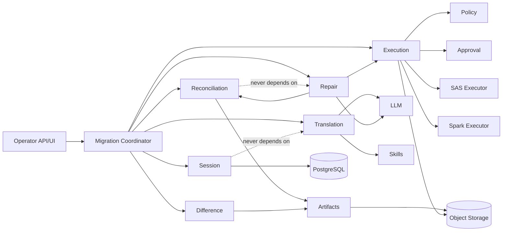

# Architecture

## Product boundary

The workbench exists to prove or disprove bounded semantic equivalence for a SAS program and a translated PySpark candidate under a pinned reference output, input snapshot, environment, and reconciliation policy. It is not a general coding agent, chat UI, notebook, RPA platform, or arbitrary workflow engine.

The five governing rules are:

> **The model proposes.**  
> **The harness executes.**  
> **The reconciler verifies.**  
> **The event log proves.**  
> **The operator decides when uncertainty remains.**

## Runtime layers

```text
Databricks App / operator API
          │
          ▼
  Workbench control plane
  ├── HTTP/UI adapter
  ├── durable queue
  ├── orchestration workers
  └── Cordis worker contexts
          │
          ├── migration services (consumers)
          ├── session/evidence persistence
          ├── policy/approval/guard services
          └── SAS/Spark execution policies
                         │
                         ▼
         external execution providers
         ├── Databricks Lakeflow Job
         ├── local/container Spark
         ├── reference-CSV SAS provider
         └── future SAS Viya/Grid/container
```

Cordis is the worker-local runtime foundation. PostgreSQL and object storage are the distributed authorities. Databricks is the Spark execution and data-governance plane, not part of the Cordis capability graph. The current Milestone 1 implementation is intentionally a local provider composition; the production authority split is documented but not yet implemented.

The DeepSeek-derived assumptions were independently rebased to DSH merge commit `46a7f68b0922371ce7144b668b90e377d8e799f4`. See the [target audit](dsh-target-audit.md) and [verification record](deepseek-harness-verification.md) before changing a runtime claim.

## Capability map

```text
Context
├── workbench.migration       coordinator/state machine
├── workbench.sessions        authoritative migration sessions
├── workbench.workUnits       bounded semantic repair work units
├── workbench.workspace       deterministic SAS include discovery
├── workbench.semanticIr      bounded SAS structural IR and source spans
├── workbench.modelContext    bounded model-context assembly and evidence summaries
├── workbench.macroResolution bounded static macro-resolution evidence
├── workbench.artifacts       immutable content-addressed objects
├── workbench.evidence        hash chain, roots, certificates
├── workbench.llm             model provider registry (advisory)
├── workbench.tools           guarded migration tool runtime
├── workbench.sas             semantic parsing/IR facade
├── workbench.spark           semantic model/canonicalization facade
├── workbench.translation     rule/LLM/hybrid/replay providers
├── workbench.reconcile       schema/aggregate/row/statistical strategies
├── workbench.difference      deterministic localization
├── workbench.diagnostics     information-gain experiment planning
├── workbench.repair          harness-owned state machine
├── workbench.approval        hash/policy/environment-bound decisions
├── workbench.policy          immutable policy snapshot/evaluation
├── workbench.skills          progressive SAS semantic skills
├── workbench.subagents       role-specific, authority-limited workers
├── workbench.execution       policy-resolved execution orchestrator
├── workbench.executor.sas    reference/Viya/Grid/container providers
├── workbench.executor.spark  Databricks/local/Docker providers
├── workbench.snapshots       immutable input/environment snapshots
├── workbench.certificates    bounded, evidence-sealed claims
└── workbench.storage         PostgreSQL + object-store providers
```

Consumers depend on service definitions. A translation or repair component never imports Databricks SDK, a database client, an object-store SDK, or a model provider.

## Service dependency graph



## Event families

Cordis 4's upstream event service provides the five dispatch primitives. The workbench uses a small typed facade (`src/events.ts`) around the RC declaration surface; it does not depend on DSH's event interface. Only durable migration events enter a session log; policy and observer events are not evidence by themselves.

### Durable migration events

- `migration/created`
- `workspace/discovered`, `dependency/graph-created`
- `semantic-ir/created`
- `macro-resolution/created`
- `work-unit/created`, `work-unit/updated`, `work-unit/closed`
- `source/registered`
- `snapshot/created`
- `translation/started`, `translation/completed`
- `artifact/created`
- `execution/started`, `execution/completed`, `execution/unknown`
- `reconciliation/started`, `reconciliation/completed`, `reconciliation/failed`
- `difference/report-created`
- `repair/started`, `repair/proposed`
- `patch/applied`
- `certificate/issued`
- `migration/escalated`
- `session/forked`, `session/recovered`

### Orchestration events

- `migration/pre-step`
- `migration/request`
- `migration/step-stopping`
- `migration/turn-stopping`

These are control-plane signals and are not automatically evidence.

### Capability-policy events

- `executor/pre-execute`, `executor/post-execute`
- `reconcile/pre`, `reconcile/post`
- `approval/request`
- `artifact/pre-write`
- `credential/request`

Policy listeners produce decisions; the resulting durable event records identity, version, evidence, and outcome.

## Event dispatch ownership

| Semantics | Workbench use | Contract |
|---|---|---|
| `emit` | notification after a committed state transition | never the source of truth; listener errors cannot roll back committed state |
| `parallel` | independent digest, quota, and archive observers | awaited aggregate barrier when durability matters |
| `serial` | ordered migration stop/admission decisions | first bail value is authoritative |
| `bail` | synchronous approval/policy short-circuit | first non-null result stops dispatch |
| `waterfall` | bounded request enrichment and execution wrapping | caller owns payload snapshot; plugins must not alter evidence identity |

A waterfall stage declares ordering, idempotency, allowed mutation, and failure behavior in its contract. It is not used for deny-only policy.

## Scope model

```text
Tenant
└── Migration
    └── Attempt
        └── Candidate
            └── Execution
```

Each scope owns:

- an opaque Cordis-derived scope key
- a child context; provider isolation is automatic at candidate/execution boundaries and may be requested at other boundaries
- an immutable policy snapshot that can only narrow
- a candidate/attempt workspace and output prefix
- an environment and executor identity
- an independent repair/failure projection
- an immutable inherited evidence prefix

Ancestors observe descendant events. Siblings never observe each other. The explicit `ScopeService.on(...)` seam enforces domain admission for derived Cordis listener contexts; `ScopeService.target(...)` also installs a native filter. A child cannot rebind to a broader parent or inherit later parent policy changes.

## Authoritative state

```text
Durable event table
       ↓ deterministic fold
Projection tables / UI views / orchestration state
```

A mutable projection is a cache. Rebuilding it from the event log must produce the same state. Model-visible source, skills, reconciliation reports, prior hypotheses, and tool results must all be reconstructable by sequence and artifact digest.

### Hash-chain envelope

```text
eventHash[n] = SHA-256(canonicalJson({
  migrationId,
  scopeId,
  sequence,
  eventType,
  payload,
  previousHash,
  createdAt
}))
```

The final chain hash is the evidence root for Milestone 1. The chain verifies contiguous sequence numbers, the previous hash, and canonical event content. A later certificate can store leaf proofs and a sealed root without changing event identity.

## State ownership

The deterministic coordinator owns all transitions. Models return advisory proposals. Reconciler strategies return evidence-backed reports. Repair transitions are explicit and cannot be called by a model. Approval is external human authority but stale approval is rejected at the execution boundary.

## Tool runtime

```text
request
→ resolve the target scope/provider contract
→ materialize and verify artifact references
→ bind execution/candidate/session IDs
→ validate and deep-freeze arguments
→ pre-execute policy event
→ approval if required
→ monotonic deny-only guards
→ append `execution/started` and flush before submission
→ provider body
→ normalize provider state
→ verify output artifacts
→ post-execute policy event
→ canonical frozen result
→ append `execution/completed` or `execution/unknown`
```

The result visible to the model is the canonical result emitted by the runtime, not provider prose. An ambiguous submit, status, or output-verification failure is recorded as `UNKNOWN`; the harness never blindly retries an external side effect whose outcome may be open. Every external side effect is a tool or service capability.

## Model boundary

Model context is a deterministic projection containing only relevant source spans, IR nodes, candidate spans, reconciliation evidence, a skill version, prior attempts, and failed hypotheses. Secrets, raw credential values, unrestricted logs, and policy internals are excluded. Compaction may replace reasoning context but never authoritative evidence.

**Milestones 1–2 have no model/provider call.** The model boundary is a contract reserved for later translation/diagnosis services. No LLM, full SAS parser, Databricks SDK, or repair loop is silently wired into the proof path. A bounded structural SAS IR parser is now present, but deterministic dataset reconciliation remains a harness-owned verifier rather than model-owned validation.

## Workspace discovery

`workspace` is a deterministic, artifact-backed SAS source discovery service. It accepts logical workspace paths and registered source artifacts, reads only the source artifacts, resolves static `%include` directives relative to the including file, and records a bounded `DependencyGraph` as `workspace/discovered` followed by `dependency/graph-created`.

The graph is reconstructed into `session.projection.dependencyGraphs`. Work-unit creation from a graph fails closed when the selected root has unresolved includes or a cycle. This service does not crawl arbitrary local paths, infer macro-generated code, read the large Databricks reference dataset, or grant a model access to the full workspace. See [workspace discovery](workspace-discovery.md).

## Semantic IR boundary

`semanticIr` consumes a durable dependency graph and verified source artifacts, then emits a bounded structural IR snapshot with source spans. The parser is deterministic and deliberately limited to recognizable SAS structure; it does not claim full SAS semantics. A work unit stores the immutable `irSnapshotId` and a bounded set of node IDs, allowing the model-context service to retrieve only relevant source spans. The IR never contains the large Databricks dataset. See [bounded SAS semantic IR](semantic-ir.md).

`macroResolution` consumes the same verified graph and records static macro definitions, calls, and unresolved/ambiguous evidence without expanding generated code. Its durable `macroResolutionId` is immutable on a work unit. Unknown autocalls and dynamic names remain explicit evidence. See [static SAS macro resolution](macro-resolution.md).

## Model-context boundary

`modelContext` reads only the selected work-unit source artifacts and summarizes bounded execution/reconciliation evidence. It never reads a Databricks table, embeds dataset rows, expands the dependency closure, or copies a whole workspace into a prompt. It returns a frozen context with a canonical `contextDigest` for reproducibility. See [bounded model context](model-context.md).

## Bounded work units

A migration session remains the authoritative evidence history, but diagnosis and repair operate on a first-class `MigrationWorkUnit`. The unit records the SAS module, immutable dependency closure, relevant IR node IDs, input snapshot, logical reference output, candidate identity, reconciliation identity, failure signature, and required skills. It is stored through `work-unit/created`, `work-unit/updated`, and `work-unit/closed` events and reconstructed into `session.projection.workUnits`.

The closure and IR list are bounded and immutable after creation. `ctx.modelContext.assemble()` now uses this object to produce a deterministic context containing only selected source excerpts and reconciliation summaries. Databricks table contents remain in the Databricks data plane; a `databricks` reference is a logical manifest, not a byte transfer through the control plane.

## Reconciliation boundary

Translation and repair have no authority over reconciliation code. Reconciliation consumes independently materialized reference and candidate outputs under a versioned policy:

- schema parity
- aggregate parity
- keyed/ordered/multiset row parity
- deterministic statistical profile

The implemented JSON/CSV verifier binds the policy version and fingerprint, canonicalizes values, uses decimal-string arithmetic for numeric aggregates, writes an immutable difference report, and appends `reconciliation/completed` or `reconciliation/failed`. A certificate says only: **the artifact was shown equivalent to the specified reference execution under policy P, environment E, and input snapshot S.**

## Repair boundary

A repair candidate contains parent artifact identity, semantic patch, full artifact digest, hypothesis, expected observable effect, affected IR/source spans, model/skill metadata, and policy fingerprint. The harness:

1. rejects duplicate semantic patches/hypotheses/reconciliation signatures,
2. rejects oscillation,
3. executes in a candidate scope,
4. independently reconciles,
5. verifies predicted improvement and no new regression,
6. selects a winner deterministically or escalates.

## Persistence and deployment

- PostgreSQL: queue, session metadata, durable events, projections, locks, approvals, cost records, external-job mappings
- Unity Catalog Volume/object storage: source/input/reference/candidate/output/log/report/patch/certificate artifacts
- Cordis: each worker’s plugin composition, dependencies, effects, local services, and event dispatch
- Databricks: Spark execution, job scheduling, compute, UC governance, Delta/Parquet, logs, run metadata

A process-local Context is never treated as a fleet-wide registry or queue.
